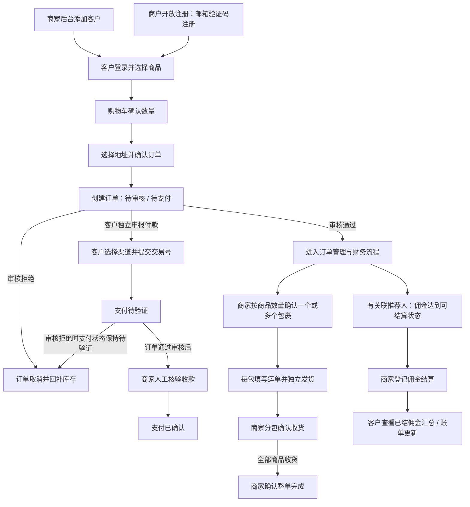

# DailyActivity 商城与商家管理系统 PRD V1

## 1. 文档控制与阅读约定

| 项目 | 内容 |
| --- | --- |
| 文档版本 | V1.9（商户佣金功能开关） |
| 编写日期 / 最近更新 | 2026-09-27 / 2026-10-31 |
| 文档状态 | 已确认业务规则直接写入正文；实施建议单独标注，不表示研发已实现或验收已通过 |
| 产品范围 | 多商户 SaaS 平台：每个商户拥有独立商品目录及客户商城，经营订单、付款、客户、推荐佣金和 COA |
| 依据 | 当前工作目录中的 HTML 页面、JavaScript 交互、共享 Demo 数据逻辑及 `tech_design.md` 的已确认技术落地 |
| 交付目的 | 为产品、设计、研发、测试、运营及财务提供可追踪、可讨论、可验收的需求说明 |
| 业务负责人 / 审批人 | 待指定 |
| 目标上线日期 / 预算 / 团队容量 | 待确认，不在本文件中推定 |

### 1.1 证据与范围说明

本文件以当前项目完整 Demo 为范围，包括 `customer/` 和 `seller/`，而非仅某一个页面。未能读取用户正在打开的浏览器标签页，也未取得用户浏览器 localStorage 中已经修改的运行数据，因此当前浏览器可能存在的临时数据、弹窗状态或未保存配置不作为事实依据。

Demo 用于说明交互与业务逻辑。正式系统的信息架构、功能入口、路由、模块划分及文件命名应按实际业务场景设计，不受 Demo 的 HTML 文件名、目录结构、单页面板或弹窗组织方式约束。正文中的原型现状用于解释业务来源；第 4 章描述正式产品的功能组织建议，第 15 章的文件路径仅用于证据追踪。

页面逻辑通过静态源码核对；本次未执行浏览器端到端测试。Demo 及其旧测试数据不作为正式系统的历史兼容要求或本次测试通过证明。

当前 Demo 使用浏览器存储模拟数据、认证与页面同步，没有提供可验证的服务端、真实支付回调、真实库存流水或资金清算能力。文中“提交付款”“确认支付”“结算佣金”均需区分业务记录与真实资金流转。

### 1.2 需求标记与效力

| 标记 | 含义 | 执行约定 |
| --- | --- | --- |
| D：Demo 已体现 | 当前页面或可达交互中能够找到依据的行为 | 可作为原型基线，仍需业务评审；不代表生产质量合格 |
| E：企业级补充 | 为完整性、一致性、可追溯性及可验收性提出的目标要求 | 是本 PRD 的建议方案，不宣称已经实现或已经批准 |
| B：已确认业务规则 | 已直接纳入各功能、状态、金额、数据及验收章节的正式业务要求 | 优先于 Demo 现状和 E 建议；以对应正文为准，不另设决策记录 |

每个功能块的“现状”只描述 D，不是正式实现要求；“目标与异常”按 B 结论落实，并以 E 补充边界。原型与已确认结论冲突时以 B 为准。建议数值、字段长度和未明确的实施细节仍属 E，不能标作用户已确认。需求编号用于评审和测试引用，与开发任务编号无关。

优先级为建议：P0 表示交易、金额、权限、资金记录等核心要求；P1 表示首版运营完整性；P2 表示可独立延后优化。优先级不等于上线承诺。未明确确认的实施参数仍按 E 标注，不视为默认同意。

本版与技术实现相关的并发控制、文件访问、初始化、部署和接口细节以 `tech_design.md` 为准；本文件保留业务目标、状态、金额和验收口径，若两文档冲突以技术设计中的最新用户确认结论对齐。

### 1.3 评审与变更流程

1. 产品负责人确认业务范围；运营确认商品、类目、客户和履约；财务确认金额、付款、佣金与账单；研发确认数据一致性与依赖；测试确认验收覆盖。
2. 已确认事项直接更新对应正文及验收要求，不另行保留问答、回填模板或落实记录；后续仍需明确的事项在相关章节标注，确认后并入正式规则。
3. 冻结版本后，涉及状态、金额公式、权限、数据归属的变更必须记录变更原因和历史数据处理方式，不能只修改页面文案。
4. 已完成订单、已确认付款、已结算佣金的历史事实不得随主数据变更被悄然重算。

## 2. 产品定位、目标与范围

### 2.1 产品定位

DailyActivity 是支持商家后台开通客户及商户开放邮箱自助注册、面向已登录客户提供商品采购的商城与运营后台。客户查看商品和分析证书，按自身定价下单并提交付款交易号；商家核验收款、处理履约，并管理客户推荐关系和佣金结算。

Demo 中商品页面含实验室研究用途说明，展示商品不等于业务可销售范围已经确认。正式经营地区、商品准入、客户资格和条款内容由业务负责人确定；本 PRD 不作法律适用结论。商品及经营资料维护见 11.3，上线资料准备见 14.2。

### 2.2 业务目标与衡量方法

| 目标 | 业务效果 | 指标定义 | 目标值 |
| --- | --- | --- | --- |
| 采购闭环 | 客户可自主完成选品、下单、付款信息提交和进度查询 | 下单成功率 = 成功创建订单的有效请求数 / 通过基础校验的创建订单请求数 | 待建立基线 |
| 付款可追踪 | 每笔收款可对应客户、订单、渠道、交易号与核验人 | 核验时长 = 最终核验时间 − 付款信息提交时间；统计中位数、P95 | 业务 SLA 待确认 |
| 履约透明 | 客户可看到真实状态和附件 | 履约记录完整率 = 必填信息齐全的状态变更数 / 状态变更总数 | 建议 100% |
| 定价一致 | 客户报价、订单快照和账单保持可解释的一致性 | 同一订单的跨端金额不一致笔数 | 建议 0 |
| 佣金准确 | 可结算范围明确，避免重复结算 | 重复结算笔数；两端待结佣金差异 | 建议均为 0 |
| 权限有效 | 用户只访问授权数据与动作 | 越权用例通过率 = 被正确拒绝的越权请求 / 总越权请求 | 建议 100% |

指标用于正式系统运营和验收设计，Demo 未提供真实监测数据。不能以静态示例数据推算真实转化率、收入、利润或运行容量。

### 2.3 建议首版范围

| 模块 | 首版内容 | 优先级 |
| --- | --- | --- |
| 客户访问 | 邮箱登录、开放注册时邮箱验证码注册、退出、资料、密码、地址簿 | P0 |
| 商品采购 | 商品目录、搜索、分类、价格、购物车、订单创建 | P0 |
| 客户订单 | 查询、详情、允许范围内的编辑与取消、付款信息提交 | P0 |
| 付款与履约 | 人工收款核验、打包、发货、收货、完成、操作记录 | P0 |
| 客户经营 | 后台客户开通、类型与等级、推荐人及佣金率 | P0 |
| 商品资料 | 商品、赠品、等级价、库存字段、COA、类目 | P0 / P1 |
| 佣金与账单 | 佣金生成规则、单笔和批量结算、统一账单、导出 | P0 |
| 后台访问 | member、菜单权限、服务端鉴权 | P0 |
| 交易配置 | 收款渠道、商户按客户 V1～V6 等级配置的运费与订单运费快照 | P0 |
| 通用体验 | 语言切换、分页筛选、复制、图片预览、空态与错误提示 | P1 |

### 2.4 首版边界（B）

平台支持多商户独立经营。每个商户在同一 SaaS 应用中维护自己的商品、价格、库存、类目、COA 及相关文件；客户只能浏览和购买访问域名所属商户的目录。客户可由商家后台添加，或在商户开放时通过邮箱验证码自助注册；账户开通沟通、到账核查、付款异常处理和佣金实际支付均可在线下完成，线上记录订单、付款提交、已确认收款和已完成的佣金结算。

明确不做：退货退款、线上核验失败处理流程、已付款改金额及补退差额、预购、拆成多个订单、物流自动回传、客户自助确认收货、履约回退、非注册类自动业务通知、自动链上核验、自动打款和异步导出。商品支持按 V1～V6 等级独立配置数量阶梯价；未配置该等级阶梯时使用等级固定价或商品默认价，不提供客户专属价或其他自动折扣规则。

游客购物车、系统直连银行卡收单、钱包提现、优惠券、税费引擎、正式发票、分仓和 ERP 对接也不在本次交付范围。商家可允许客户申请站外制作的线上支付链接；系统不生成、保存或发送链接。付款异常不阻塞独立履约流程，但不能未经线下核实就自动标记已支付。业务信息采用软删除，购物车临时行除外；历史业务数据及关联长期保留，具体见 9.5。

## 3. 角色、权限与数据边界

### 3.1 角色定义

| 角色 | 现有能力 | 目标数据范围 |
| --- | --- | --- |
| 未登录访问者 | 客户登录；已开放注册的商城提供买家注册入口；商家或平台登录 | 不可读取客户价格、订单、地址、佣金和后台数据 |
| 客户 | 浏览商品、COA，下单、付款信息提交，管理本人资料和地址，查看本人推荐佣金 | 本人订单、地址与账户；本人作为推荐人的佣金汇总及结算记录 |
| 推荐人 | 现有客户的一种关系身份，不是独立账号角色 | 仅本人直接推荐关系对应的允许字段；不可直接操作被推荐客户订单 |
| 商户 Admin（平台创建商户时生成的初始 seller） | 全部业务菜单；成员权限列表标记为商户 Admin，编辑和启停操作禁用 | 当前商家业务数据及成员权限；密码由平台商户管理重置 |
| 商家成员 | 获授权的业务菜单；拥有 `members` 菜单即可管理成员 | 当前商家且在授权动作范围内的数据 |
| 平台超级管理员 | 开通、启停和配置商户；查看全平台经营数据并支持商户处理业务问题 | 跨商户订单和买家只读视图、经营总览、待处理队列、商户分析及审计；不进入商户成员列表，不直接修改商户订单、付款或买家账户 |

“合作伙伴 / 固定客户”是客户业务分类；“V1 / V2 / V3 / V4 / V5 / V6”是定价等级；二者均不能直接等同于角色权限或自动授信资格。客户类型和定价等级属于商家内部资料，只允许商家侧查看；客户侧不得通过页面、接口响应或可解码的报价令牌获知本人或其他客户的类型、等级，仅接收本人适用的商品价格。

### 3.2 权限矩阵

下表为商户业务权限；独立平台身份的商户管理能力见 3.4，不参与商家成员菜单授权。

| 功能 | 客户 | 推荐人身份 | 获授权商家成员 | 全菜单 member |
| --- | --- | --- | --- | --- |
| 浏览上架正品及公开给客户的 COA | 是 | 同客户 | 商城访问另需客户身份 | 是，后台管理 |
| 创建、查看本人订单 | 是 | 同客户 | 依订单/客户菜单授权查看 | 是 |
| 编辑或取消客户订单 | 仅符合状态限制的本人订单 | 同客户 | 订单编辑依授权；当前无商家取消入口 | 是，仍受业务状态约束 |
| 提交本人订单付款信息 | 是 | 同客户 | 无代客户提交入口 | 无代客户提交入口 |
| 确认收款、履约 | 否 | 否 | 订单权限范围内 | 是 |
| 查看本人推荐佣金 | 商户启用佣金时可用 | 同客户 | 商户启用佣金且有相应菜单 | 同左 |
| 佣金结算、账单导出 | 否 | 否 | 商户启用佣金且有相应菜单 | 商户启用佣金时可用 |
| 商品、COA、类目及支付渠道管理 | 否 | 否 | 对应菜单授权 | 是 |
| 成员与授权管理 | 否 | 否 | 否 | 是 |

### 3.3 企业级授权要求（E）

- AUTH-01（P0，B）：服务端校验身份、客户数据归属和菜单权限；member 有某菜单权限即拥有该菜单全部操作，商户 Admin 账号保护除外：其资料与状态只由平台商户管理维护。业务状态限制对全菜单 member 和其他成员同样有效。
- AUTH-02（P0）：客户通过订单 ID、地址 ID、付款入口参数或文件 URL 访问他人数据时应被拒绝，响应不得泄露该数据的详情。
- AUTH-03（P0）：客户 ID 为持久业务归属标识；邮箱和姓名变化不改变历史订单归属。当前按邮箱/姓名匹配的逻辑必须替换。
- AUTH-04（P0）：禁用商家成员、撤销成员权限或停用客户后，下一次受保护请求必须拒绝失效身份/权限；已打开的页面也不得继续提交。停用客户的会话不得继续创建订单、提交付款或修改客户数据。
- AUTH-05（P0）：客户、佣金、账单菜单所需的关联订单只读详情属于该菜单的查看能力；处理订单仍要求订单菜单权限。不能仅凭前端传入来源参数绕过服务端菜单校验。
- AUTH-06（P1，B）：后台不设置额外字段级授权，同一菜单内的授权成员可查看该菜单完整业务字段并执行全部操作。客户和后台的身份边界仍有效：客户不得查看后台成本、其他客户地址或内部记录；后台同步导出不脱敏。

### 3.4 多商户与商户独立目录（B，2026-10-30）

- 买家端以唯一商户域名识别商城，登录页、顶部和页脚展示该商户名称与 logo。每商户选择一套内置 CSS 主题（classic、forest、editorial），业务内容一致，可有不同排列与视觉样式；主题由系统开发维护，不接收任意 CSS。
- 商品资料、默认售价、V1～V6 等级价、数量阶梯价、成本、库存、上下架状态、类目、COA、商品证书关系及相关文件均归属单一 merchant_id。各商户独立创建和维护目录；同一 SKU、商品名或类目名可以在不同商户重复。客户只能看到其账号商户的商品、价格、库存和证书，订单只扣减该商户自己的商品库存。
- 买家和后台成员各属于一个商户。哪个商户创建买家，该买家的订单就归哪个商户；后端下单时写入固定商户归属。首版不支持账号转移或同一账号切换商户，订单不随创建管理员或主数据变动转移。卖家可在分别验证过凭证的多个后台账号之间切换，各账号仍固定归属自己的商户。
- 支付渠道、买家、成员、地址、购物车、订单审核、收款、履约、包裹、附件、推荐关系、佣金、账单、结算、统计和导出均按商户独立。推荐人必须来自同一商户；同一结算批次不能包含其他商户的订单。
- 买家邮箱在商户内唯一；商家登录账号在 seller 表内唯一、平台登录账号在 admin 表内唯一，二者可同名；八位客户码及订单号全局唯一。买家登录按域名识别商户，不增加商户选择。订单号为 UTC 下单日期 `YYYYMMDD` + 5 位随机数字，不增加商户前缀。
- 平台超级管理员是独立 platform 身份，不归属商户，通过通用管理域名的 `/platform/` 入口管理商户、域名、品牌、主题、运费、佣金开关和客户可用付款方式，并开通首个商户管理员；同时查看全平台经营汇总、跨商户订单、买家购买概况和业务待处理队列，支持定位及协助商户问题。平台查看订单和买家详情须填写用途并记录审计；列表默认遮蔽买家姓名和邮箱，完整联系方式须再次填写用途并单独记录。平台对商户订单、付款、买家账户、商品目录和资金事实均只读，不提供代商户编辑或跨租户业务写入口。
- 平台经营总览展示商户与买家规模、未取消订单金额、累计已收金额、近七天订单趋势，以及待审核、待核款、待履约队列；商户分析按 UTC 时间区间汇总订单、收款、待履约和买家增长，其中收款按 `payment_receipt.verified_at` 统计区间内实际核实到账金额。订单中心支持跨商户按商户、订单/买家关键词及订单、审核、付款状态查询；买家中心支持跨商户搜索账号和购买概况。待处理队列仅按现有业务状态分类，不擅自定义超时或风险阈值。
- 平台导出支持订单、买家和商户经营汇总，固定 CSV、最多 10000 行；订单及买家导出仍遮蔽姓名和邮箱。平台审计统一展示敏感详情/联系方式访问记录及商户配置变更。
- 平台创建商户时将提供的初始 seller 标记为商户 Admin，并授予全部业务菜单。成员权限列表显示该标记，禁用此账号的编辑及启停操作；服务端同样拒绝卖家侧对该账号的资料、密码、权限和状态修改。平台编辑商户时可重置该账号密码；弹窗展示目标管理员账号，新密码和确认密码均留空则不修改，设置时须为 12～64 个字符且两次一致、不能全为空白。成功后该管理员的旧登录立即失效，其他成员、买家和其他商户账号不受影响；不改变目标账号启用状态或菜单权限。商户资料保存与密码重置原子提交，并记录平台操作者和目标管理员，不保存或展示明文密码。初始管理员不存在时不得改为重置其他成员。
- 平台商户管理列表首列展示对应商户的 Logo，使用商户品牌资料中的图片；未配置时展示系统默认 Logo。
- 商户佣金开关默认开启。关闭前必须结清所有待支付佣金，并处理完可能生成佣金的待审核订单；有未结记录时拒绝关闭并提示原因。关闭期间客户和商家端隐藏全部当前及历史佣金、推荐关系与佣金率信息，相关 API 和导出也不返回这些信息；订单、推荐关系、计提、账单和结算历史保留，重新开启后恢复展示。关闭期间创建的订单锁定零佣金，重新开启后也不补计。
- 商户成员的商品、COA、类目维护权限只由本商户的 seller_permission 菜单决定，不再存在平台授予的公共目录权限。新增商户的初始管理员标记为商户 Admin 并拥有本商户全部业务菜单；普通新增成员由本商户管理员按表单授权。商户 Admin 不能通过卖家成员管理编辑或启停，但仍由 seller_permission 校验业务权限；平台可重置其密码。每商户保留至少一个有效的 members 权限持有者；平台首账号由受控引导建立，业务接口不提供平台账号启停或删除。
- COA 创建、编辑、绑定、解绑和转移均校验 COA 与商品属于当前商户；商品管理员可选本商户已有类目，但维护类目本身须 categories 菜单权限。客户浏览和订单选品只能读取本商户目录。
- 一个商户修改、停用或删除自己的目录记录，不影响其他商户。历史订单金额/成本和完成时 COA 快照保持原值；订单中的产品和证书文件不可被其他商户读取。停用商户保留其自身目录及业务历史。
- 商品和文件均为商户私有；库存数量、库存流水和人工调整记录均按商户隔离，不提供跨商户目录或库存对账入口。
- 停用商户后，其成员与买家均不能登录和访问受保护业务，包括处理历史订单；重新启用必须重新登录。该商户自己的业务数据和目录保留。已签发文件链接按原短时有效期到期，不承诺即时回收。

## 4. 产品信息架构与功能需求映射

### 4.1 设计原则

1. 按客户采购、订单服务、账户管理和商家运营等业务场景组织功能；一个 Demo 文件可以拆成多个正式业务入口，多个 Demo 中的同类交互也可以合并为一个业务模块。
2. 客户商城与商家后台采用独立导航和授权上下文。后台的“客户”与“内部成员”分别命名，避免统一称为用户造成权限和对象混淆。
3. 商品、订单、证书、客户、佣金等稳定业务对象使用统一名称与标识；创建、编辑、核验、履约、结算属于这些对象的业务动作，不要求每个动作都成为一级菜单。
4. 路由描述用户可定位的业务入口，不代表物理文件路径或 API 地址。下表为正式系统的建议路由；实际组件文件和目录由技术方案按选定框架确定。
5. 对弹窗、抽屉、独立页面的选择，以任务复杂度、信息量、返回上下文和直接访问需求为依据。无论采用何种载体，权限、字段、状态和金额规则保持一致。

### 4.2 客户商城

建议一级导航为“商品”“分析证书”“购物车”“我的订单”“我的账户”；账户下组织个人资料、地址簿、账户安全与推荐佣金。客户登录是访问入口，不属于登录后的业务导航。

| 业务场景 | 功能入口 | 建议路由 | 职责与主要交互 | 需求编号 |
| --- | --- | --- | --- | --- |
| 访问商城 | 客户登录 / 注册 | `/login` | 已开通客户登录；商户开放注册时显示邮箱验证码注册入口；登录后返回合法目标入口 | C-01 |
| 选购商品 | 商品目录 | `/products` | 分类、搜索、库存与客户价格、加入购物车 | C-02 |
| 查询质量资料 | 分析证书 | `/certificates` | 按商品、SKU、批次检索，查看与下载有权限的 COA | C-03 |
| 管理待购商品 | 购物车 | `/cart` | 修改数量、移除商品、校验可售性与报价、进入结算 | C-04 |
| 确认采购 | 订单结算 | `/checkout` | 选择或新增地址、确认商品与费用、填写备注、创建订单 | C-05 |
| 完成付款申报 | 订单付款 | `/orders/:orderId/payment` | 订单创建后选择渠道、查看订单总额、提交交易号；新订单与稍后付款共用同一业务流程 | C-06 |
| 跟进采购 | 我的订单 | `/orders` | 查看本人全部订单，统计、筛选、分页与操作入口；覆盖进行中及终态订单 | C-07 |
| 查看单笔采购 | 订单详情 | `/orders/:orderId` | 商品与金额快照、收货信息、付款状态、履约进度、附件及允许的订单动作 | C-07 |
| 调整或取消采购 | 编辑订单 / 取消订单 | 订单列表或详情内的操作 | 按订单与付款状态开放编辑或取消，不设独立一级菜单；保存后返回原订单上下文 | C-08、C-09 |
| 维护个人信息 | 个人资料 | `/account/profile` | 用户码与邮箱只读，编辑姓名 | C-10 |
| 维护配送信息 | 地址簿 | `/account/addresses` | 新增、编辑、默认地址与删除；结算中复用同一地址业务能力 | C-11 |
| 维护账户安全 | 账户安全 | `/account/security` | 修改密码及统一的安全校验 | C-12 |
| 查询推荐收益 | 我的推荐与佣金 | `/account/referrals` | 当前及历史推荐客户、逐用户待结与已结佣金汇总 | C-13 |

客户采购流程为“购物车 → 订单结算 → 订单付款”。创建订单后客户进入付款阶段，可立即申报，也可稍后从订单历史申报；订单审核由商家在后台处理，不改变客户侧流程。

### 4.3 商家运营后台

建议按“交易与财务”“客户经营”“商品与资料”“系统管理”分组导航。分组用于帮助定位，不新增业务权限；实际菜单按成员授权展示，有菜单即具有该菜单全部操作权限（B）。

| 业务分组 | 功能入口 | 建议路由 | 职责与主要交互 | 需求编号 |
| --- | --- | --- | --- | --- |
| 后台访问 | 商家登录 | `/admin/login` | 成员身份验证、进入有权限的工作入口、退出登录 | S-01 |
| 交易与财务 | 订单审核 | `/admin/order-audit` | 查看新订单、查看详情、填写备注并审核通过/不通过 | S-02A |
| 交易与财务 | 订单管理 | `/admin/orders` | 查询已审核订单、统计、编辑、收款核验、履约操作和导出入口 | S-02～S-06 |
| 交易与财务 | 订单详情 | `/admin/orders/:orderId` | 统一查看订单、付款及操作记录；来自客户、佣金、账单的详情入口复用该业务视图并校验权限 | S-02 |
| 交易与财务 | 佣金管理 | `/admin/commissions` | 佣金查询、单笔/批量结算、结算详情及导出；结算作为列表或详情内动作 | S-07 |
| 交易与财务 | 账单管理 | `/admin/bills` | 应收与应付账单、统计、关联业务追踪和导出 | S-08 |
| 客户经营 | 客户管理 | `/admin/customers` | 客户搜索、开通、编辑、启用/停用、类型与等级维护 | S-09 |
| 客户经营 | 客户详情 | `/admin/customers/:customerId` | 客户资料、推荐关系、订单记录及其筛选；查看订单后可回到原客户上下文 | S-09 |
| 商品与资料 | 商品管理 | `/admin/products` | 正品与赠品、商品信息、价格、库存、上下架和 COA 关联 | S-10 |
| 商品与资料 | 分析证书管理 | `/admin/certificates` | COA 新建、编辑、当前文件替换、商品绑定、详情及下载 | S-11 |
| 商品与资料 | 商品类目 | `/admin/categories` | 类目命名、排序、启停、商品关联与受限删除 | S-12 |
| 系统管理 | 收款渠道 | `/admin/settings/payment-channels` | 收款币种、网络与地址、二维码及说明；与订单收款核验区分 | S-13 |
| 系统管理 | 成员与权限 | `/admin/settings/members` | 内部成员创建、编辑、启停和权限分配；要求 `members` 菜单 | S-14 |

新增/编辑商品、客户、证书及渠道可以根据表单复杂度采用独立页面或表单面板；打包、发货、核验和结算采用带明确业务对象的操作表单。信息架构不要求沿用 Demo 的单个后台 HTML 文件或通用弹窗实现。

### 4.4 路由、模块与文件命名约定

- 使用明确的业务词：`products` 表示商品、`orders` 表示订单、`customers` 表示客户、`members` 表示内部成员、`payment-channels` 表示收款渠道；不以 `index`、`history`、`users` 等泛称替代具体业务职责。
- 建议 URL 使用小写英文、资源名复数和连字符；不携带 `.html` 后缀，不沿用 Demo 的拼写或文件分组。`:orderId`、`:customerId` 是动态业务标识占位符，不包含邮箱、姓名等个人信息。
- 同一业务对象在不同入口使用相同标识；客户和后台路由分别校验身份及访问范围。知道详情地址不构成访问授权。
- 列表查询条件可通过查询参数保留，详情返回恢复筛选及页码；密码、交易凭证、完整地址和表单敏感内容不得写入 URL。
- 组件或页面文件按职责命名，例如 `ProductCatalog`、`ShoppingCart`、`Checkout`、`OrderPayment`、`CustomerOrderDetail`、`AdminOrderDetail`、`CustomerManagement`、`AppConfig`、`MemberPermissions`。这些是语义示例，不指定大小写风格、扩展名或框架目录规范。
- 文件拆分应服务于维护与复用：地址表单、金额汇总、订单明细等可形成共用组件；报价、状态判断和权限规则保持统一业务来源，不能因拆分页面产生多套计算逻辑。

### 4.5 信息架构验收要求

1. 每个导航入口能够定位到上述业务职责与需求编号；注册入口只在商户开放时显示，不因原型文件名出现泛化用户管理或只包含终态的“历史订单”等错误含义。
2. 商品选购、结算、创建订单、立即或稍后付款可连续完成；创建后的刷新与返回不能重新创建订单。
3. 订单、客户详情可通过合法地址直接进入；登录或权限校验失败时不返回敏感数据，成功后恢复合法目标。
4. 从客户、佣金或账单查看订单时，保留来源上下文；复用详情不扩大字段和操作权限。
5. 页面、抽屉、弹窗或组件拆分变化不改变第 5～11 章规定的业务规则；具体路由调整同步维护本章映射，Demo 源文件改名不影响正式需求。

## 5. 核心业务流程与状态规则

### 5.1 采购与履约流程

审核、付款和履约状态分别保存。订单未取消且支付状态为待支付或部分支付时，客户可独立于审核结果申报付款；审核不会改写支付状态。待支付、待验证或部分支付订单均可打包、发货、收货和完成；付款未核实不阻塞履约。订单审核通过时生成待结佣金；通过审核且佣金状态为待支付即可结算，不要求订单完成或收款。佣金实际支付在线下完成，线上只登记结果。

订单审核是与履约、付款和佣金并列的独立状态。新订单的 `auditStatus` 为 `pending`；后台只能审核一次为 `approved` 或 `rejected`。待审核期间客户可以按待处理未付款规则编辑或取消；取消后的 `withdrawn` 为内部终态，不能进入审核或财务流程。拒绝审核时订单履约状态同时改为 `cancelled`，按订单当前有效商品数量一次性回补库存，不创建应收账单或佣金。只有审核通过的订单进入商家订单管理、应收账单和佣金流程；客户付款申报不要求审核通过。

### 5.2 订单状态机（B）

| 状态 | 编码 | 进入方式 | 可执行操作 | 退出规则 |
| --- | --- | --- | --- | --- |
| 待处理 | `pending` | 新单或仍有商品未打包 | 未开始打包时按既有规则编辑/取消；继续打包、对已打包包裹发货/收货；独立付款 | 全部商品打包进入 packed；合法取消或审核拒绝进入 cancelled |
| 已打包 | `packed` | 全部商品已打包但未全部发货 | 逐包发货/收货；独立付款/核验 | 全部商品发货进入 shipped |
| 已发货 | `shipped` | 全部商品已发货但未全部收货 | 商家分包确认收货；独立付款/核验 | 全部商品收货进入 received |
| 已收货 | `received` | 全部商品收货 | 商家确认完成；独立付款/核验 | 进入 completed |
| 已完成 | `completed` | 商家确认完成 | 查看详情；未付清时仍可付款/核验；佣金结算按独立资格校验 | 无履约回退、编辑和取消 |
| 已取消 | `cancelled` | 客户合法取消订单 | 查看历史；仅回写一次库存 | 无恢复、付款、核验或履约操作 |

客户取消条件必须同时满足：订单为待处理、支付为待支付、尚未确认任何包裹，且佣金未结算。部分打包订单虽然整体仍为 pending，也禁止编辑和取消。已支付、待验证、已打包及其后续状态一律不可由客户取消（B）。审核拒绝是独立审核结果，会将待审核订单取消并恢复库存，即使客户已提交付款申报也不改写支付状态；取消后沿用既有规则，不再申报或确认付款。佣金结算后禁止取消订单，避免已支付佣金对应取消订单。不做自动超时取消、删除订单替代取消或退款撤单。商家新增取消入口未获本次明确要求，首版沿用客户取消入口。

状态变更在事务内锁定订单并重新读取原状态；不允许跳级、回退、重复事件。已完成仅终止履约，不终止收款；已取消则终止本单线上交易。付款与履约独立不等于取消、金额编辑没有限制。

### 5.3 支付状态机（B）

分阶段付款不预设阶段、比例或到期日；商家按每次核实的抵扣订单款金额登记，累计收齐后标记已付清。付款、履约与佣金资格保持独立。

| 状态 | 编码 | 含义 |
| --- | --- | --- |
| 待支付 | `unpaid` | 累计已收为 0，且没有待核验申报 |
| 待验证 | `pending_verification` | 存在一笔待核验申报；可能已有部分实收，页面同时显示累计已收与余额 |
| 部分支付 | `partially_paid` | 累计已收大于 0 且小于订单总额，没有待核验申报 |
| 已付清 | `paid` | 累计已确认收款等于订单总额 |

1. 一张订单允许多笔申报和多笔确认收款，同时最多一笔待核验申报。申报不增加实收；核实后结束该笔申报，再按余额继续付款。订单未取消且状态为 unpaid/partially_paid 时客户可申报，与审核状态无关；已完成未付清仍可收款。
2. 每次申报、收款必须明确本次金额及 expectedUpdatedAt。金额为大于 0、最多两位小数的 USD 抵扣订单款金额，不得超过当前余额；没有明确金额的旧请求拒绝，不默认全额。
3. 累计已收 = 有效确认收款之和；剩余待收 = 订单总额 − 累计已收。商家按核实金额登记；与申报金额不一致必须填写内部差异原因。保留客户原始申报金额、交易号和渠道快照，以及最终核实值、操作人、时间。
4. 待审核且待处理时，付款已申报也允许编辑正品数量/价格、增删商品和优惠额，并原子调整库存及应付。原申报及申报时订单总额不改写；审核通过按新应付创建应收和佣金。申报金额超过新应付不阻止审核编辑；收款只能登记抵扣本单的金额，超额线下处理。
5. 客户编辑和取消继续受既有资格限制；审核通过后商品明细与金额冻结，实际确认收款后金额锁定，部分支付亦不可改金额或由客户取消。每笔申报渠道快照锁定，下一笔可另选渠道。
6. 核验在事务内锁订单、比较版本、重算余额；收款、申报状态、订单状态、账单和事件原子提交。关联申报的收款具有 submission_id 唯一约束；直接收款依靠订单锁及必填版本防止重复。交易号不作为唯一业务键，重复使用由商家线下核查。
7. 渠道附加费只按本次付款金额计算客户转账提示，按分 HALF_UP 舍入，不纳入订单实收抵扣、应收、佣金和账单金额。每笔渠道快照独立保存。
8. 已确认收款为不可修改历史事实；退款、撤销、更正、超额款项及核验异常在线下处理。订单取消后不能继续申报或核验；订单审核通过后的佣金结算不受履约和收款进度限制。

### 5.4 佣金状态机（B）

| 界面状态 | 含义 | 条件 |
| --- | --- | --- |
| 待验证 | 新系统不产生此佣金状态 | 不作为正常业务状态或迁移验收项 |
| 待支付 | 可结算佣金 | 订单审核通过、未取消且佣金未结算 |
| 已支付 | 已登记线下完成的佣金支付 | 存在该订单唯一有效结算记录 |

佣金状态与订单 `paymentStatus` 分开保存。订单创建时固定一层直接推荐人及费率，之后客户关系或费率变更只影响新订单。审核通过时创建佣金计提并进入待支付；只有审核通过且未取消的订单可结算，服务端在结算事务内再次校验。佣金基数为订单优惠后商品小计（商品小计减优惠额，不含运费）；订单商品金额在审核通过时固定；佣金未结算也不开放已审核订单的商品编辑。佣金结算后，订单金额不可再改且订单不可取消，已结算事实不可重算。订单审核通过后，客户和商家均禁止修改商品集合、数量和单价，金额相同也不例外；仍符合资料编辑条件时可修改地址和备注。结佣后客户页面隐藏取消入口。全新系统不产生 `estimated` 佣金记录，不执行历史佣金迁移。

**商户佣金开关（B）**：新商户及现有商户默认开启。平台关闭开关前，必须不存在 `estimated/payable` 佣金计提，也不得有佣金开关快照为开启且费率大于 0 的待审核订单；否则拒绝关闭。关闭后客户与商家端不展示任何佣金、推荐关系或费率信息，涉及这些信息的 API、账单统计和导出均受服务端开关保护。数据保留，重新开启后历史佣金信息恢复。关闭期间创建的订单保存 `commissionEnabledSnapshot=false` 和 0 佣金率，不产生佣金计提；重新开启不追补这些订单。已配置的客户推荐关系及佣金率保留，关闭期间不可查看或修改，重新开启后可用于新订单。

订单在佣金结算前取消时，将尚处于 `estimated` 或 `payable` 的计提及应付账单置为 `void`；已结算佣金禁止取消订单。取消订单不进入佣金列表、导出、计数或金额汇总。

## 6. 客户端详细需求

### 6.1 C-01 客户登录与退出（P0）

**现状（D）**：仅支持已有客户邮箱和密码登录。页面提示联系商家申请账户。邮箱去掉首尾空白并验证基本邮箱格式，密码不能为空；账号不存在、密码错误或账号停用时返回统一错误。登录成功记录最近登录时间并进入商品目录；退出后回到登录页。

**目标与异常（B）**：商户可在平台商户配置中开放或关闭买家自助注册；默认关闭。客户仍可由商家后台直接添加，也可在开放注册的商城通过邮箱验证码自行注册。注册验证码证明注册者能接收该邮箱邮件；只有验证码正确、未过期且未使用时才创建客户账号。开放注册前必须保存可用的商户 SMTP 邮件配置。新注册账号默认 `customerType=regular`、`priceTier=V1`，邮箱验证成功后立即启用。注册时可选填写同商户现有启用客户的 8 位邀请码（即 `user.code`）；服务端校验后写入推荐关系，佣金率初始为 0，由商家后续维护；不填写则无推荐人。佣金机制关闭时不展示或接受邀请码；买家不能自行指定等级、类型或佣金率。

验证码为 6 位数字，有效期 10 分钟，60 秒后可重发，每个验证码最多尝试 5 次。可选邀请码须为同商户启用客户的 8 位 `user.code`；格式错误、跨商户、不存在或已停用的邀请码均拒绝注册并在邀请码输入框提示，不消费有效邮箱验证码。邮箱与 IP 均需限流。验证码提交错误、过期或已使用均拒绝创建账号；并发重复注册由商户内邮箱唯一索引和客户码全局唯一索引兜底。验证码请求不暴露该邮箱是否已有账号。关闭注册后入口不展示，服务端发送验证码和创建账号接口均拒绝请求。买家注册成功后回到登录页，不在浏览器保存密码。

**其他目标与异常（E）**：

1. 未登录直接进入受保护页面时拦截访问；服务端不得先返回敏感数据再依赖页面跳转。
2. 登录提交中禁用重复提交；失败保留邮箱、不回显密码，提示可操作的错误；网络失败与凭证错误区分。
3. 会话失效提示重新登录；登录后恢复仍有权限且状态允许的原业务入口（E），会话时长在认证技术配置中明确。
4. 退出必须使当前会话失效；浏览器后退不得恢复有效操作权限。
5. 买家可由商家后台直接建号，也可在已开放注册的商城自助注册；商家直接建号和后台重置密码规则见 S-09。忘记密码仍联系商家，由后台重置后线下交付；首版不提供在线找回密码。登录后主动修改密码见 C-12。首次改密策略属于 E 认证参数，在技术方案中明确。

**验收**：有效启用账户可登录；错误凭证与禁用账户不可登录；退出后重新访问订单接口被拒绝。关闭注册的商户不显示入口且服务端拒绝注册请求；开放注册前缺 SMTP 配置不能保存；邮件验证码正确时创建默认客户资料，错误、超时、重用或达到尝试上限均不建号；同一邮箱并发注册只创建一个账号。商家后台直接建号仍沿用原流程。

### 6.2 C-02 商品目录、搜索与加入购物车（P0）

**现状（D）**：

- 展示上架且类型为正品的商品；赠品不展示。商品卡包括名称、SKU、描述、库存、客户价格、可用 COA 链接和加入购物车按钮。
- `active=true` 且库存为 0 的正品可展示缺货，加入按钮禁用；下架商品不展示。
- 搜索去首尾空白、不区分大小写，按名称、描述、SKU 包含匹配；与分类筛选组合生效。无结果展示空态。
- Demo 分类来自商品集合；正式规则（B）只显示启用类目并严格按后台排序值升序展示，同序按稳定 ID 排序。停用类目下所有商品从目录隐藏，不能新加入购物车或新下单；已存在购物车项提示失效，历史订单不受影响。
- 同一商品重复加入合并数量，最高不超过页面读取的库存；新增时数量为 1。浮动购物车数量是商品件数之和，金额为商品小计，不含运费。
- Demo 带 `prebuy` 的商品可能出现预购文案；首版明确不做预购和拆单（B），正式目录不显示这类承诺或入口。

**目标与异常（E）**：加入前重新确认可售状态；被下架、转赠品、删除或库存不足时提示原因。客户价格由服务端按当前客户定价配置读取适用单价，未配置时使用商品默认价；不能由前端传入等级决定（B）。首页一次加载全部可售正品，不分页；商品搜索和分类筛选由前端本地完成（B，本次确认）。商品响应只包含首页使用的字段、该客户的单件适用价及适用的数量阶梯，不返回基础价、成本价、等级标识、其他等级价或价格来源。客户类型和定价等级是商家内部资料，客户页面、客户 API 和可解码报价令牌均不得暴露本人或他人的类型、等级（B，本次确认）。金额刷新失败时不可沿用未确认报价直接下单。保持搜索条件和分类；异步加载显示加载态。

**验收**：赠品和下架商品不可被客户加入；首页全部可售正品一次返回、无分页；搜索名称/描述/SKU 与分类在前端取交集；商品响应和报价令牌不含客户类型、价格等级、成本价或其他等级价；客户只收到本人适用单价；库存为 2 的商品连续加入三次购物车最多为 2。

### 6.3 C-03 COA 查询、查看和下载（P1）

**现状（D）**：客户 COA 页展示可售正品关联的证书，每个“商品 × 证书”一行。一件商品可有多份 COA。列为 Product、SKU、Lot、Purity、Fill、Test Date、Certificate；结果数量是行数，不一定是独立文件数。

搜索支持商品名称、SKU、商品批次以及证书名称、文件名、批次、纯度、装量、检测日期的文本包含匹配；点击 View / download 在新标签打开文件。页面没有独立分页。未关联商品的证书、赠品证书和下架商品证书不进入当前客户列表。

**字段现状**：批次优先取商品级 `coaLot`，再取证书批次和名称；纯度、装量、检测日期亦优先使用商品级字段。多证书可能因此显示相同批次信息；正式字段来源和历史快照规则见下文及 S-11。

**正式规则（B）与异常（E）**：一商品可关联多 COA，一 COA 同时最多关联一商品；批次、纯度、装量和检测日期来自证书自身，缺失显示“—”。只要订单状态不是已完成，订单中的商品均读取当前最新的有效关联 COA 元数据及文件，包括后台后加商品；证书编辑、替换、转移、解除或软删除后，重新读取订单即反映最新结果。没有有效关联时显示无 COA，不回退到下单时资料，也不阻止正常履约。确认完成时，将订单各商品当时关联的全部有效 COA 元数据、文件引用和绑定关系保存为快照，与完成状态原子提交；完成后只读取该快照，后续变更不再影响。已取消订单未进入完成状态，仍按最新资料读取，不生成完成快照。新 COA 作为当前关联资料新增；同一 COA 的新文件直接替换当前文件，不建立 COA 版本概念。当前证书目录只显示启用类目下可售正品的有效关联；本人订单的 COA 访问不因商品下架而关闭，已完成订单的证书快照在商品或证书软删除后仍可查。预览和下载先由业务接口校验归属，再返回短时签名 URL；下载接口不暴露本地目录，持有链接仅在短时有效期内可读。

**验收**：绑定两份 COA 的正品显示两行；查询无结果有空态；只有授权客户能访问文件；未绑定证书不虚构链接或报告内容。

### 6.4 C-04 购物车（P0）

**现状（D）**：按商品展示名称、可用库存、单价、整数数量和删除入口；直接输入数量，按 Enter 或失焦触发校正。正常库存下数量范围为 1 至当前库存，非整数输入退回 1。删除移除整个商品行。空车提供回到商品目录入口。

**目标与异常（E）**：

1. 购物车归属当前客户，同一设备切换客户不得看到其他客户购物车。
2. 数量只允许正整数；库存降至 0 时标记失效，不能自动改为 1 并继续购买。
3. 商品价格、库存或上架状态变化时明确提示变更；失效商品阻断结算或要求先移除，不得静默漏单。
4. 当前计算的小计只是报价；创建订单时必须重新计算并反馈变化，客户确认后再提交。
5. 购物车为空不得进入下单。删除最后一件商品后，小计、数量和结算按钮状态同时更新。
6. 已提交订单清空的是本次成交商品；并发加入的新商品不应被一起清空。

**验收**：非法数量不保存；库存或价格变化能被发现；创建订单失败时购物车保持；客户 A、B 数据完全隔离。

### 6.5 C-05 四步结算与创建订单（P0）

| 步骤 | 内容 | 继续条件 | 返回规则 |
| --- | --- | --- | --- |
| 1. 购物车 | 商品、数量、商品总额 | 至少一条有效商品 | 可继续选品 |
| 2. 配送 | 默认或已选地址，切换地址、新建地址 | 有完整地址 | 可回购物车 |
| 3. 提交订单 | 商品只读、地址、商品小计、运费、总额、选填备注 | 商品与地址有效 | 创建前可回前两步 |
| 4. 付款申报 | 显示订单号、应付金额和原有收款渠道，可立即申报付款；也可稍后从订单历史申报 | 订单创建成功 | 不再退回创建步骤重复下单；可前往订单历史查看订单状态和支付状态 |

**创建逻辑（D；正式规则补充见下文）**：创建待审核、待支付订单，`auditStatus=pending`；复制商品名称、数量、单价、地址、买家备注和金额；写入提交时间；清空购物车。只有商家审核通过后，订单才出现在订单管理并生成应收账单和佣金计提。创建成功后进入原有付款步骤，客户可在订单未取消且待支付时立即申报，也可稍后从订单历史申报；付款不依赖审核结果。当前 Demo 订单号由日期和数量拼接，仅适合演示；正式订单号按下方规则由服务端生成。付款不是创建订单的前置条件。

**地址逻辑（D）**：优先选择默认地址，否则选择首条；选择后关闭地址弹窗。新增地址保存后直接用于本次订单；取消不改变选择。客户地址字段见第 9 章。

**目标与异常（E）**：

1. 创建请求使用服务端签发的一次性报价令牌；同一令牌只能创建一笔订单。前端在请求未返回时禁用对应按钮；并发或重复使用同一报价时，数据库唯一约束阻止重复订单。
2. 订单号由服务端生成，格式为 UTC 下单日期 `YYYYMMDD` + 5 位随机数字；例如 `2026100901235`。5 位数字包含前导零，取值为 `00000` 至 `99999`，无 YT 前缀。
3. `sales_order.order_no` 的永久唯一索引是并发下的最终保障。插入时若随机候选号冲突，服务端在同一订单事务中换号重试；全平台同一 UTC 日期的 100,000 个后缀均已占用时返回明确冲突；不同年份和日期不共用号码空间，取消订单不释放已提交的号码。
4. 年月日按服务端 UTC 时刻计算，不能按客户端浏览器时区生成。订单事务整体回滚时订单号不被占用；同一报价令牌重复提交时返回 `QUOTE_ALREADY_USED`，不重新分配号码、不重复扣库存。结果未知时先刷新订单列表确认，不自动创建新报价并再次提交。
5. 下单校验身份、报价有效性、库存、商品可售性、数量、地址和运费；失败说明具体原因，不清空购物车。
6. 创建订单成功时直接扣减可售库存，订单、正品/赠品库存变动和流水在同一事务提交；失败全部回滚（B）。不设预占库存或发货扣实存步骤，发货不再扣库存；合法取消按订单当前有效数量回补一次，合法编辑按数量差额调整，见 9.2。
7. 保存商品 ID、SKU、类型、名称、成交等级价/默认价、成本（若有）、完整地址、下单时按客户等级确定的运费值、币种、下单时直接推荐人及佣金率；后续主数据编辑不改变这些成交快照。COA 未完成时读取最新资料，完成时才保存快照，见 C-03。应用商户配置中的运费变更后，展示新报价并要求客户重新确认，不能静默按新运费成交。
8. 超时且结果未知时先刷新订单列表确认；不可自动重新签发报价并创建第二单。
9. 买家备注按文本保存、展示并导出；建议最多 1,000 字符，超长不静默截断。

**验收**：成功只产生一个订单；初始状态为 `pending/unpaid` 且审核状态为 `pending`；商品小计和总额一致；订单出现在订单历史但不进入后台订单、应收账单和佣金列表；待审核且未取消时可申报付款；审核通过后进入后台订单和财务记录。

### 6.6 C-06 客户提交付款信息（P0）

客户结算后的付款步骤和历史订单付款弹窗共用付款方式选择。平台管理员在商户管理中分别启用加密货币和线上支付链接，可同时启用；客户选加密货币时沿用逐笔付款申报规则，选线上支付链接时可申请商家站外制作的链接。展示订单总额、累计已收、剩余待收、本次付款金额、有效加密货币渠道和交易号；本次金额可填写部分金额，提供“支付剩余全部款项”快捷操作。买家支付弹窗先展示订单商品与订单金额；Amount paid 和 Remaining to pay 在 Total 下方作为独立一组金额行展示，复用 Subtotal 的字号、颜色和标签左对齐、金额右对齐样式。本次金额输入放在 Transaction ID / Tx hash 输入上方，两个字段相邻；Pay remaining balance 快捷操作展示在 This payment (USD) 标题旁边，窄屏允许自然换行。

1. 商户启用加密货币时，未取消且 unpaid/partially_paid 的本人订单可提交加密货币申报；审核前也可以。pending_verification 禁止重复申报，paid 已付清关闭付款入口。核验前不增加实收。
2. 保存本次 declaredAmount、申报时订单总额 declared_order_total、原始交易号、渠道快照及时间；不覆盖前一次记录。POST /customer/orders/{id}/payment-submissions 请求必须有本次金额、expectedTotalAmount、expectedUpdatedAt；旧 PUT 入口兼容路径但同样要求明确金额与版本。
3. 本次抵扣订单款金额大于 0、最多两位小数且不超过当前剩余待收。渠道附加费率 0–100%、最多两位小数；实际转账提示 = roundHalfUp(本次金额 × (1 + rate/100),2)。渠道费用仅用于转账提示，不计入订单抵扣金额。

4. 客户申请线上支付链接仅限未取消且 `unpaid/partially_paid` 的本人订单。系统在订单事件中记录一个 `payment_link_requested` 标记；重复申请返回现有标记，不重复写事件。申请不会创建付款申报、收款事实或改变订单付款状态。商家自行在站外制作链接并联系客户；系统不生成、保存或发送链接。申请后客户仍可切换至加密货币付款。
5. 商家可通过现有“登记收款”流程记录线上链接的站外到账：收款渠道为虚拟 `Online payment link`（`channel_id=0`），固定渠道快照，交易号和本次核实金额照常保存；该虚拟渠道不用于客户提交付款申报。订单仍只按商家确认的实收金额更新付款状态。
6. 非空交易号最多 256 字符，无唯一性或链上真实性校验；渠道名称、币种、网络、地址、附加费率、二维码 UUID 随每笔申报保存快照。待核验时不能换本笔渠道，下一笔可选不同渠道。
7. 显示逐笔付款记录。买家端每笔记录独立分组，采用紧凑布局，卡片内边距为 12px 14px、记录间距为 8px；顶部展示核验状态和时间，中间渠道与金额使用标签和值同行排列，金额适度加粗，窄屏允许自然换行；底部交易号标签与可换行的交易号并排，使用轻分隔线而不另设背景块，具体交易号后提供复制图标及复制成功/失败反馈；窄屏保持此阅读顺序。买家端客户申报记录只展示 Channel、Declared amount 和 Transaction ID；待核验时金额和交易号取客户原申报值，Receipt confirmed 时 Declared amount 展示 receivedAmount（核实金额）、Transaction ID 展示核实交易号，复制入口复制当前展示的交易号；后台直接登记的收款展示渠道、核实金额和 Transaction ID（取核实交易号）。客户不可见内部差异原因和核验人信息。商家端订单详情每笔记录分三行展示：第一行渠道、金额、申报时间，第二行交易号，第三行审核人、审核时间。后台直接收款不展示申报时间。审核时间取本笔收款的核验时间，待核验时显示“未核验”，审核人和审核时间中的“未核验”均使用红色字体。标签与内容同行排列，缩小卡片内边距和记录间距，第一行渠道、金额、申报时间列宽比例为 1:1:2，第三行审核人和审核时间各占一半；审核人姓名保持单行，超长姓名省略并可悬停查看全文，窄屏按字段顺序自动换行。中文交易号标题统一为“交易号”，复制图标放在具体交易号后。商家端交易号使用普通字段样式，不设背景、分隔线和额外内边距，与渠道标签左侧对齐；已核验记录展示实际收款渠道快照、核实交易号和实收金额，待核验记录展示原申报渠道快照、原申报交易号和申报金额，审核人显示“未核验”。历史收款渠道与原申报渠道不一致时，保留各自快照：商家已核验记录取收款渠道，买家申报记录仍取原申报渠道，不改写历史数据。商家端不展示逐笔状态、订单总额快照、内部备注和差异原因，接口及后台仍保留历史信息。固定每页 10 条，归属由服务端校验。
8. 无有效加密货币渠道且未启用线上链接时提示联系商家并保留订单；二维码放大、地址复制有成功/失败反馈。请求过程中禁用按钮；版本/金额变化或响应丢失后重新读取订单，不能按旧金额自动重试。

**验收**：一次付清及多次付款都可完成；部分付款后有继续付款入口；待核验不能重复提交；本次金额、版本和交易号必填；申报不增加实收；付款历史保留原始快照；审核编辑不改写历史申报。线上链接申请可重复点击但只记一个事件，申请后付款状态及申报/收款记录不变；客户仍可改用已启用的加密货币；商家登记外部到账后保存固定虚拟渠道快照并按实际核实金额更新付款状态。

### 6.7 C-07 历史订单、统计与详情（P0）

**现状（D）**：默认全部时间、全部付款、全部发货状态，每页 5 单。按本周、上周、本月、上月、自定义起止日期、付款状态、发货状态和关键词组合筛选。关键词按订单号、客户、城市、运单号、商品名称匹配。Demo 的“待支付”包含待验证，与后台不同。正式统计合并待支付与待验证，统一标为“待支付（含待验证、部分支付）”，统计未支付订单数和待支付总额，不单设待验证统计卡；订单详情仍显示真实支付状态，不能用统计分组替代操作资格判断，见 8.3。

买家端 Order History 的 Date 筛选独占第一行，第二行依次排列 Payment 和 Shipping；窄屏按此顺序换行。订单卡展示订单号与复制、创建时间、支付状态、商品总件数、前两个商品名称、更多商品入口、订单金额、订单状态及操作。已取消订单的列表卡不展示支付状态标签及其标题。非取消且 `paymentStatus=unpaid` 的订单显示付款入口；`status=pending` 且未付款时显示编辑和取消入口。订单历史不展示内部审核信息。

订单卡在有优惠时显示具体优惠额，订单金额为优惠后应付。买家端订单列表的金额区域只展示 Order total，不展示 Amount paid（累计已付）和 Remaining to pay（剩余应付）。订单详情及付款界面可展示这两个金额。上述付款金额仅在非取消且待核验或部分付款时展示，Awaiting payment（待付款）和 Fully paid（已付清）时隐藏；累计已付仅包含商家已确认的收款，尚未核验的申报不计入。详情金额汇总展示商品小计、运费、优惠额（负项）和最终应付。详情包括付款状态及交易号、履约时间线、节点时间/备注/图片、运单号、商品数量/单价/金额、收货地址、买家备注、金额汇总。买家端详情将 Amount paid 与 Remaining to pay 分两行放在 Order total 下方，复用 Subtotal 的字号、颜色和标签左对齐、金额右对齐样式；Payment records 放在弹窗内容最下方及关闭按钮之前，订单整体付款状态放在 Payment records 标题右侧，交易号和时间由逐笔记录展示，移除单独的 Payment status 区域；取消订单隐藏整体付款状态标签。图片可放大；订单号、交易号、地址、商品信息等支持复制。客户时间线与列表订单进度使用同一包裹汇总：当前阶段名称与列表一致，较早阶段可标记部分完成；未完成阶段显示当前或待完成；取消订单提示履约停止。

**目标与异常（E）**：统计不随列表筛选变化时，显式标注“全部订单”；列表筛选不修改统计口径。筛选变化回到第一页，翻页保留筛选。默认排序建议创建时间倒序、订单号作稳定次序。日期开始晚于结束时提示错误。客户不展示后台专用核验备注或其他客户信息；履约节点的客户可见备注/图片随订单展示。后台菜单内不另设字段授权。

买家订单详情的订单进度与卖家详情一样将五个阶段单行排列，按同一包裹汇总标明已完成、当前、部分完成和待完成；已取消时提示履约停止。不另设进度详情折叠区；逐包履约时间、备注、图片和面单在包裹区域展示，整单完成备注有值时直接显示在进度下方。

**验收**：详情金额与列表一致；5 单分页正确；无订单与筛选无结果有不同提示；客户仅访问本人订单；取消订单不伪造后续履约完成状态。

### 6.8 C-08 客户编辑订单（P0）

**前置（D）**：订单为待处理且支付为待支付，不处于待验证。可修改已有商品数量、切换或新增收货地址、修改备注。不能添加或删除商品、修改单价。保存校验每行数量为大于等于 1 的整数，重新计算小计和总额，并写入客户修改订单事件。

正式规则：客户仅在待审核阶段可修改正品数量，审核通过后商品明细及成交价冻结，仅保留允许范围内的收货地址和备注编辑；赠品行只读，不允许增删或改数量（B）。修改正品数量与订单保存原子提交：增加数量扣减差额、减少数量回补差额；任一商品库存不足则整次编辑不生效（B）。订单运费取下单时按客户等级确定的运费快照；改地址不因地区而改变运费（B）。

商品下架不影响已创建订单的正常操作（B）：原订单商品在待审核且符合编辑条件时仍可增减数量，审核通过后禁止修改商品明细；编辑地址/备注、取消、付款及履约仍按各自条件执行，不增加“必须仍上架”的条件；订单状态、金额锁定、操作权限与库存校验照常执行。已有行的正品/赠品身份按订单商品类型快照判断。新加入购物车及创建新订单仍按目录可售规则校验。

**目标与异常（E）**：保存时重新检查状态、可编辑行和库存；编辑期间商家打包或客户另一标签提交付款时，应拒绝过期保存并重新加载最新订单。地址变更不重算地区运费；仅待审核时允许改正品数量，数量变化时，有自动阶梯快照的行按该快照重算单价；人工定价行及无阶梯快照的历史行沿用成交单价，再重算商品小计和订单总额，保存前展示金额变化。取消编辑不落单据修改；已独立新增的地址是否保留应提示。

**验收**：待验证、已支付或已打包订单不能客户编辑；数量为 0、小数、负数均拒绝；保存成功记录变更人、前后值、时间，并同步所有金额。

### 6.9 C-09 客户取消订单（P0）

**现状（D）**：只允许取消本人待处理且待支付订单；二次确认后将订单状态改为已取消，记录取消人、时间和备注，不删除订单。取消确认弹窗关闭时不变更订单。

**目标与异常（E）**：最终提交时重新校验订单状态；与付款提交、商家打包并发时只允许一个结果成功。取消必须原子回补本订单当前有效数量对应的正品和赠品库存，重复请求不得重复回写（B）；创建时已直接扣减，编辑时已按差额调整，取消不能再次按最初数量回补。已支付、待验证或已打包及之后均禁止取消（B）。已取消不可再次付款或结佣；取消单应收口径见 8.3 的 E 建议。不做自动超时取消、退款或取消后恢复。

**验收**：待验证/已支付/已打包均拒绝客户取消；重复取消只保留一次有效状态变更；历史详情继续可查。

### 6.10 C-10 个人资料（P1）

**现状（D）**：展示只读用户码、姓名、不可由客户修改的注册邮箱。姓名去首尾空白且非空后可保存，成功显示提示。

**目标与异常（E）**：姓名仅影响当前资料和后续快照，不能重分配历史订单；保存失败保留输入；建议姓名最多 100 字符。客户不能通过请求直接修改用户码、邮箱、类型、等级、推荐人或佣金率。

**验收**：空姓名拒绝；合法姓名刷新后保留；不可编辑字段在服务端同样受限。

### 6.11 C-11 地址簿（P0）

**现状（D）**：新增、编辑、删除地址，默认地址有标识。必填姓名、街道地址、城市、邮编、电话；套房和州/省/地区选填。默认地址删除被阻止并提示先设置另一个默认地址，但当前没有可见的设置默认入口；正式默认地址规则见下文。

**目标与异常（E）**：地址必须属于当前客户。提供“设为默认”入口，每个客户最多一个默认地址，首次新增地址自动默认。删除非默认地址需确认；删除默认地址时，如仍有其他地址，确认后自动将下一条可用地址设为默认；删除最后一条地址后允许账户暂时没有默认地址。删除前若关联历史订单，保留订单地址快照。地址统一使用收货人、街道、套房、城市、州/省/地区、邮编、电话字段；运费统一且不随地区变化。结构化配送字段仅用于配送信息完整性，不新增地区运费规则。不得将邮编作为数值导致前导 0 丢失。

**验收**：地址列表逐项显示字段名和值；必填缺失或邮编、电话格式错误时，输入框标红并在下方显示原因，修正后错误提示清除且不能提交无效地址；首次新增自动成为默认；设置默认后旧默认自动取消；删除默认地址时按规则自动维护默认地址；编辑不产生重复地址；地址删除后购物车可重新选择；历史订单不随地址删除失去配送信息。

### 6.12 C-12 修改密码（P0）

**现状（D）**：填写当前密码、新密码和确认密码；三项非空，确认一致，旧密码正确才成功；成功清空表单。当前客户侧没有最小密码长度规则。

**目标与异常（E）**：与后台重置使用统一密码策略，密码不得明文保存、回传或写入日志；修改失败不能覆盖密码。客户开通与商家协助重置可在线下联系；首版无自助找回密码，注册邮箱验证见 C-01。密码更新后的会话失效策略属 E：建议其他会话失效并提示重新登录，具体参数由认证技术方案确定。提供提交中和成功/失败反馈。

**验收**：旧密码不正确、两次不一致或不满足最终密码策略均失败；成功后旧密码不可再次登录。

### 6.13 C-13 我的推荐人群与佣金（P0）

**现状（D）**：正式佣金归属按下单时锁定关系（B）。我的推荐页展示佣金订单数（总数、待收取、已收取）和佣金额（总额、待收取、已收取）。统计按下单时锁定的佣金记录及费率计算，排除取消订单和佣金率为 0 的订单；当前佣金率为 0 且没有历史有效佣金的推荐客户不显示在列表中，佣金率为 0 的记录不进入佣金明细。

**推荐列表（B）**：列顺序为 `User`、`Commission collected`、`Pending commission`；`User` 单元格仅显示用户名，不展示用户 code 或其他辅助文字；移除 `Commission rate`、`Operation` 和 `Pending commission order amount`，不再提供列表“查看历史”入口。`Commission collected` 表示当前登录推荐人从该用户订单中已经结算的佣金总额，按不可变逐单结算记录汇总，无记录显示 0；不包含待验证、待收取佣金或其他推荐人的结算金额。推荐关系或当前费率变更后，历史已结金额仍归原推荐人。

买家佣金金额按“待收取 / 已收取”展示，对应后台的 `payable / settled`，不读取订单付款状态替代佣金状态。全新系统不产生或展示 `estimated` 佣金记录。无佣金记录时显示空态。客户无主动结算、提现或修改佣金率入口。

商户佣金开关关闭时，客户账户不显示推荐佣金入口，推荐佣金汇总和明细 API 拒绝访问；重新开启后，原有关系与佣金历史恢复显示。

**目标与异常（E）**：

1. 只按一层推荐计算，推荐人与费率在下单时锁定；订单审核通过即进入待收取，不校验履约完成或收款状态。逐订单计算后汇总，费率不因当前关系变化而重算。新佣金不进入待验证状态，待验证统计为 0。
2. 统计仅包含非取消且费率大于 0 的佣金记录；待收取、已收取的佣金金额按 `payable / settled` 汇总，不读取订单付款状态代替佣金状态。
3. 佣金归属按订单快照，不因当前推荐关系或佣金率变化而改变。佣金记录只展示推荐客户姓名和佣金相关快照，不授予其地址、付款凭证或订单操作权；关系变更后旧订单仍可查。
4. 商家线下付款并登记结算后，客户刷新或重新进入可见待收取减少、已收取增加；首版不要求实时推送（B）。

**验收**：审核通过的未完成订单计入客户待收取佣金；已结算订单不重复计入；其他推荐人的客户及佣金不可访问；待结与历史合计可与后台逐笔核对；推荐列表列顺序符合上述要求，逐用户已结佣金可与后台结算明细核对，未结算或其他推荐人的金额不得计入。

## 7. 商家后台详细需求

后台所有列表及弹窗的搜索框后统一提供“刷新查询”图标，保留当前关键词及其他筛选条件，点击后重新查询第一页；原有回车/自动搜索保持可用。查询期间禁用刷新按钮，失败沿用页面错误提示。包裹打包中的商品搜索属于本地筛选，刷新只重新应用当前关键词，不重新加载订单或清空打包草稿。

### 7.1 S-01 商家登录、导航与退出（P0）

**现状（D）**：独立商家登录页，账号和密码必填；账号匹配不区分大小写，必须存在、启用且密码正确。错误时统一提示“账号或密码错误，或该成员已被禁用”。有效会话直接进入后台，显示当前商户配置的 Logo 和名称及成员姓名；只显示已授权菜单，未授权面板切换被拦截。拥有 `members` 菜单的 member 可进入成员管理，其他成员不可。

**目标与异常（E）**：登录后优先打开合法的请求面板，否则第一个有权限的菜单；如果没有任何权限，展示联系运营负责人的提示并提供退出。禁用、改密、权限变化按 AUTH-04 使权限及时失效。生产环境不得展示演示账号或默认密码。

**验收**：未授权 hash 不能打开受限面板；禁用成员不可登录；登录与客户会话不混用；不拥有 `members` 菜单的 member 无法直接调用成员管理接口。

**卖家账号快速切换（B）**：后台顶部和卖家登录页提供“切换账号”，列表展示本浏览器保存的商户名、成员姓名及登录账号。首次添加账号须正常验证账号和密码；之后切换先由服务端验证该账号已保存的登录凭证，有效时直接进入该账号后台，失效时要求重新登录。添加失败、验证网络错误不影响当前账号；失效账号不自动登录。保存登录凭证和必要展示信息，不保存密码或权限，仅建议本人可信设备使用。

切换不执行退出接口，保留其他账号的登录状态；切换成功回到后台入口，重新读取目标账号商户、权限及业务数据，清空原页面状态。同一浏览器、同一站点的所有卖家标签页同步刷新；切换会关闭未保存的页面内容，不支持标签页各自保持不同卖家身份。弹窗不展示可信设备、标签页刷新或本机移除说明文案。账号归属和服务端权限规则保持不变。

后台顶部仅展示商户与成员姓名，不展示字母头像；“退出登录”入口位于“切换账号”弹窗内，登录页的账号切换弹窗不展示退出入口。“退出登录”仍撤销当前账号在所有设备的既有凭证，并清除本机保存的该账号凭证，其他已保存账号不受影响。账号列表“移除”只删除本浏览器保存的非当前账号信息，不调用退出接口；退出或失效后的账号可通过重新输入密码恢复。服务端退出未确认时明确提示，不能宣称已撤销其他设备登录。

**切换验收**：添加并登录两个账号后可往返切换；错误密码、目标账号过期/停用、网络错误均不会误清当前登录；切换后不显示或复用旧身份业务数据；旧标签页在刷新前不能使用新身份提交旧表单，旧请求的迟到响应或 401 不会覆盖/清除新登录；客户会话不受影响。

### S-02A 订单审核（P0）

后台在“订单管理”前提供“订单审核”菜单，权限码为 `order_audit`。审核列表每页 10 条，可按审核结果筛选待审核、不通过和通过，并按订单号、客户姓名/邮箱、运单号、商品名称或 SKU 搜索，搜索条件与所选审核结果同时生效。列表展示订单号、下单时间（紧跟订单号，按本端时区显示）、收货人、商品数、商品金额、运费、优惠额、应付、支付状态和操作，不展示累计已收和剩余待收列；支付状态的标签、提示图标及取消订单的显示与订单列表保持一致。待审核记录提供“进入审核”，已处理记录提供“查看详情”。订单号可点击打开订单详情；弹窗显示客户与收货信息、商品明细、金额、交易号、买家备注、支付状态；付款待验证时，在交易号下方展示对应待核验申报的支付金额，使用原申报 declaredAmount，不以当前订单总额代替。待审核时提供审核通过/不通过及最多 1,000 字审核备注。审核决定保留审核人、审核时间及备注并写入订单操作记录。

新下单先扣减库存并进入待审核；审核通过后进入订单管理、创建应收账单及佣金计提。客户付款申报独立于审核状态；审核决定不改写支付状态。审核不通过时审核状态记为 `rejected`，订单状态同时改为 `cancelled`，不生成应收账单或佣金，并按订单当前商品数量在审核事务内恢复库存。重复审核和并发审核只能有一个结果。客户在待审核阶段可以按原规则编辑或取消；客户取消会退出审核队列并恢复库存。

待审核且履约状态为待处理的订单提供“编辑”操作，点击打开订单商品编辑弹窗，审核详情中也可进入。添加商品采用“新增商品”按钮入口，点击打开独立搜索弹窗；按名称或 SKU 搜索并选择一个商品，点击“确认添加”后加入订单编辑内容，取消选择不改变订单。同商品确认添加时合并数量，最终通过“保存修改”提交订单。仅要求 `order_audit` 权限；未付款时可修改数量和成交单价、搜索添加正品或赠品、删除商品，至少保留一行。已有行名称、SKU、类型和成交价沿用快照；新增商品须上架且类目启用，默认按客户当前等级适用的数量阶梯取价并保存完整阶梯快照；该等级未配置阶梯时使用等级固定价或默认价，赠品固定零价。调整单价须填写最多 256 字原因。付款申报不限制审核编辑；实际存在确认收款时锁定所有正品和订单金额，仅允许零价赠品调整。保存原子调整库存、重算商品小计和总额，并记录修改人、时间、商品前后信息及仅商家可见的修改原因；运费和推荐人/佣金率沿用下单快照。保存不会改变审核或支付状态，也不会提前创建财务记录。审核通过/拒绝按修改后的订单执行；过期保存、库存不足或审核期间已处理时拒绝写入。

**验收**：普通订单菜单无权读取/处理审核队列；待审单只出现在审核菜单；订单号详情与“进入审核”使用同一订单快照；编辑可修改、添加和删除商品且库存同步，不能删除最后一行；无审核权限、审核已处理或版本过期的编辑请求拒绝；付款已申报后仍可编辑正品和金额，原始申报保留；通过后订单与财务记录按最新金额出现；拒绝后审核状态为 rejected、订单状态为 cancelled、财务记录不存在、最新有效商品数量回补且不能重复审核；审核前已申报的支付状态不会因审核决定被改写。

订单编辑弹窗提供“优惠额 (USD)”输入与优惠后应付预览，优惠与商品修改随“保存修改”原子生效；关闭编辑弹窗不保存草稿。进入审核弹窗只读展示已保存的优惠和最终应付，不提供优惠输入。待审核订单尚无确认收款事实时可新增、修改或清除优惠；客户已申报付款、处于待验证状态不影响商品和优惠修改。已有确认收款事实后锁定金额，禁用优惠输入且服务端拒绝变更。保存不修改审核或支付状态，也不提前生成财务记录。优惠不修改商品成交单价、商品小计或运费，按 8.1 校验；保存必须携带 expectedUpdatedAt，过期请求拒绝。记录操作人、时间及商品和金额前后快照，审核编辑事件仅商家可见。买家在优惠保存后申报付款，审核仍可沿用已保存金额正常通过或拒绝；拒绝保留金额快照并取消订单。审核通过后优惠额、商品明细和金额固定，客户及商家均不得再改数量或单价。待审核时若新商品金额不足抵扣优惠或应付降为零，整次编辑拒绝，库存和账单不变。买家可看到优惠金额和最终应付，内部审核说明不公开。佣金按优惠后商品小计（商品小计减优惠额）计算，不含运费。

### 7.2 S-02 订单列表、筛选和详情（P0）

订单管理列表支付金额列命名为“已付”和“待付”，分别展示 paidAmount（累计已确认收款）和 remainingAmount（剩余待支付金额）；列表不展示“更新时间”列。

**参考 Demo（D）**：列表只包含审核通过订单，每页 10 单，字段为订单号、收货人、商品件数、商品金额、运费、订单总额（Demo 标为应付）、支付状态、订单状态、状态更新时间与操作。更新时间实际取当前履约阶段时间，不等于最近编辑时间。

筛选包括全部时间/本周/上周/本月/上月、自定义起止日期，付款全部/待支付/待验证/部分支付/已付清，发货全部/待发货/部分发货/全部已发货，以及订单号、用户名、邮箱、tracking number、商品名、商品 SKU 搜索。付款筛选按钮只展示状态名称，不展示各状态订单数量。筛选取交集；变化回第一页。待发货匹配 pending/packed，包含部分商品已发货；部分发货匹配 pending/packed 且至少一个包裹已发货或收货；全部已发货匹配 shipped/received/completed。运单搜索匹配任意有效包裹，订单不重复计数。

订单管理点击订单号立即打开独立订单详情弹窗，显示加载状态；加载失败可在弹窗重试，关闭后返回原列表的筛选和页码。商家端订单详情将订单状态以标签放在顶部订单号旁，将订单整体支付状态以标签放在“付款记录”标题旁；移除原来独立的状态行。取消订单隐藏支付状态标签，窄屏允许标题和标签换行。订单详情中的赠品按订单商品类型快照显示“赠品”标签。订单详情标题旁提供“复制订单”按钮，复制订单号、收件人及完整收货联系方式、下单客户邮箱，以及整单全部商品 SKU 和数量；商品代号列按当前列表最长代号对齐，数量列与代号之间留 20 个等宽空格；复制成功或失败在弹窗内提示。运单号在详情中展示并可复制；订单详情提供 17TRACK 外部物流查询，链接使用对应包裹运单号，不代表已接入物流同步。订单管理列表不展示图片列，列表接口不返回附件预览字段；详情保留包裹图片和面单，可按原方式查看。订单状态为已收货或已完成时，状态标签下不再显示包裹数、已发包数和已收包数；其他已开始履约的订单继续显示这三项。订单状态为已完成时，订单管理列表及详情隐藏“管理包裹”入口；包裹和物流记录仍可只读查看。

详情展示客户与地址、订单备注、商品明细、金额、付款状态、逐笔付款记录及操作记录；交易号仅在对应付款记录中展示，详情顶部不再单独展示交易号。后台操作记录展示统一备注、操作人和可点击放大的履约图片；履约进度与订单状态标签使用同一包裹汇总，标明已完成、部分完成、当前状态和待完成阶段；部分打包、部分发货、部分收货时，当前阶段名称与订单状态标签一致。各包裹展示独立运单号及复制入口，并按包裹列出商品数量、物流、图片、面单和事件。当前详情商品价格只读，编辑从列表进入；残留内联改价函数不视为当前可见入口。

**目标与异常（E）**：明确“下单客户”和“收货人”不同概念，列表目前 `customer` 来自下单客户而可能与地址姓名不同，字段名称和取值需统一。建议同时保留创建时间、最近更新时间、状态更新时间。日期与状态筛选统一见第 8 章；付款统计将待支付/待验证合并为“待支付（含待验证、部分支付）”，详情和筛选仍保留真实状态，取消与金额编辑按真实状态校验。接口错误、无权限、空结果各有反馈。

**验收**：多条件筛选结果正确；详情与列表属于同一订单；已取消不出现在未发货集合；外链携带当前运单号且不传客户隐私；查看详情不触发业务变更。

### 7.3 S-03 商家编辑待处理订单（P0）

**现状（D）**：只判断履约状态为待处理，可编辑已有商品数量/单价，删除商品行，搜索添加商品，编辑收货信息及备注；至少保留一行商品。搜索按商品名、SKU、类目、类型匹配，最多给出 12 个候选。正品要求上架，赠品即使下架也可能进入当前候选。

同商品再次添加使数量加 1。新加正品使用该客户当前等级固定价，未配置则使用商品默认价；赠品单价固定为 0 且只读。数量必须为正整数；价格非空、有限且非负，保存到两位小数。运费只读，修改地址不重新计算运费。地址当前以姓名、街道、城市/邮编三段编辑，与客户七字段不一致。

保存重新计算小计和总额，追加“后台修改订单”事件；没有变化直接关闭。当前已支付订单编辑后会把 `paidAmt` 改为新的总额，不代表发生真实补款或退款。

**目标与异常（E）**：

1. 审核通过后的待验证、部分支付及已付清订单均禁止金额相关编辑（B）；待审核编辑不受付款申报限制：禁止导致行金额、商品小计或订单总额变化的数量、单价、商品增删操作，运费和已提交付款渠道同样锁定；不显示补款/退款入口。审核通过后的订单商品明细统一冻结，包括零价赠品；待处理且待验证/已付订单仅商家可修改不影响金额的地址和备注，客户仍无编辑权限。首次确认包裹后全部编辑关闭。实收只来自收款事实。待验证期间不得通过换渠道、刷新配置、重新计价或直接请求绕过锁定；线下异常处理不解锁金额。
2. 新加正品按客户当前等级及数量取阶梯价并保存完整快照，未配置该等级阶梯则使用等级固定价或默认价；不提供客户专属价或其他自动折扣规则（B）。待审核阶段已有自动阶梯行按订单快照随数量取价，人工价和历史固定价行保留成交价；审核通过后正品和赠品的增删、数量、单价均禁止修改，金额相同也拒绝；商家仅在允许金额编辑时可调整，正品成交单价必须大于 0，记录原因。商品下架不改变原订单已有行的编辑和履约资格，仍按正常状态、权限、金额锁定和库存规则操作；已有行类型按订单快照判断。后加商品在订单未完成时同样读取最新 COA，完成时一并保存快照。
3. 赠品仅后台可添加、删除和修改数量，客户端只读；赠品按正品规则在创建时直接扣减库存，合法编辑按数量差额调整，取消回补，发货不重复扣减；基础价、等级价和成交单价固定为 0（B）。建议只选择上架且类目启用的赠品，至少保留一件正品；这两项属于 E 实施建议，未作为用户已确认结论。
4. 编辑事务内锁定订单并重新读取状态；若已有确认包裹、正在结算或付款核验金额已变化，拒绝本次保存。
5. 删除、添加、改价、数量、地址、备注分别记录前后值和操作者。价格调整建议填写原因；客户可见备注与内部原因分离。
6. 与客户端统一结构化地址；修改配送目的地不改变下单时按客户等级保存的运费（B）。后台编辑必须支持收货人、街道、套房、城市、州/省/地区、邮编和电话字段；本商户等级运费配置变更只影响新订单。

**验收**：部分或全部打包后编辑入口隐藏且请求拒绝；数量/价格校验正确；不能删除最后一行；赠品金额为 0 且客户不可操作；审核通过后的待验证、部分支付及已付清金额相关写请求被拒绝，实收保持。

**审核后商品锁定验收（B）**：审核通过但尚未结佣时即冻结商品集合、数量和单价；同总额换量/换价、零价赠品增删和直接接口请求均拒绝。已有历史已审核订单同样冻结。符合原资料编辑条件时可改地址及备注，但不得重写商品、库存、订单金额或佣金。

### 7.4 S-04 人工确认收款（P0）

订单管理提供“登记收款”，对审核通过、非取消、未付清订单开放，包括已完成未付清订单。无客户申报时可直接登记，有待核验申报时必须确认该笔申报。

1. 展示当前订单总额、累计已付、剩余待付；累计已付取已确认收款总额 paidAmount，剩余待付取订单余额 remainingAmount。有申报时另显示申报金额、申报渠道和交易号；申报金额取 declaredAmount，交易号取客户原始申报交易号。弹窗不展示申报时订单总额，后台仍保留该历史快照。商家填写本次核实金额、最终交易号及内部备注。
2. 无申报时金额由商家填写，“收取剩余全部款项”放在“本次核实收款金额 (USD)”标题右侧；有客户申报时仅隐藏该快捷按钮，核实金额输入框始终展示并带入本次申报金额，允许直接调整；申报金额不符合当前余额时提示核对，不自动改变金额。核实结果与申报有差异时必须写原因。本次抵扣金额大于 0、最多两位小数且不超余额；超额款项在线下处理。金额、渠道、交易号和内部备注／差异原因在失焦或提交时校验，失败时对应输入框标红，并在输入框下方显示红色提示；修改正确后自动清除。提交校验失败时聚焦首个错误字段。服务端字段校验错误显示在对应字段，订单变化或网络错误保留弹窗级提示。
3. 有申报时沿用原渠道快照，即使该渠道已修改、停用或删除；直接登记需当前有效渠道。原申报金额和交易号保留；确认后的收款不可修改。
4. 每次保存新增一笔 payment_receipt，结束关联申报，累计更新订单付款状态和应收账单。部分支付即增加实收和减少待收；最后一笔才 paid。每单一张应收账单，最终付清才记录账单付清时间。
5. orders 菜单权限、订单行锁、必填版本、订单总额快照、当前余额和申报 ID 共同保护写入。交易号不唯一；一笔申报最多一条收款。重复、过期或并发请求不得重复增加实收。响应丢失后先重读再操作。
6. 收款不推进履约、不修改库存或佣金资格。商家详情、账单和客户关联订单可查看逐笔记录；内部备注和差异原因继续保存，接口仅向商家授权成员返回，订单详情付款记录不展示；卖家订单详情对应的“确认收款”操作记录展示本次内部备注／差异原因，买家不可见。历史事件为空而收款记录已有备注时，仅在确认事件和收款事实的数量、追加顺序、核验人及时间一致时读取补充展示，不改写历史记录。

**验收**：订单 1,000 分次收 300、400、300，状态依次部分支付、部分支付、已付清；核实少于申报须写原因并保留余额；超余额、缺金额/版本、重复核验、权限不足均不写资金事实。

### 7.5 S-05 履约操作与附件（P0）

“完成订单”入口位于订单管理列表的操作列，与“管理包裹”并列；订单详情及包裹管理弹窗不提供整单完成入口。列表对已收货订单显示入口，点击后读取最新订单及服务端允许动作，独立弹窗展示订单号、完成确认和选填的买家可见备注。提交时携带最新订单版本，成功后刷新列表及统计；提交中禁用重复操作和关闭，失败后须重新加载核对再提交。

| 操作 | 提交要求 | 选填内容 | 成功后 |
| --- | --- | --- | --- |
| 确认打包 | 分配订单商品行和数量；每个包裹本节点至少 1 张有效图片 | 每包备注 | 创建一个或多个已打包包裹，记录成员/时间/附件 |
| 发货 | 打开单个已打包包裹；运单号必填 | 承运商、快递面单、备注 | 当前包裹已发货，保存运单及事件 |
| 确认收货 | 选择已发货包裹并二次确认；不要求上传图片 | 备注 | 所选包裹已收货，记录成员/时间 |
| 确认完成 | 全部订单商品收货且二次确认；不要求上传图片 | 买家可见备注 | 已完成并保存各商品最新有效 COA 快照；不改变佣金状态或金额，不检查付款 |

**附件现状（D）**：旧 Demo 的打包和发货上传图片均为选填，支持多选，单张不超过 5 MiB，非图片和超限文件拒绝；读取失败不推进订单。当前打包图片数量及发货面单要求见下方正式规则。

**正式规则（B）与异常（E）**：每个包裹打包须有且仅有 1 张有效图片；发货运单号必填，快递面单选填（如上传，面单即发货凭证，不再单独上传发货照片）。分别校验本包本次节点已提交的附件，不以此前打包图片充当面单；收货和完成仅确认，不新增图片必传要求。打包、发货及其他履约附件和履约节点的统一备注对该订单客户可见；订单主记录的内部备注不对客户展示，首版不提供“内部附件”类型。文件大小 ≤ 15 MiB；面单每包最多 10 张，图片格式为 JPG/JPEG/PNG/GIF/BMP，打包图片允许选择文件或直接调用设备后置摄像头拍摄。已选择的附件必须上传成功并经服务端校验、属于当前订单且可由当前成员引用；上传中、失败、已移除或无权引用的文件不计有效数量。任一待提交附件失败不推进状态，可移除失败附件后重试；打包须保留唯一一张有效图片，发货可不附面单。图片关联、节点事件与状态变更原子提交。商家操作收货/完成，不做客户自助收货、物流回调或履约回退（B）。付款未确认不能阻止正常履约。

**验收**：发货无运单失败，承运商及面单为空可发货；打包无图或多图失败，打包支持选择单张图片或直接拍摄上传；收货/完成不因未传图被拦截；已选择面单的超限/伪造类型被拒绝；重复点击不跳两级；完成/取消不显示履约推进按钮，但完成未付保留付款与核验。

商品下架不影响已有订单逐级履约（B）。确认完成时的 COA 读取和快照保存须与完成状态保持一致；与 COA 编辑、文件替换或绑定调整并发时取得一致的有效资料，不能写入新旧混合内容。任一必要写入失败则完成操作整体失败；无有效 COA 时保存空集合并可正常完成（E 事务实现，落实 B 快照时点）。

#### 7.5.1 一个订单多个包裹（B，2026-10-08 用户确认）

- 订单保持一份金额、支付、库存占用、佣金及完成 COA 快照；包裹只描述履约。同一商品行可按数量分到多个包裹，正品与赠品均计入完整性校验；每包非空、数量为正整数，所有有效包裹分配总量不得超过订单行数量。
- 可分批打包，也可先发出已打包包裹，再继续打包剩余商品；商家逐包发货/收货，不提供批量操作或包裹选择复选框。整体六态表示全部商品完成的里程碑，部分打包、部分发货、部分收货和包裹数量由服务端另行汇总，两端展示同一事实。
- 首个包裹确认后，客户和商家编辑及客户取消均锁定。所有商品均收货才可确认订单完成；不能因当前唯一包裹收货而遗漏尚未打包的商品。包裹履约不再扣库存、不拆分金额、不重复生成佣金。
- 商家采用逐包装箱：在同一页勾选本包商品、调整数量、添加一张图片和选填备注；图片可从设备选择或直接调用摄像头拍摄。打包时同时展示订单收货地址快照中的收件人、街道/门牌、城市、地区、邮编、电话及下单客户邮箱，方便核对包裹信息。包裹标题旁可复制订单打包信息，文本按订单号、包裹编号、收件地址/联系方式、邮箱及本包所选商品代号和数量排列，地址信息与商品清单之间使用分割线；商品代号列按当前列表最长代号对齐，数量列与代号之间留 20 个等宽空格；复制结果在弹窗内提示。包裹管理列表中的已保存包裹同样展示收货信息和复制操作，复制该包实际分配的商品代号及数量，并使用相同的列对齐格式。可切换“这一包装剩余全部 / 只装一部分”，勾选商品默认装入该商品剩余全部数量，可减小数量拆到多包。“保存（仅此包）”确认当前包裹并返回列表，未装商品继续留待后续打包；“保存，继续下一包”确认当前包裹后更新剩余量，直接开始下一空包。同一弹窗内返回列表后继续本次打包，保留未提交草稿数量、图片和备注。确认前检查空包、整数数量、超额分配及每包必需图片，错误定位到对应商品或图片；提交期间禁用重复操作，窄屏底部保存按钮保持可见。关闭弹窗或刷新订单会清除未提交草稿。
- 不提供重新分包功能，已保存包裹按原商品分配继续履约。历史归档包裹、分配、事件及附件保留可查，不计入当前履约数量。
- 每个包裹有独立运单号和可选承运商。包裹操作命名为“发货”；表单先填写选填的承运商，再填必填的运单号，运单号前显示红色 `*`；仅设置一个选填的快递面单上传区。面单如上传即为发货凭证，允许 JPG/PNG/GIF/BMP/PDF；最多 10 个，单文件最多 15 MiB。打包图片每包仅一张，支持 JPG/PNG/GIF/BMP 文件或直接拍照上传，单文件最多 15 MiB。上传区沿用图片选择、预览和移除样式，面单支持拖入、追加，PDF 提供文档预览入口。买家和卖家包裹详情中的图片面单与打包照片一样直接显示缩略图，点击放大；PDF 面单显示可点击的文档预览卡片。附件和公开备注随本包事件向本人客户展示，内部订单备注和商家操作人不向客户公开。历史发货照片继续显示，不要求补传面单。包裹管理列表不显示常驻刷新按钮。
- 买家订单列表显示包裹总数、已发与已收包数和部分状态；详情分包列出商品数量、运单、照片和面单，运单号后使用复制图标，复制后使用与 Transaction ID 相同的临时弹窗提示，3 秒后自动消失，买家每个有运单号的包裹均显示“查询物流”外部入口，保留未打包商品的进度。卖家列表、详情、搜索和导出均支持多个包裹；导出仍每单一行，运单号在单元格内换行并增加包裹数列。
- 全新系统直接使用包裹结构，不安排历史整单物流迁移；履约事件和附件关联实际包裹，已完成订单的包裹、物流和快照永久保留。

### 7.6 S-06 导出共性与订单导出（P1）

**现状（D）**：订单、账单、佣金的“导出”按钮先按当前筛选条件统计匹配记录和实际 CSV 明细行数，并弹窗提示数量；成员确认后才发起同步 CSV 下载。取消确认不导出；零条或超过同步导出上限时禁止确认。不进入选择模式，不保留跨页选择、排除项或导出任务。

订单导出为 UTF-8 带 BOM 的 CSV，每个订单一行。字段依次为：订单号、下单时间、下单客户、邮箱、商品总价、运费、优惠额、订单总额、支付状态、订单状态、运单号、买家备注、累计已收、剩余待收；新增付款列追加在原列末尾。文件名形如 `order-details-YYYY-MM-DD.csv`。

**目标与异常（E）**：

- 导出只包含当前筛选下、最终有权限的数据；生成时在当前时点重新查询筛选结果，不保存选中 ID 集合或截止时间。
- 商品总价使用订单保存的小计快照；订单导出按订单一行，不展开商品明细。
- CSV 转义逗号、引号、换行，并处理公式注入；保留订单号、SKU、运单号等字符串的前导 0。
- 导出同步完成、不脱敏、不增加异步任务中心或大数据分批任务（B）。保留菜单权限和筛选范围校验；失败可重试，只有实际文件生成成功才提示完成。确认弹窗使用点击导出时保存的筛选条件；确认后重新按该条件生成文件。计数与文件生成之间的数据变更可能造成实际行数变化。

**验收**：点击导出先显示当前匹配记录数及实际明细行数；取消不发起文件导出；确认后才下载；零条或超过上限不可确认；特殊字符不破坏列；导出不触发核验、编辑或结算。

### 7.7 S-07 佣金管理与结算（P0）

**数据生成（B）**：创建订单时保存直接推荐人、被推荐客户和佣金率快照；只有一层，不向上递归分佣。没有推荐人的订单不生成佣金，之后补推荐关系不追溯旧单。审核通过时创建待结佣金记录。订单在佣金结算前取消时将 `estimated` 或 `payable` 计提及应付账单置为 `void`，且取消订单不进入佣金列表、导出或统计；已结算佣金的订单禁止取消。后台结算操作仅允许审核通过且未取消、佣金状态为待支付的记录，不要求订单完成或收款。待审核时的商品编辑在审核通过后按最终商品金额和锁定费率生成佣金；审核通过后商品与金额冻结，结算后保留完整快照并禁止影响订单金额。0% 佣金不生成计提、应付账单或结算记录，也不进入待结列表、批量结算和佣金导出；直接构造结算请求必须拒绝。

**统计**：展示佣金记录数、待支付数、已支付数、佣金总额和已结算额；均排除已取消订单，且不随当前列表筛选变化。全新系统不生成 `estimated`，也不将其作为常规筛选项。

**列表（D）**：每页 10 行，显示订单号、结佣客户、下单客户、佣金基数（优惠后商品小计）、佣金率、佣金额、订单状态、佣金支付状态、操作。按下单日期区间、佣金支付状态及推荐人/下单客户姓名或邮箱搜索。点击订单号看订单详情；已结算看结算详情。

**本次确认（B）**：佣金列表的“订单状态”使用与订单管理列表相同的包裹履约汇总及状态文案，部分打包、部分发货和部分收货也按相同口径显示；结佣资格仍按原始订单状态判断。

**单笔结算（D）**：仅审核通过、未取消且佣金待支付的记录可操作，与订单履约和支付状态无关。弹窗展示双方客户、订单金额、佣金率、佣金额和订单状态；选填 remark 最长 1,000 字符。确认时重查审核状态、取消状态、佣金资格、金额和是否已结算，写入推荐人、被推荐人、订单、基数、费率、金额、时间、操作者与备注，更新佣金和账单。

**批量结算（D）**：

1. 批量结算与导出模式互斥，切换清空原选择。
2. 只有审核通过、未取消且佣金待支付的记录可勾选；全选仅选择当前页符合条件的记录，选择可跨页保留，筛选变化清空选择。
3. 确认弹窗列出每单双方客户、金额和费率，汇总订单金额与佣金；统一填写备注。
4. 提交时重查订单审核状态、取消状态和佣金资格；若部分状态变化，整批失败并提示刷新，不应按旧选择继续。
5. 成功为每笔订单分别生成结算记录，当前并未发生真实资金划转。

**目标与异常（E）**：

- 下单时锁定直接推荐人及佣金率；审核通过后生成并固定待结快照，商品明细和金额不再允许编辑，结算采用结算时快照，不查询当前客户关系决定历史归属（B）。
- 一订单最多一份直接推荐佣金及一份有效结算，按订单 ID 保证唯一；变更当前推荐人不能让旧订单生成第二份结佣（B）。
- 批量建议事务全成功或全失败：按稳定顺序锁定所选记录，检查状态、金额和权限；任一冲突返回受影响订单，不产生部分成功。若批准部分成功方案，必须明确逐单结果和重试范围。
- 确认结算即登记商家已完成的线下支付（B），不是待付款审批。弹窗明确“已在线下支付本次佣金”，操作者确认后写入金额、时间、成员及备注；不增加自动打款、独立付款审批或强制凭证上传。
- 已结算记录不可编辑、物理删除或重新结算；首版不新增线上冲正、撤销和退款功能。误操作联系商家线下核对，原始结算事实永久保留。
- 客户停用、推荐关系删除、客户邮箱变更不能隐藏历史结算事实。

**导出（D）**：订单号、结佣客户、下单客户、佣金基数、佣金率、佣金额、订单状态、佣金支付状态、下单时间；文件名 `commission-details-YYYY-MM-DD.csv`。

**交互与验收**：佣金列表的操作栏不提供“查看订单”，仅对审核通过、未取消且佣金待支付的记录提供可用“结算”按钮；其他记录不可操作，已结算记录保留“查看结算”。批量结算先进入列表勾选模式，按页选择符合条件的记录；确认结算打开明细和备注弹窗，取消则清空选择并返回普通列表。单笔和批量确认均展示订单/佣金信息、允许填写选填备注，并在提交期间禁用重复提交。订单未审核通过、已取消或佣金资格变化时不能结算；订单未完成或付款未清不阻塞结算。重复操作只记一次；批量资格变化整批失败；历史费率/关系不变；客户端待结减少与本次结算逐笔合计一致。

### 7.8 S-08 统一账单（P0）

**现状（D）**：账单展示订单和佣金两类业务事实。下单账单金额为订单总额、客户为下单客户；结佣账单金额为佣金、客户为推荐人。下单编号为 `BILL-` 加订单派生标识，结佣为 `COMM-` 加订单派生标识。

列表字段：账单号、类型、关联订单、客户、账单金额、账单状态、订单状态、订单日期、操作。下单账单状态为待验证或部分支付时，金额列在总金额下分两行展示“已收 + 金额”和“待收 + 金额”；待支付或已付清时隐藏这两行。每页 10 条。筛选支持类型、日期与关键词；类型为“下单”时显示收款状态筛选（全部、待支付、待验证、已支付），类型为“结佣”时显示结佣状态筛选（全部、待验证、待支付、已支付），类型为“全部”时不显示账单状态筛选。佣金账单的预计/待结/已结分别展示为待验证/待支付/已支付。关键词仅匹配账单号、订单号、客户名和邮箱。当前两类账单日期均来自下单时间，不是实际结算时间。取消订单不出现在账单列表。

**本次确认（B）**：账单列表的“订单状态”使用与订单管理列表相同的包裹履约汇总及状态文案；账单状态仍独立表示应收或应付进度。

统计含订单数、待支付订单数、订单总额、已收、待收、结佣总单、待支付结佣单、佣金总额、已结、待结，当前不随筛选变化；页面不展示账单总数。订单统计按一行排列，结佣统计按一行排列。

**正式规则（B）与异常（E）**：明确下单账单为应收方向，结佣账单为应付方向；不得相加后作为收入或净利润。两类账单在审核通过时写入 `billing_entry` 事实表，并在订单编辑、取消、收款核验、订单完成和佣金结算事务内同步更新；同一订单最多一条应收账单和一条佣金应付账单。两类账单统一使用关联订单的下单日期作为账单日期、日期筛选及导出日期依据（B）；正式界面及导出将原“生成时间”列命名为“订单日期”，避免误解为实际收付款时间。实际核验、支付和结算时刻仍独立记录并可查看，但不改变账单所属订单日期。金额必须与订单、收款、佣金和结算事实保持一致。应收侧待支付、待验证与部分支付合并统计，金额取剩余待收，但详情保留真实收款状态和核验操作差异；应付侧按待结、已结和已作废统计，新系统不生成 `estimated` 佣金记录，佣金状态不套用收款状态。取消单和筛选范围按 8.3 的 E 实施口径标注，应收应付仍分开，佣金按订单审核通过状态确定结算资格。

**导出（D）**：账单号、账单类型、订单日期、关联订单、客户、邮箱、账单金额、已收/已支付金额、账单状态、订单状态；文件名 `billing-details-YYYY-MM-DD.csv`。

**验收**：同一订单可出现独立下单与结佣账单且 ID 不冲突；核验只更新应收方向，结佣只更新应付方向；列表、统计、导出同口径。

### 7.9 S-09 客户管理、推荐关系与订单记录（P0）

**列表现状（D）**：每页 10 人，新增“推荐人”列，显示推荐人姓名；没有推荐人时显示 `-`。按合作伙伴/固定客户、是否有未支付订单、用户码/姓名/邮箱搜索；可按最近登录、推荐数、订单数、总金额、待支付订单数、待支付金额升降序。未登录时间显示缺失值并排序在有效时间之后。

**创建/编辑（D）**：

| 字段 | 当前规则 |
| --- | --- |
| 客户类型 | 合作伙伴 `partner` / 固定客户 `regular`；新建默认合作伙伴 |
| 客户等级 | V1～V6，新建默认 V1 |
| 姓名 | 必填、去首尾空白 |
| 邮箱 | 必填且格式有效；写入前 trim、转为小写，最多 128 字符且归一化后在本商户内唯一；商家编辑允许修改 |
| 密码 / 重复密码 | 新建必填且一致；编辑留空不改，填写则必须一致 |
| 推荐人 | 可选；从已有客户按姓名、用户码、邮箱搜索选择；不能选择自己 |
| 佣金率 | 有推荐人才展示且必填；默认 0%，范围 0～20 的整数；移除推荐人时移除费率 |
| 用户码 | 系统生成，使用 `0–9A–Z` 的八位大写 Base36 字符；客户不能修改 |
| 注册 / 最近登录 | 新建记录日期，未登录显示“—”，登录后更新 |

**详情（D）**：展示有值的资料、类型、推荐人、费率、等级、地区、注册和登录时间，缺失字段不伪造。列表推荐数可点击打开直接推荐客户列表，展示用户码、用户、邮箱、客户类型、佣金率、最近登录时间和注册时间；订单总数/待支付数可直接打开客户订单记录。两个入口各自只显示对应列表，不提供切换 Tab；操作列不重复提供订单记录和推荐客户入口。启用/禁用客户前需二次确认。待支付金额大于 0 时以红色文字突出显示。

**订单记录（D）**：限定当前客户；快捷日期、付款、发货与订单号筛选；每页 10 条。列表显示订单号、订单商品、订单状态、付款状态、金额和时间；订单号旁支持复制订单号，点击订单号打开订单详情。分页栏并列展示随当前筛选变化的订单数、待支付订单数、有效总金额及待支付金额；取消单计入订单数，但不计有效金额。客户列表的待支付订单数可点击打开此记录，并默认选中“待支付（含待验证、部分支付）”。当前客户记录“未发货”可能包含取消单，与主订单列表不同；正式筛选与统计统一按 8.3 执行。

**正式规则（B）与异常（E）**：客户邮箱编辑不改变订单和推荐关系归属，全部用稳定客户 ID；邮箱写入前 trim、转为小写，最多 128 字符，归一化后在本商户内唯一；不提供客户专属价格规则。用户码固定八位，由 `0–9A–Z` 生成并统一保存大写、不区分大小写且唯一（B）；不再使用两位数字加一位大写的格式。推荐关系和费率修改仅影响之后创建的订单；旧单按下单快照继续归属（B）。当前 Demo 没有客户删除/启停管理按钮；正式系统在客户管理中提供启用/停用操作（B）。停用客户不能登录、下单或提交付款，但保留其订单、佣金、账单和历史记录；启停不改变既有业务数据，并记录操作者、时间和原因。客户可由商家后台添加；商户开放时也可通过邮箱验证码自助注册；后台创建账号不要求邮箱验证，后台密码重置仍由商家线下交付（B）。

**验收**：同一商户大小写不同的重复邮箱拒绝，不同商户可使用相同邮箱；不能选自己为推荐人；佣金率默认 0%，0% 与 20% 可保存，负数或大于 20 拒绝；邮箱修改不丢失历史订单；启用/停用只改变后续访问资格，不删除或改写历史记录；停用客户登录、下单和付款均被拒绝；订单记录返回上下文保留。

### 7.10 S-10 商品管理、定价与赠品（P0）

**列表（D）**：按类目、正品/赠品、上下架状态、名称/SKU 搜索；库存和价格支持升降排序；每页 10 条；库存 ≤ 10 显示低库存标记。列含类目、名称、SKU、COA、基础价、库存、状态、编辑/删除；类型为赠品时，在商品名称旁显示清晰的“赠品”标签。上架商品的删除按钮禁用；上架/下架操作需二次确认；本页不定时自动刷新。

**表单（D）**：启用类目可选；类型正品/赠品；名称、SKU 为必填，正品基础价格必填；SKU 不区分大小写唯一；描述选填；成本价选填且非负；正品基础价和 V1～V6 等级价为非负数字，等级价可空；赠品基础价和等级价固定显示为 0 且不可输入；库存字段意图为非负整数；可多选 COA；可上/下架。

Demo 实际库存使用 `parseInt`，负数和小数处理不完整；缺少类目时保存校验不充分。目标要求必须在服务端严格拒绝非法整数和不存在/停用类目，不能照搬前端宽松解析。

**价格（B）**：正品基础价、已配置的 V1～V6 等级价及订单成交单价均必须大于 0，0 和负数均拒绝；等级价可空，空值表示未配置并回退到商品默认价，不能把 0 当作空值或有效价。读取客户等级对应数量阶梯价；该等级未配置阶梯时回退到等级固定价或基础价。客户首页、购物车、创建订单和后台添加商品采用同一规则，后台人工改价同样遵守正品单价大于 0。按两位小数金额保存时，正品有效单价最低为 0.01 USD，不能将更小正数舍入为 0 后保存（E 精度约定）。赠品的基础价、等级价和订单成交价全部强制为 0，赠品成本价如需记录仍单独维护；不按固定折扣自动生成，也不设置客户专属价逻辑。上方 D 中允许正品零价的表单行为不作为正式规则。

**数量阶梯（B）**：卖家以 V1～V6 等级为入口分别配置数量档，各等级的档位数量和区间相互独立。每组从 1 开始，连续且不重叠，最后一档无上限；按同一 SKU 的本次购买数量选择单价，整行统一使用所选单价。赠品不设置阶梯价。新订单保存客户当时适用的完整阶梯快照，待审核时改数量按快照取价；审核通过后商品集合、数量和单价冻结，后续商品改价或客户等级变化不改变该快照；无快照的历史订单不补建或重新定价。商家人工改价后该行继续使用人工单价，后续数量变化不自动覆盖。阶梯配置与固定价可并存，清除阶梯后新采购回退到固定价。每等级最多 100 档属于 E 实施上限。

**COA 关联（D）**：商品与 COA 为 N:1 关系：一个商品可关联零份或多份 COA，每份 COA 同一时刻最多关联一个商品。商品编辑支持按 COA 名称或 Lot 搜索、多选和移除；已选 COA 显示为输入框标签并可单独删除。COA 列展示所有关联证书并可在新浏览器标签预览。COA 从其他商品转移时，保存后从原商品移除并关联到当前商品。关联变更记录操作人及时间。

**删除（D）**：必须先下架，再二次确认删除。删除或转赠品时会清理相关购物车引用；已有订单没有可靠的全字段快照保障。

**目标与异常（E）**：

1. SKU 唯一性在服务端并发保障；建议名称 ≤ 200、SKU ≤ 64、描述 ≤ 2,000 字符。
2. 库存建议通过调整单/流水修改，记录原因与操作者；现有直接覆盖数量可作为界面输入，不能丢失历史调整依据。
3. 所有商品删除采用软删除，保留商品和历史关联；不再出现在新采购候选，已有订单成交快照及已完成订单 COA 快照仍可查（B）。未完成订单 COA 按 C-03 读取最新有效关联。
4. 未填写成本价保持未知，不得以“销售额 × 60%”作为真实成本。当前模拟 `cogs` 不进入利润报表。
5. COA 与商品为 N:1：同一商品可关联多份 COA；单份 COA 最多属于一个商品，转移时解除其原商品关联并建立新关联。未完成订单读取最新有效关联，已完成订单读取完成时全部 COA 快照，不依赖当前绑定关系（B）。
6. 赠品的商品基础价和等级价均保存为 0，进入订单的成交价也强制为 0；不能由客户绕过目录直接购买赠品。

**验收**：重复 SKU 拒绝；负库存/小数库存拒绝；正品基础价、已配置等级价及人工成交价为 0 或负数均拒绝，赠品价格保持 0；上架商品不可直接删除；下架和类型变化同步新采购可售性，下架不影响原订单正常操作；已有订单成交价不随商品价变化。

### 7.11 S-11 COA 管理（P1）

**列表与详情（D）**：列表分页，每页 10 条，搜索仅匹配 COA 名称、关联商品名和商品 SKU；显示名称、Lot、Purity、Fill、Test Date 和关联商品 SKU。点击 SKU 弹窗查看商品详情；“查看证书”在新浏览器标签打开当前证书；支持编辑和删除。来源缺失显示“未记录”。

**新增/编辑（D）**：COA 名称、Test Date 和 Certificate file 必填；新建必须上传 PDF/JPG/JPEG/PNG，单文件不超过 5 MiB；编辑可保留当前文件而不重新上传。Lot、Purity、Fill 可选。关联商品支持搜索下拉选择且可不选。保存创建人/时间，修改人/时间，替换时更新上传时间且保留创建信息。

**删除（B）**：二次确认后软删除 COA，结束当前有效关联；未完成订单重新读取时不再包含该证书，已完成订单仍可查看完成时保存的证书快照及原文件。其他 COA 不受影响。

**目标与异常（E）**：

- 元数据归属每份证书，禁止商品级字段覆盖多份证书；一个商品多份 COA、一份 COA 同时只属一个商品（B）。不承接无法验证归属的历史违规绑定；不能猜测删除业务关系。
- 文件上传校验真实类型、大小和读取结果；不凭扩展名信任内容。文件上传失败不产生半条 COA 或悬空绑定。
- 建议名称 ≤ 200、批次 ≤ 100、纯度 ≤ 32、装量 ≤ 64 字符；首版沿用证书文本字段表达纯度和装量（E），不新增计算用途；每份证书独立保存。
- 编辑不改创建人；无历史证据不能将当前操作人伪填为创建人或原绑定人。
- 文件替换直接更新当前有效 COA；不建立 COA 版本概念。未完成订单读取最新证书元数据和文件，订单完成时保存快照；后续替换或软删除不影响已完成订单的快照及原文件。当前文件替换不能覆盖或破坏完成快照引用的文件内容；软删除后当前目录隐藏，订单文件下载按订单归属生成短时签名 URL，下载接口再次校验签名和文件清单（B）。
- 普通新建不接受示例 SVG 文件；初始化用 SVG 仅为 Demo 占位，不代表支持范围扩展。

**验收**：新建缺文件失败；原文件可保留；超 5 MiB 或类型不符失败；一商品两证书分别显示自身元数据；删除一份不误删其余关联。

### 7.12 S-12 类目管理（P1）

**现状（D）**：列表按排序值升序，显示类目名字、排序、商品数、启停状态、更新人、更新时间与操作。商品数可点击打开该类目商品弹窗，按固定分页查看商品名、SKU、价格和库存，并可关闭弹窗。新增和编辑均以“类目名字”作为名称字段；排序默认列表长度加一；可启用/停用。改名不改变商品关联。删除必须停用且没有任何关联商品，再二次确认。

**目标与异常（E）**：使用类目 ID 关联商品，名称不是关系键；建议名称不区分大小写唯一、排序为正整数。同序按稳定 ID 排序。停用后隐藏该类目及其全部商品，禁止新购；客户类目严格按后台排序。历史订单照常保留。类目删除同样软删除（B）。编辑属于已停用类目的商品时，不得把原类目静默切到下拉第一项。

**验收**：有关联商品类目不能删除；启用类目不能直接删除；改名不丢商品；停用展示策略与批准规则一致。

### 7.13 S-13 支付渠道配置（P0）

| 字段 | 当前规则（D） |
| --- | --- |
| 渠道名 | 必填，2～32 字符，不区分大小写唯一 |
| 币种 / 网络 | 结构化保存，均为必填；展示名称不能替代币种和网络字段 |
| 二维码 | 新建必填，编辑可保留；图片类型，单文件 ≤ 5 MiB，可预览/放大 |
| 收款地址 | 必填，界面最多 120 字符，当前仅检查非空 |
| 支付详细说明 | 可选，界面最多 240 字符，客户付款页展示 |
| 状态 / 排序 / 推荐 | 当前 Demo 无；正式系统用于控制新付款可选范围和展示顺序，启用渠道排序后的第一条为推荐渠道 |
| 元信息 | 创建、更新时间与操作人 |

**现状（D）**：可新增、编辑和二次确认删除；客户默认首个渠道。没有启停、排序、推荐配置、地址网络校验或二维码解析一致性校验。附加费率按 C-06 正式规则用于客户实际转账提示金额，不作为系统订单金额入账。

**正式规则（B）与异常（E）**：收款渠道由商家后台配置，到账核查线下进行；有收款渠道菜单即可新增、编辑、启用、停用和软删除，不设置额外动作权限或复核人。加密货币和线上支付链接两个付款方式开关由平台管理员在平台商户管理页配置；新商户默认加密货币开启、线上支付链接关闭，商家成员不能修改。客户只看到商户启用的方式；加密货币方式仅列出已启用渠道，链接方式只记录客户申请。商家自行在站外制作链接并联系客户，系统不生成、保存或发送链接；申请不会创建付款申报、收款事实或改变订单付款状态，且客户申请后仍可改用加密货币。商家直接登记未申报收款时也只能选择当前启用的方式；已存在的付款申报仍按原渠道快照核验。渠道必须结构化保存币种、网络、地址、二维码、说明和可选附加费率；费率范围为 0–100%、最多两位小数，空值表示未配置，不声称名称匹配就已接入链上服务。只有启用渠道可被新付款选择；已提交付款保留渠道快照（含费率），不受后续停用、删除或编辑影响。推荐渠道不单独保存，始终取启用渠道按 `sortNo/id` 排序后的第一项；删除、停用或排序变化后，下一次读取自动使用新的第一项。没有启用渠道时提示新付款不可用。二维码与收款地址由运营在保存前人工核对，系统不承诺自动解析或链上校验。客户付款页有正费率时显示 `Additional rate +x.xx%` 和含费率的 `Amount due`，实际转账提示金额按 `roundHalfUp(订单总额 × (1 + rate / 100), 2)` 计算，付款按钮显示相同金额；无正费率时显示订单总额。此附加金额不增加系统订单、应收、账单、统计或付款申报记录中的金额，系统不单独保存附加费或实际转账金额，到账由商家线下核对。线上链接站外到账通过现有收款登记记录，使用 `channel_id=0` 和固定 `Online payment link` 快照。

**验收**：重复名、空币种/网络、空地址、超限图片不可保存；上传失败保留原二维码；启用渠道按 `sortNo/id` 第一条作为推荐；渠道修改不改变已提交付款快照；停用渠道不再被新付款选中；没有启用渠道且未启用线上链接时订单仍保留且付款不可提交。两个付款方式的开关独立保存；链接申请只产生一个订单事件，不能代替付款申报或收款；商家登记站外链接到账后，收款历史保留虚拟渠道快照、实际交易号和核实金额。

### 7.14 S-14 成员与权限管理（P0）

**现状（D）**：仅拥有成员管理菜单的 member；列表显示成员、账号、状态、菜单权限、添加人、更新时间及编辑/启停。搜索仅匹配成员姓名和账号，每页 10 人。平台创建商户时生成的初始 seller 带有商户 Admin 标记；列表显示标记并禁用该行的编辑与启停操作。

新增姓名、登录账号、初始密码必填；姓名最多 100 个字符；登录账号最多 64 个字符且不区分大小写唯一；密码为 12～64 个字符；至少选择一个业务菜单，默认订单管理。编辑可重置密码，留空保持，设置新密码时同样须为 12～64 个字符。可授权菜单为订单审核、订单、佣金、客户、账单、商品、COA、类目、支付，不包含权限管理。禁用/启用需要二次确认。

**正式规则（B）与异常（E）**：权限只到菜单级，勾选菜单即授予该菜单全部操作；商户 Admin 的身份标记仅保护其账号资料和状态，不额外授予业务权限。卖家端禁用其编辑及启停按钮，服务端拒绝对该账号的更新和状态变更；密码仅由平台商户管理重置。其他成员仍按菜单权限管理。成员使用登录账号，不强制新增邮箱字段。统一密码和会话参数在技术方案中列明，不推定为用户已确认。权限变更、密码重置、禁用均即时生效；不得返回成员密码。各业务请求即时校验权限，前端缓存的登录成员不能延长被撤回授权。不能移除自己作为最后一个 `members` 菜单持有者的权限，避免系统失去后台用户管理入口。成员列表按本商户分页展示，每页 10 人，提供总条数、数字页码和首末页切换；平台账号不进入商户成员列表。成员搜索使用独立关键词在服务端查询，提交或清空搜索后回到第一页，不受商品等其他页面关键词影响。

**验收**：member 不能授予自己未授权菜单；商户 Admin 行显示标记且编辑、启停按钮禁用，直接调用对应接口也返回拒绝；至少保留一个有效 `members` 菜单持有者；空权限或重复账号拒绝；禁用后的已有 JWT 不能提交业务动作。

### 7.15 S-15 商户运费配置（P0，B）

运费保存于商户资料 `merchant.shipping_fee_v1`～`merchant.shipping_fee_v6`，分别对应 V1～V6 客户等级；在商户开通时六档均必填，由平台超级管理员在商户管理的编辑弹窗中调整；支付管理页面不再提供运费配置入口。各档金额为 USD，非负、最多两位小数，0 表示该等级免运费。首版不提供地区、重量、免邮门槛或定时生效规则。

购物车和报价读取当前买家所属商户、当前客户等级对应的运费。创建订单时锁定客户及商户配置，并校验报价运费与该等级当前值相同；不同则返回 QUOTE_CHANGED，要求重新报价。订单保存 `sales_order.shipping_fee` 实际运费快照，之后修改商品、地址、客户等级或商户配置均不替换旧单运费。

后台保存六档运费携带 expectedUpdatedAt；旧表单覆盖时返回冲突。配置立即用于新报价，无需重启。运费由平台在开通商户时显式配置，YAML 不参与业务运费计算。

**验收**：商户配置 V1 运费 10、V2 运费 5，V1/V2 客户的购物车、报价和订单分别使用对应金额，订单保存实际运费快照；修改任一等级运费后只影响该等级的新报价/订单，旧订单金额不变、旧报价提交被拒绝；普通成员不能通过商户管理接口修改运费；平台超级管理员可编辑各等级运费。

## 8. 金额、佣金、统计与时间口径

### 8.1 已确认金额规则与计算精度

订单以 USD 计价，展示币种与两位小数；支付渠道按后台配置，实际到账线下核查。以下 `round2` 为十进制四舍五入到两位小数（E 精度约定）；金额用十进制数或最小货币单位存储，不以浮点近似作为最终资金事实。

| 名称 | 公式 / 规则 | 规则性质 |
| --- | --- | --- |
| 客户单价 P | 正品按当前客户等级与数量取阶梯价，未配置该等级阶梯则取固定等级价或商品默认价；正品单价必须大于 0，0 非法，空等级价表示未配置；赠品固定为 0 | B |
| 正品行金额 | `round2(P × 正整数数量)`；已成交行保留成交单价 | B 定价，E 舍入 |
| 赠品行金额 | `0 × 数量 = 0`，只由商家管理数量、占用库存 | B |
| 商品小计 S | 各商品行金额之和 | D 延续 |
| 运费 F | 按当前客户 V1～V6 等级读取商户对应的 USD 运费，由平台管理员在商户管理页面维护；下单时只保存实际运费值，不随地区变化或后续配置更新 | B；20 USD 仅为示例 |
| 优惠额 D | 尚无确认收款的待审核订单，由商家在编辑弹窗保存时给予，付款申报不影响修改；固定 USD 金额、最多两位小数，0 ≤ D ≤ S，正数优惠后应付必须大于 0；新单及旧单默认 0 | B 优惠时点；E 仅抵商品金额与输入边界 |
| 订单总额 T / 最终应付 | `S + F − D` | B；系统订单、账单和统计均使用该值 |
| 支付渠道附加费率 | 每渠道可选保存为 0–100%、最多两位小数的百分比并随付款快照展示；不计算附加费金额 | B；实际渠道费用由客户与渠道在线下处理 |
| 已收款 R | 仅商家线下核实后登记支付结果；确认成功时按订单总额记录有效收款事实 | B |
| 待收金额 | 待支付与待验证合并汇总且每单只计一次；统计排除取消单 | B 合并；E 范围与展示约定，见 8.3 |
| 单笔佣金 K | `round2((商品小计 S − 优惠额 D) × 下单锁定佣金率 / 100)`，按优惠后商品小计计佣，不含运费 | B |
| 待结佣金 | 已完成、未结算订单逐笔 K 之和，不要求订单已付款 | B |

**定价例**：正品默认价 100，V2 价 95，V2 客户看到 95；V2 未配置则 100，配置为 0 或负数时保存失败。V2 等级价变化只影响新报价，已有订单行保留原成交价；后台合法人工调整后的正品单价也必须大于 0。赠品保持 0，运费仍允许为 0。

**金额例**：假设当前客户等级对应运费 F=20 USD（仅示例，不是固定默认值），商品小计 200，订单总额为 220.00。若支付渠道配置附加费率 5%，客户付款页显示 `Additional rate +5.00%`、`Amount due $231.00`；订单、账单和付款申报记录仍按 220.00，本例优惠额为 0，佣金基数为优惠后商品小计 200.00，佣金率 5% 时为 10.00。附加的 11.00 只显示为实际转账提示，不单独入账。

**优惠佣金例**：商品小计 100，优惠 20，佣金率 5%，佣金基数为 80、佣金为 4；运费另行计入订单应付，不参与佣金。商品小计 90 全额优惠 90 且运费为 20 时，应付为 20、佣金基数及佣金额为 0。

**佣金舍入例**：两笔优惠后商品小计均为 0.05、费率 10%，逐单舍入 0.01+0.01=0.02；不先合并商品小计再计算。客户、后台、账单和导出使用相同逐单结果。

**历史口径**：不执行历史批量重算；审核通过时按最终优惠后商品小计创建佣金快照，此后商品编辑被禁止，完成不再重算佣金；已完成及已结算的佣金、账单和结算记录保持原快照。佣金导出读取佣金基数快照。

**金额锁定例**：订单申报时应付 100，待审核编辑为 80 后原申报仍为 100；核验以新应付为上限、差异必须写原因。实际确认收款后订单金额锁定。审核通过后的所有订单统一冻结商品明细和金额；下一笔付款渠道独立选择。

### 8.2 报价锁定与联动（B + E）

1. 下单按客户等级价及该等级运费生成商品、运费和订单总额快照；创建订单前显示 `S + F`。支付渠道不参与订单金额计算。
2. 客户下单后选择渠道，付款页和稍后付款入口展示订单总额、渠道信息和交易号输入；切换渠道只改变本次付款申报渠道，不改变订单金额或账单金额。
3. 提交交易号时持久化渠道快照和交易号；商家按当前应付余额和本次核实金额登记收款。直接线下收款、尚无客户申报时，商家选择实际渠道后确认支付结果。
4. 提交付款只锁定本笔渠道快照；待审核订单仍可编辑正品和金额，实际收款后锁定金额。审核通过后的商品明细和金额统一冻结。提交付款与金额编辑并发时由订单行锁和当前状态只接受一个合法结果；线下异常处理不解锁或自动变更线上金额和状态。
5. 各商户运费由平台管理员在商户管理页面维护，保存后立即影响该商户的新报价和新订单；所有已创建订单（含待支付、待验证和已支付）保留原运费快照，合法改数量/地址也不按新配置补收或减收。创建前报价过期须展示新运费及总额，客户重新确认后方可创建。报价和创建订单只比较运费值，不保存或比较配置版本/标识；不增加地区表、重量阶梯、定时生效或自动目的地计费。
6. 支付渠道仅提供币种、网络、地址、二维码和说明；系统不提供实时汇率、渠道币种转账数量计算或链上自动核验。订单按 USD 的 `S + F − D` 记录和核验支付结果。

### 8.3 统计与账单口径（B 合并统计 + E 实施口径）

待支付、待验证与部分支付合并统计（B），金额按剩余余额，适用于客户、后台订单、客户订单记录及下单账单的付款汇总：统计名称统一为“待支付（含待验证、部分支付）”，数量和金额均合并，不另设待验证统计卡。合并的是报表分组，不是底层状态；订单明细仍展示 unpaid / pending_verification / partially_paid / paid，筛选器可保留对应的独立状态项，但必须明确筛选项指单一真实状态，不能与汇总卡同名异义。

取消单计入范围、统计是否跟随筛选仍属 E 实施建议；账单日期统一使用关联订单的下单日期（B），具体口径见下表。应收与应付方向、预计佣金与可结佣金分别统计，不因付款汇总合并而改变。

| 指标/场景 | 口径 | 性质 |
| --- | --- | --- |
| 总订单数 | 当前授权范围全部订单，含取消；有效金额另注明不含取消 | E |
| 待支付（含待验证、部分支付）订单数/金额 | 非取消且 paymentStatus 属于 unpaid、pending_verification 或 partially_paid，金额按剩余待收；包含已完成未付；每个订单只计一次，不能分别汇总后重复加总 | B 合并，E 排除取消 |
| 已付清订单数/累计实收 | 订单数只计 paid；累计实收包含部分支付订单的已确认收款；履约状态不限制；待验证不计入实收 | B 收款事实，E 汇总展示 |
| 有效订单总额 | 非取消订单 `S + F − D` 之和 | B |
| 待收金额 | 对非取消的 unpaid / pending_verification / partially_paid 订单合计订单总额减有效实收；与“待支付（含待验证、部分支付）金额”同源，不再作为另一份欠款叠加 | B 合并，E 表达 |
| 待发货 | pending + packed（含部分发货），不含 cancelled | B 多包口径 |
| 部分发货筛选 | pending/packed 且有 shipped/received 包裹 | B |
| 已发货筛选 | shipped + received + completed | E |
| 运输中统计 | 至少一个有效包裹为 shipped，每个订单计一次 | B |
| 已收货统计 | received + completed | E |
| 推荐总人数 | 当前直接推荐人数；不代表历史结佣订单客户数量 | E |
| 待结佣订单金额 | 属于该推荐人快照、已完成、未结算订单的优惠后商品小计合计 | B 资格，E 展示 |
| 预计佣金 | 未完成且未取消的佣金，不计入可支付佣金 | B 资格，E 展示 |
| 待结佣金 | 已完成且未结算；包含订单未收款情形，不按 unpaid / pending_verification 再拆分统计 | B |
| 已结佣金 | 有效线下结算登记金额之和 | B |
| 下单账单 | 应收方向，保留取消单历史；取消单标记无效应收且不计待收；未收款合并统计，详情保留真实付款状态 | B 合并，E 取消处理 |
| 结佣账单 | 应付方向；预计、待结、已结按佣金阶段区分，不合并为真实已收收入 | B 资格，E 展示 |
| 顶部统计 | 全量统计，不随列表筛选，标注“全部数据，不受筛选影响”；全量仍限定当前登录身份可访问范围 | E |
| 客户订单记录底部 | 随该客户记录列表筛选变化，明确“当前筛选汇总” | E |
| 日期依据 | 订单、佣金列表及两类账单的日期筛选统一按下单时刻；账单展示与导出的“订单日期”也取该时刻。实际核验/结算时刻单独保留，不用于替代账单日期；结算历史仍按实际结算时刻倒序 | B 订单日期，E 展示与排序 |

付款提交将 unpaid 改为 pending_verification 时，在订单总额不变的前提下，合并数量和金额不变，支付结果仍未确认；部分确认收款只减少待收金额，累计付清后才从待支付订单数移出。合法取消从待收统计移出但保留历史。上述变化只改变统计归类，不影响履约，也不产生额外库存动作。

单笔订单上的“待支付”标签严格指 unpaid；“待验证”不得因合并统计而获得再次付款、客户编辑或取消资格。审核编辑允许 pending_verification；审核通过后的商品和金额编辑在所有付款状态下均禁止。所有端、账单和导出复用同一统计口径；导出明细保留真实状态而非统一改写成待支付。

### 8.4 时间、筛选与排序（B）

1. 服务端保存统一 UTC 时刻；买家页面按买家端所在时区显示，卖家页面按卖家端所在时区显示。同一事件可能显示不同日期/时间，但必须对应同一个绝对时刻。
2. 默认从各端浏览器取得有效 IANA 时区，列表/详情注明时区；缺失时采用明确标注的 UTC 兜底（E 实现约定），不默认套用开发者时区。
3. 本周、上周、本月、上月及自定义日期按发起查询的端时区解释，转换为 UTC 区间提交服务端。结束日使用次日开始前的半开区间，覆盖完整自然日。
4. 周一为一周起点；自然月边界按各端时区计算。自定义开始晚于结束则拒绝，单边范围明确标识。
5. 导出采用发起导出的卖家端时区，在时间列/文件说明中标明时区；导出列表与当前查询采用同一转换结果。
6. 下单、付款提交、核验、履约、结算分别记录真实时刻；排序使用绝对时刻和稳定 ID，不按格式化时间字符串排序。
7. 时区不同的两个用户按各自“本日/本周”查询，记录集合可以不同，这不是数据不一致；同一订单详情的绝对时刻必须一致。
8. 账单日期统一取关联订单创建时刻，按本端时区展示和筛选；不是截取订单号中的业务日期，也不取收款核验或佣金结算日期。跨月收款或结佣不改变账单对应的订单日期。

## 9. 数据字典与生命周期

本章为业务数据要求，不限定数据库表或 API 命名。D 表示现有概念；E 表示需增加或重构的目标字段。字段长度未在前文标为 D 的，均为建议值，须由接口设计和业务评审确定。

### 9.1 客户与商家成员

| 实体/字段 | 类型与约束 | 说明 |
| --- | --- | --- |
| Customer.id | 唯一、不可变 ID | D；E 用于所有权和关联，替代邮箱/姓名匹配 |
| userCode | 固定 8 字符、唯一、不区分大小写 | B；应用从 `0–9A–Z` 随机生成并统一保存大写，共 36⁸ 个候选码 |
| name | 非空字符串，建议 ≤ 100 | D；可编辑，历史快照不覆盖 |
| email | 有效邮箱，最多 128 字符；应用 trim、转为小写后在本商户内唯一 | D；商家可改，客户只读 |
| customerType | partner / regular | 商家内部资料；客户侧不展示、不返回 |
| priceTier | V1 / V2 / V3 / V4 / V5 / V6 | 商家内部资料；客户侧不展示、不返回；未知值不可静默授予更低价格 |
| active | 布尔 | B；正式客户管理可启用/禁用，禁用后不可登录但不影响历史订单、付款、佣金和账单 |
| referrerId | 可空客户 ID，不能等于本人 | 当前关系用于新下单；历史订单以锁定快照为准（B） |
| commissionRate | 可空百分比整数，0～20 | D；有推荐人必填，默认 0 |
| registeredAt / lastLoginAt | 时间戳 / 可空时间戳 | D 概念；E 统一时区与精度 |
| emailVerifiedAt | 可空时间戳 | 注册创建时记录邮箱验证成功时间；商家创建账号保持空值；后台改邮箱后清空 |
| passwordHash | 不可逆密码摘要 | E；不可把 Demo 明文 password 直接用于生产 |
| SellerMember.id / account / name | ID、唯一账号、姓名 | D；账号建议 ≤ 64 字符 |
| merchantAdmin | 布尔，默认 false | 平台创建商户时只为初始 seller 设为 true；保护账号资料和状态，不能代替 seller_permission 授权 |
| active / permissions | 布尔、菜单权限集合 | 业务权限完全由 seller_permission 菜单关系决定；merchantAdmin 不是额外菜单授权 |
| createdBy / createdAt / updatedBy / updatedAt | 操作人 ID 和时间 | D 部分存在；E 完整保留 |

### 9.2 地址、商品与价格

| 实体/字段 | 必填 / 约束 | 说明 |
| --- | --- | --- |
| Address.id / customerId | 是 | E 客户归属；不能是全站共享地址数组 |
| recipientName | 是，建议 ≤ 100 字符 | 当前 name |
| street | 是，建议 ≤ 200 字符 | 街道、门牌等 |
| apt | 否，建议 ≤ 100 字符 | 套房/单元 |
| city | 是，建议 ≤ 100 字符 | 城市，不混放邮编 |
| region | 否，建议 ≤ 100 字符 | 州、省或地区 |
| postalCode | 是，字符串建议 ≤ 20 | 地址表单按 1～12 位字母、数字、空格和连字符校验；不作整数 |
| phone | 是，字符串 ≤ 32 | 地址表单允许数字及 `+() .-`，总长度不超过 32，数字位数为 6～15 |
| isDefault | 布尔 | 同一客户最多一条默认地址 |
| Product.id / sku | 是；SKU 唯一 | ID 不变，SKU 变更策略需保留历史 |
| categoryId | E 必填引用 | 当前 cat 为名称字符串 |
| name / description | 名称必填 / 描述可空 | 长度见 S-10 |
| type / active | regular 或 gift / 布尔 | 可售性不能仅依赖库存 |
| basePrice / costPrice | 正品基础价必须大于 0，赠品为 0 / 可空非负成本 | 正品拒绝零价和负价；未知成本必须是空，不是 0 或估算值 |
| stockAvailable | 非负整数 | 创建订单直接扣减；合法编辑按差额调整，取消按当前有效数量回补一次；发货不再扣减（B） |
| StockMovement | E 商品 ID、订单/编辑 ID、变动前后量、数量变化、原因、操作者、时间、服务端操作追踪 ID | 记录创建扣减、合法编辑差额、取消回补及后台库存调整；订单与库存流水原子提交，不新增预占字段或发货扣减流水 |
| tierPrices | 等级 → 正品可空正金额，赠品为 0 | 正品空表示回退基础价，已配置值必须大于 0；赠品所有等级价强制为 0 |
| merchant.shipping_fee_v1…shipping_fee_v6 | V1～V6 各等级非负 USD 运费；最多两位小数 | B；创建商户时六档必填，商户管理页面维护，20 为示例 |
| CartItem | customerId + productId + quantity | E 每客户每商品唯一；quantity 为正整数；移除或下单消费时物理删除 |

**库存事务规则（B；E 流水字段与防重实现）**：

- 不建立预占/实存二次扣减模型。订单成功创建时，按每个商品在订单中汇总后的数量直接扣减可售库存；正品和零价赠品同规则，任一商品不足则订单和全部扣减一并失败。
- 合法编辑对每个商品计算 `差额 = 新有效数量 − 旧有效数量`；正差额扣减、负差额回补、零差额不动库存。新增行的旧数量视为 0，删除行的新数量视为 0；同商品重复行先汇总，禁止重复扣减。金额锁定和赠品权限限制先于库存变动校验。
- 合法取消按编辑后当前有效数量回补一次，状态、库存、流水在同一事务提交；重复取消或超时重试读取同一结果。打包、发货、收货、完成、付款提交/核验均不再次扣库存或回补。
- 示例：库存 10，创建数量 3 后为 7；合法改为 5 后为 5；取消回补 5 后为 10，重复取消仍为 10。若不取消而发货，库存仍为 5。
- 商品软删除不删除库存身份或流水，取消仍可回补原商品但不能令其重新上架。后台日常库存调整保留独立原因及前后值，不能用于撤销订单或绕开取消条件；商品行锁不能覆盖期间发生的订单扣减。库存不足、订单状态变化或任一写入失败时不允许部分行成功。

### 9.3 订单、商品快照与付款

| 实体/字段 | 规则 | 业务用途 |
| --- | --- | --- |
| Order.id / orderNo | `orderNo = UTC YYYYMMDD + 5 位随机数字`，永久唯一、不可变 | 订单识别及对账定位；唯一索引仲裁随机碰撞，取消不释放号码；一次性报价摘要唯一阻止重复创建 |
| customerId | 服务端绑定当前客户 | 客户与商户双重隔离；订单归属取买家账号所属商户，不支持买家切换商户（B） |
| customerSnapshot | 下单客户姓名/邮箱等必要快照 | 后续资料修改不篡改历史 |
| addressSnapshot | 结构化地址快照 | 与地址簿独立，编辑订单生成新的订单快照 |
| orderStatus | 六态枚举 | 见 5.2 |
| auditStatus / auditedBy / auditedAt / auditRemark | 独立审核状态（pending/approved/rejected/withdrawn）、审核人、时间和备注 | 新单待审核；审核通过才进入后台订单及财务流程；拒绝同时取消订单并回补库存 |
| paymentStatus | 唯一支付状态字段 | 见 5.3；不得多字段互相冲突；客户付款申报与审核状态独立 |
| currency | 明确币种代码 | Demo 商品计价 USD |
| subtotal / shipping / discount / total | 非负金额，`total = subtotal + shipping − discount` | shipping 为下单快照；待审核申报不锁定编辑，审核通过后商品及金额冻结，确认收款同样锁定金额；渠道费率不改变订单金额 |
| shippingFee | 下单时按客户等级确定的实际运费快照 | 历史追踪；等级运费配置更新不批量改写订单，不保存配置版本或配置标识 |
| paidAmount / remainingAmount | 累计已确认收款 / 剩余待收 | paidAmount 汇总逐笔 receipt；remainingAmount=total−paidAmount，取消单输出 0；申报不增加实收，不包含渠道附加费 |
| buyerNote / internalNote | 客户备注 / E 内部备注 | 数据与可见性分离 |
| parcels[] | 每包状态、商品数量、独立 trackingNo/carrier、节点时间、事件与附件 | B；按包履约，订单主记录不保存运单和承运商 |
| fulfillmentSummary | 总件数、打包/发货/收货件数与包数、剩余件数、none/partial/all 进度 | 服务端汇总，不作为另一份数据库事实 |
| createdAt / updatedAt / statusChangedAt | E 明确独立时间 | 支撑列表排序与业务状态展示 |
| OrderItem.productId / sku / name / type | E 商品进入订单时的成交快照 | 删除或修改商品后仍可识别原商品、赠品和成交事实；原订单已有行按类型快照判断编辑权限 |
| OrderItem.coaSnapshots[] / coaCapturedAt | 完成时保存有效 COA 元数据、文件引用、绑定关系及捕获时间 | B；未完成时读取最新资料，不使用创建时 COA 快照；完成时可保存空集合，完成后保持不变 |
| quantity / unitPrice / lineAmount | 正整数 / 正品正金额、赠品为 0 | 数量和金额分别验证；正品人工改价也必须大于 0 |
| priceSource | 默认价/等级价/合法人工调整 | 下单后原成交价保留，不提供客户专属价规则 |
| unitCostSnapshot | E 可空金额 | 仅有真实成本时保存，内部可见 |
| referralSnapshot | 下单时固定推荐人 ID、被推荐客户 ID、费率及关系快照标识 | B；一层，之后关系修改不追溯 |
| PaymentSubmission | E 订单、客户、本次申报金额、申报时订单总额、状态、渠道快照、原始交易号、提交人/时间 | 保留客户原始申报事实；交易号无唯一约束，重复使用由人工核查；不记录渠道附加费金额或独立转账金额 |
| PaymentVerification | 可空提交记录引用、订单、渠道快照、支付结果、核验人/时间、备注、最终交易号 | B，线下核实后登记成功结果；直接确认可无客户申报；最终交易号无唯一约束，按申报唯一确认及订单版本保证不重复登记；不增线上拒绝、退款状态 |
| PaymentChannelSnapshot | E 币种、网络、地址、名称、说明、二维码 file_uuid | 付款申报后保留快照，配置变动不能影响历史核验 |

### 9.4 COA、文件、佣金与账单

| 实体 | 必要字段与约束 |
| --- | --- |
| COA | ID、名称、Lot、Purity、Fill、Test Date、当前文件 UUID、创建人/时间、上传/修改时间；元数据可空但不可伪造 |
| ProductCOALink | 商品 ID、COA ID、关联人/时间、关联结束时间/软删除标记；一个 COA 同时最多一个有效商品关联 |
| FileAsset | 应用生成的 file_uuid、服务端文件名、原文件名、用途、类型、大小、SHA-256、状态；仅 `available` 且未软删除的文件可被引用或签发下载 URL；本地磁盘保存内容，所有外部表引用 file_uuid |
| CommissionAccrual | E 订单、推荐人、被推荐人、基数、费率、金额、资格状态、订单来源快照；与当前客户关系解耦 |
| CommissionSettlement | ID、订单、下单锁定推荐人/被推荐人/费率、最终基数与佣金额、登记时间、操作者、备注；批量记录批次 ID；不强制新增凭证上传 |
| BillingEntry | E `billing_entry` 事实 ID、账单号、类型、收支方向、订单关联、客户快照、币种、应收/应付金额、已收/已付、状态及业务时间；收款、佣金计提和结算事实均通过 `order_id` 关联；B 账单日期统一取关联订单创建时刻，实际核验/结算时刻独立保存 |
| OrderEvent | 订单 ID、事件 ID、动作、前后状态、前后值、业务时间、操作者 ID、角色、公开备注、内部备注、附件；只服务订单历史展示 |
| SoftDeleteMetadata | 删除标记、删除人、删除时间；历史关联、快照和历史文件引用保留（B） |

### 9.5 永久保留与软删除（B + E）

1. 业务数据永久保留（B），删除统一为软删除，保留删除人/时间及历史关联（B）。商品、类目、COA、渠道退出当前可用列表，不级联物理删除订单、付款、结算、图片和历史文件引用。订单仅通过合法取消改变业务状态，不提供删除订单代替取消。
2. 快照记录价格、地址、类型、推荐关系、费率、运费和付款渠道；这些成交与业务事实按各自锁定时点保留，不在查询时通过当前名称或主数据拼出历史事实。COA 使用独立读取规则：订单未完成时始终读取最新有效资料，完成时保存快照，完成后只读取该快照。
3. 首版不承接 Demo 旧订单、旧状态或示例数据；正式系统从空业务库开始。若未来确需导入业务数据，必须另行定义可验证的数据装载方案，无法验证的记录不导入，不猜测补齐财务事实。
4. 当前共享地址/购物车不能自动分配给某客户；正式系统的地址、购物车、订单和付款必须由服务端按客户 ID 归属，不能依赖邮箱、姓名或浏览器存储推断。
5. 支付与履约分别保存并读取各自状态，不在每次读取时根据旧字段静默修正资金数据；成交信息按订单快照读取，COA 按未完成读最新、完成后读完成快照执行。
6. 不设置业务数据自动过期清除。永久保留覆盖可读历史数据及必要附件；备份轮换可以由运维设计，但不能导致历史业务内容消失。历史成交及已完成订单 COA 快照始终可查；推荐关系解除、客户或商品停用不丢失旧结算与已保存的证书快照。未完成订单按当前有效 COA 关联展示，不因数据永久保留而继续展示已解除或软删除的证书。

### 9.6 八位客户码（B；E 生成细则）

1. 格式固定为 `[0-9A-Z]{8}`，由服务端随机生成并统一保存为大写，例如 `0AB12CD3`、`A01BC234`、`Z9Z12345`；客户不能输入或修改。
2. 共 36⁸ = 2,821,109,907,456 个候选组合，比较不区分大小写；客户 ID 仍是内部稳定关联键，客户码只用于展示和检索。
3. 创建客户时由服务端生成并校验全局唯一；不依赖列表数量。软删除后不重复分配旧码，历史归属不变。
4. 若候选空间耗尽，明确提示无法分配并停止本次建号，不静默扩位。首版不以 Demo 旧客户码作为正式数据来源；如有正式历史客户导入，重复项必须在导入前处理。
5. 搜索和唯一性比较均不区分大小写；写入前统一大写，避免数据库排序规则和应用判断不一致。

## 10. 服务协作、事务与异常处理要求

本章描述业务契约与验收约束，不表示项目已有这些 API，也不限定 REST 路径、技术框架或第三方供应商。

### 10.1 业务命令契约（E）

写操作由最外层业务事务承载；订单、库存、付款申报、佣金计提等并发敏感记录须锁定相关行并在锁内重新检查状态，通过订单行锁与状态校验保护每订单同时最多一笔待核验申报，通过唯一约束保护每笔申报最多一次确认及每单一次佣金结算。同一签出报价令牌只能消费一次，订单保存令牌 SHA-256 摘要并有唯一索引。订单编辑、取消、付款申报/核验和履约请求，以及商品资料/库存调整请求携带页面读取的 `updatedAt`；服务端在锁定记录后比较时间戳，过期订单返回 `ORDER_CHANGED`，过期商品返回 `PRODUCT_CHANGED`。前端在 API 请求结束前禁用触发操作的按钮。这里不定义通用请求键或已提交响应重放；`expectedTotalAmount` 仍用于金额确认。

| 操作 | 请求中必须携带的业务信息 | 服务端必须校验 | 成功结果 / 联动 |
| --- | --- | --- | --- |
| 登录 | 账号、密码 | 凭证、启用状态、频率限制 | 身份令牌、允许的身份范围 |
| 获取目录/报价 | 查询、分类、商品和数量 | 登录身份、可售性、客户价格 | 当前客户有效价格、可用量、报价有效性 |
| 创建订单 | 报价令牌、备注 | 所有权、令牌签名/有效期/未消费、购物车与报价一致、价格、库存、地址及订单号唯一性 | 唯一订单号；订单、库存直接扣减、资金快照与购物车更新原子提交；随机号码碰撞时重试，重复令牌返回 `QUOTE_ALREADY_USED` |
| 修改订单 | 订单 ID、`expectedUpdatedAt`、允许字段及变更原因 | 所有权/菜单权限、锁内更新时间和状态、库存、正品单价大于 0、待审核申报不锁定编辑；审核通过后禁止商品增删及数量、单价修改，金额相同也拒绝；商品下架不阻止原订单已有行的正常编辑 | 订单快照、变更事件、库存数量差额原子调整；失败整体回滚 |
| 取消订单 | 订单 ID、`expectedUpdatedAt` | 本人、锁内更新时间和状态为待处理且严格待支付，未打包 | 取消事件、原子回写正品及赠品实际占用库存；后续重复请求返回状态冲突，不重复回补 |
| 提交付款 | 订单、渠道、本次 declaredAmount、订单总额快照、交易号、必填 `expectedUpdatedAt` | 归属、锁内更新时间和资格、渠道有效性、本次金额不超余额、原申报快照保留、交易号非空；不校验交易号唯一性 | 待验证记录、提交时间；逐笔新增申报，同时最多一笔待核验，不增加实收 |
| 核验收款 | 申报/订单 ID、本次 receivedAmount、实际渠道、交易号、差异原因、`expectedTotalAmount`、必填 `expectedUpdatedAt` | 订单菜单、事务内锁定并比较更新时间、审核通过、非取消且未付清、本次金额不超余额、申报渠道锁定、交易号非空；不校验交易号唯一性 | 线下人工核实后的支付结果登记；包含已完成未付；每单允许多笔收款，累计付清；一笔申报只能确认一次 |
| 推进履约 | 订单 ID、包裹分配或选择、每包运单/附件/备注、必填订单版本 | orders 权限及订单行锁；数量守恒、包裹归属与合法阶段；每包打包恰好 1 图，发货运单必填、面单选填；已提交附件须有效；完成要求全部商品收货并读取一致的最新 COA | 包裹状态及事件、附件、整单汇总原子更新；不再次扣库存或重复记佣金 |
| 结算佣金 | 佣金记录/订单 ID 集合、逐笔预期金额、备注 | 资格、金额与关系快照、锁内状态、重复结算、权限 | 不可变结算记录、结佣账单、客户余额；唯一结算约束防止重复结算 |
| 编辑商品/调整库存 | 商品 ID、`expectedUpdatedAt`、商品资料或目标库存、库存变更原因 | 商品存在、锁内更新时间和当前库存；数量合法，库存变更原因非空 | 商品资料、库存、价格及流水在同一事务提交；旧表单返回冲突 |
| 绑定 COA | 商品 ID、COA ID 集合、当前绑定关系 | 文件/商品存在、唯一归属、转移权限；事务内锁守卫和相关绑定 | 绑定变更与订单业务事件原子完成 |
| 修改商户运费 | 在商户管理编辑弹窗修改 USD 金额，保存后即时生效 | 平台身份、金额合法、版本校验 | 新报价读取新值，历史订单不改写；旧报价金额变化时重新确认 |
| 导出 | 类型、查询快照、选中 ID/范围 | 相应菜单、范围、数据有效性 | 同步 CSV 原字段值、不脱敏；记录结果，无异步任务 |

### 10.2 统一响应与失败行为（E）

- 成功返回最终资源 ID、业务状态和更新时间；前端以服务端响应更新，不自行推断付款或履约成功。
- 失败区分字段错误、未登录、无菜单权限、对象不可用、状态冲突、订单已变化、报价已消费、库存不足、报价变化、已结算、文件校验失败和系统暂不可用。到账不符等业务核验异常线下处理，不新增线上失败状态。
- 字段错误定位到具体字段；冲突返回可安全展示的最新状态，提示刷新后重新确认；不回传其他客户或内部异常堆栈。
- 每次操作使用服务端生成的追踪 ID 关联订单事件和库存流水；该 ID 仅用于审计，不提供请求响应重放。
- 所有写入在事务提交后才返回成功。未知结果先刷新资源/列表读取当前状态；订单、收款和结算的状态、行锁及唯一约束须阻止重复产生业务事实。

### 10.3 典型异常处理矩阵

| 场景 | 系统处理 | 客户/商家反馈 | 不得发生 |
| --- | --- | --- | --- |
| 下单时库存已不足 | 原子校验失败，不创建超卖订单 | 指出商品与当前可购买量 | 静默减少数量后直接成交 |
| 创建前价格/运费变更，或未提交付款的渠道报价变化 | 锁相关业务行并返回新报价，要求重新确认；已建单保留运费快照，待审核编辑金额变化不重写申报快照 | 展示差额与原因 | 按未展示金额成交或重算锁定订单 |
| 提交超时 | 刷新订单列表读取提交后的状态；重复使用原报价由唯一索引拒绝 | 显示结果未知，提示刷新确认 | 自动重建报价并重复下单 |
| 编辑与打包并发 | 一个事务先锁定订单并成功，另一个按当前状态冲突 | 显示订单已变化 | 后提交编辑覆盖已打包状态 |
| 客户取消与付款提交并发 | 按状态锁定只允许一个合法结果 | 告知最新状态 | 已取消订单存在新有效付款申请 |
| 核验时订单金额变化 | 拒绝金额已变化的核验请求 | 刷新并重新核对订单总额 | 自动改写实收或附加费以匹配新金额 |
| 多人重复核验/结佣 | 事务行锁、状态检查和每单唯一约束使后续操作冲突 | 已处理提示并刷新状态 | 重复入账或重复结算 |
| COA 转移冲突 | 绑定事务失败或要求刷新 | 指出当前归属 | 同一证书出现不允许的多商品绑定 |
| 文件上传失败 | 不发布引用，不推进订单 | 可重试、原数据保留 | 空文件和半成品节点 |
| 成员权限被撤回 | 下一次受保护请求拒绝 | 权限已变更 | 旧标签页继续提交成功 |
| 无支付渠道 | 订单保留，付款不可提交 | 联系商家或稍后从订单历史支付 | 丢失订单或伪造默认收款地址 |
| 剪贴板失败 | 保留文本 | 提供手动复制提示 | 未复制却显示永久成功 |
| 下载失效 | 拒绝过期或无效签名并可重新申请短时 URL | 文件不可用/重新获取 | 暴露本地目录或永久公开地址 |
| 导出失败 | 同步请求失败，不生成损坏文件 | 明确失败，可重试 | 下载空文件却提示成功 |

### 10.4 跨端一致性（E）

订单创建、编辑、取消、收款、履约和佣金结算提交成功后，以服务端最终状态更新各视图。打开旧详情时，提交由服务端在事务内重新锁定并校验当前状态。后台权限撤销必须即时作用于请求，不依赖推送是否到达。本会话提交成功后刷新受影响视图；其他会话在刷新或重新进入时读取最新数据。首版不要求推送和跨端秒级实时 SLA。

当前仅通过同源浏览器 `storage` 事件联动部分页面，不能视为跨设备实时同步能力。正式系统使用服务端持久化并在刷新/重新进入时读取；低并发场景不增加实时消息基础设施，见 NFR-03。

## 11. 非功能要求与体验标准

### 11.1 低并发场景的质量要求（B + E）

首版面向低并发使用场景，不将高并发容量规划、压力指标、分布式架构或专项压测作为首版交付要求。低并发仍需防止用户双击、网络重试和两个标签页引起的重复写入；这属于业务正确性，不增加高并发工程范围。

| 编号 | 维度 | 首版要求 |
| --- | --- | --- |
| NFR-01 | 日常性能 | 按少量日常用户完成页面和操作验证，无高并发性能数值承诺；分页、查询和同步导出不能无反馈卡死 |
| NFR-02 | 页面反馈 | 提交中有状态并禁止重复点击；超时提示处理中/结果未知，查询已有结果后再重试 |
| NFR-03 | 数据刷新 | 本会话提交成功立即刷新视图；另一会话刷新或重新进入读取最新数据；无推送及秒级实时 SLA |
| NFR-04 | 持久化 | 成功业务记录写入服务端持久化，不能只写浏览器或内存；刷新、重新登录、服务重启不丢已提交数据 |
| NFR-05 | 永久保留与恢复 | 业务记录、历史关联、必要文件永久可查；提供备份和恢复验证，未确认数值化 RPO/RTO 不作为硬性指标 |
| NFR-06 | 防重复与防覆盖 | 下单、取消回写、核验、结算均防重复；事务锁和当前状态校验不覆盖新状态，覆盖双击/重试/双标签正常使用情况 |
| NFR-07 | 小数据导出 | 按当前实际规模同步生成 CSV、不脱敏；不新增异步任务、导出队列或大数据平台 |
| NFR-08 | 追踪 | 记录关键动作的操作者、时间、业务对象、请求 ID 和成功/失败结果，能够定位对账差异；不扩展复杂监控平台 |

### 11.2 安全与隐私（E）

1. 身份、权限、字段校验、金额计算、库存和状态约束都在服务端执行；浏览器本地存储不得保存生产密码或作为财务数据事实源。
2. 密码不可明文保存，凭证和令牌不进入普通日志；买家可由商家开通或在商户开放时自行注册。自助注册通过一次性邮箱验证码验证邮箱访问能力；密码强度、会话时长和登录/注册频率限制由认证方案明确。首版不提供自助找回密码。
3. 所有用户可控文本按其输出位置安全编码，包括姓名、地址、备注、SKU、文件名与交易号；富文本不是首版默认能力。
4. 文件按真实类型与尺寸校验，存储和下载做权限控制；导出防公式执行风险；敏感数据只在授权菜单内返回。
5. 订单事件、收款事实、佣金结算和账单事实只保留业务所需字段，用于订单展示、账单和对账；不扩展跨业务的操作记录流程。
6. 后台有菜单权限即可查看菜单完整字段并执行所有操作，不增字段级权限、按钮级权限或强制脱敏（B）。客户推荐页仍只展示与本人相关的推荐及佣金信息，不能读取被推荐客户地址、付款凭证或操作其订单。
7. 打包、发货及其他履约附件和统一节点备注对订单客户可见；订单主记录的内部备注仍不公开。首版不提供内部附件类型。

### 11.3 通用交互、语言与适配（E）

- 客户默认英文，可切换中文；商家后台默认中文，登录页和登录后的顶部栏均可切换英文。两端分别保存语言偏好，跨页面及刷新后保留，互不覆盖。动态错误、状态、空态、按钮、占位符和辅助标签随当前语言显示；字典覆盖检查不能替代双语交互验收。
- 语言切换不改变用户数据、金额和业务状态。正式商品、证书、条款及联系方式由商家后台维护或线下提供（B）；证书原件不自动翻译或改写。
- 金额展示币种、两位小数；0 显示真实零，未知显示“—”；时间格式一致；危险动作不只依赖颜色区分。
- 键盘可操作导航、搜索、表格按钮和弹窗；弹窗有标题、焦点管理、关闭入口，关闭后焦点返回触发处；字段错误与控件关联。
- 支持加载、空数据、无匹配、字段错误、网络错误、无权限、提交中、成功和状态冲突等状态，不能全用同一空表格代替。
- 删除、取消、启停和结算确认应写清对象、数量、金额及影响；表单有未保存修改时关闭策略一致。
- 建议验收客户 375/768/1440 像素宽度，后台 1024/1440；窄屏表格允许局部横向滚动，按钮和关键金额不能不可达。
- 浏览器建议覆盖发布时 Chrome、Edge、Safari、Firefox 当前稳定版本及前一版本；准确支持列表在测试计划冻结，本文不宣称当前 Demo 已通过。

## 12. 原型差异与落地风险清单

以下是本次源码核对发现的差异，不是本次对页面的修改记录。未对原型源码做修复。

| 编号 | 证据/现象 | 影响 | 目标处理 / 待确认 |
| --- | --- | --- | --- |
| GAP-01 | Demo 历史页面曾将渠道附加费混入 total，购物车、历史订单和后台展示口径不一致 | 若照搬会把不属于系统的渠道费用写入订单金额 | 正式系统仍只按 `商品小计 + 运费` 形成订单总额；可保存和展示渠道费率快照，但不记录附加费金额，C-06、S-04、8.1 |
| GAP-02 | 后台已付待处理订单改价会改 paidAmt | 虚构到账/退款 | 待验证及已付均禁止改金额，所有金额和实收保持；S-03、5.3、8.2；Demo 尚未修复 |
| GAP-03 | 核验只更新 payStatus，旧 paymentStatus 和 paymentReference 可能保留；客户仍引用多个字段 | 已付订单仍被识别待验证或展示旧交易号 | 单一状态事实源与原始/核验交易号分离；S-04 |
| GAP-04 | 已完成订单无付款操作入口 | 完成未付订单不能继续登记收款；付款独立履约、完成即结佣本身已获确认 | 保留付款与履约独立流程，补完成后付款/核验，不增加收款门禁；5.1、C-06、S-04 |
| GAP-05 | 下单/编辑缺完整库存动作 | 库存失真，取消可能重复回写 | 下单直接扣减、合法编辑调差额、取消回补一次、发货不扣；正品赠品一致；9.2 |
| GAP-06 | 共享存储的 addresses/cart 无客户归属；订单按邮箱或姓名定位；付款 URL 查找未完整验证归属 | 账号切换和直接访问存在数据边界问题 | 客户 ID 归属、独立存储、服务端鉴权；AUTH-02/03 |
| GAP-07 | 多 COA 共用商品级元数据，种子含一证多商品 | 批次混淆，与确认关系冲突 | 证书级字段、一 COA 一个有效商品关联；未完成订单读取最新 COA，完成时保存快照且永久保留；C-03、S-11、9.5 |
| GAP-08 | 客户推荐按客户汇总后计算，后台逐单舍入；未结算随当前费率变化 | 两端差分、追溯重算 | 逐单佣金和锁定时点；S-07、8.1 |
| GAP-09 | 推荐人变更后通过当前关系重新寻找结算，历史记录可能不再匹配 | 旧结算消失或同订单重新结算 | 订单级关系快照与唯一结算规则；S-07、9.3 |
| GAP-10 | 后台客户改邮箱后订单按旧邮箱关联 | 历史订单归属丢失 | 稳定客户 ID；定价只按等级价/默认价；S-09、S-10 |
| GAP-11 | 默认地址不能切换；原型运费按 city 文本取 28/32 | 地址操作缺口；地区运费与正式按客户等级配置规则不一致 | 补默认地址入口及 S-15 等级运费配置；同一商户按等级可调、旧单保留快照；C-11、8.2 |
| GAP-12 | 类目启停和排序未控制客户目录 | 未实现已确认的隐藏和排序规则 | 停用类目及商品隐藏并禁止新购，严格后台排序；C-02、S-12 |
| GAP-13 | 待支付/待验证/取消在统计中混用 | 欠款统计不一致 | 待支付和待验证合并统计；真实状态与取消资格不合并，其余统计范围保留 E 标注；8.3 |
| GAP-14 | 客户能改赠品，赠品库存校验不完整 | 与后台专属操作及同库存规则冲突 | 客户只读、后台管理、同正品库存；下架可选范围属于 E 建议；C-08、S-03、9.2 |
| GAP-15 | 本地密码、会话和权限判断；已登录商家成员对象可能是旧快照 | 不能作为生产认证与撤权机制 | 服务端认证授权；AUTH/NFR |
| GAP-16 | 商品成本模拟为小计 60%；已有订单快照字段不全 | 无法可信计算成本/利润或稳定商品历史 | 不输出虚构利润；完整订单快照；S-10 |
| GAP-17 | 本地与 UTC 截取混用、时间排序不稳定 | 各端日期边界漏查 | UTC 存储、各端当地展示/查询，绝对时刻排序；8.4 |
| GAP-18 | 文件为 Data URL、localStorage 大数据写入可能退回内存或失效 | 刷新丢数据、文件不可追踪 | 正式本地磁盘 + `file_asset` 清单 + 后端签名下载；NFR |
| GAP-19 | 预购文案、占位条款/联系方式、翻译缺失 | 承诺超出首版及资料缺失 | 去除预购扩展；使用商家后台维护或线下提供的真实内容；2.4、11.3 |

## 13. 验收矩阵与测试准备

本章是待执行的验收要求，不是本次运行结果。对于 E 相关用例，以批准后的实施参数确定最终预期。首版应覆盖正常、边界、失败、并发、越权、快照读取和跨端一致性；不以 Demo 旧数据兼容作为验收范围。

### 13.1 建议测试数据

建立隔离测试环境：至少两个普通客户、一个推荐人、一个拥有全部菜单的 member 和仅有订单菜单的成员；V1～V6 客户；有/无等级价的客户；上架正品、缺货正品、下架正品、上架/下架赠品；0%、5%、7%、20% 佣金率；多个收款渠道及启停/排序/推荐组合；一商品多 COA、未绑定 COA；六种履约状态与三种支付状态的合法组合。

准备跨日期边界订单、已取消未付订单、已完成未付订单、已结算佣金、重复交易号、异常文件、价格变化、库存 1 的重复提交及双标签操作场景。样本不能使用真实客户隐私或真实生产支付；不得从示例 COA 推断真实检测结果。

### 13.2 核心功能验收

| 用例 | 关联需求 | 条件与操作 | 预期结果 |
| --- | --- | --- | --- |
| AC-01 | C-01/S-01 | 错误密码、不存在账号、禁用账号登录 | 均拒绝且无账号细节泄露 |
| AC-02 | AUTH-01/02 | 未登录直接访问目录、订单、文件及后台写接口 | 受保护数据不可读写 |
| AC-03 | C-02/S-10 | 分别访问上架、下架、赠品和缺货商品 | 可见性与购买资格符合规则 |
| AC-04 | C-02 | 名称、描述、SKU 搜索并叠加类目 | 取交集，无结果有明确空态 |
| AC-05 | 8.1、S-10 | 正品基础价/等级价分别为正数、0、负数，等级价另测空值；赠品为 0 | 正品基础价及已配置等级价必须大于 0，零价/负价保存拒绝；空等级价回默认，合法等级价优先；赠品固定为 0；不读取客户专属价 |
| AC-06 | C-04 | 数量输入空、0、负数、小数、超库存及删除最后一件 | 非法不成交；空车不能下单 |
| AC-07 | C-05 | 四步创建订单后不提交付款 | 只生成一单，pending/unpaid，历史可查；订单号符合 `YYYYMMDD + 5 位数字` 格式 |
| AC-08 | C-05/10.1 | 双击创建、超时后重试同一请求 | 一个订单、一次库存动作；重试返回相同订单号，不创建新订单号 |
| AC-09 | C-05、9.2 | 库存为 1，双标签分别提交购买 1 | 至多一单成功，成功创建即扣至 0；另一请求库存不足且不创建订单，无预占或负库存 |
| AC-10 | C-05/S-10 | 下单后改商品名、价、类型，删除地址 | 原订单快照可查且成交事实不变 |
| AC-11 | C-06、8.1 | 同订单同渠道分别从购物车与历史页支付 | 订单总额 `S+F-D`、支付状态和渠道快照一致；不生成附加费记录 |
| AC-12 | C-06 | 无渠道、交易号空白；另测同渠道交易号已被其他订单使用 | 前两项拒绝且订单仍保留；相同交易号不触发唯一性拦截，满足其余条件可提交，重复使用由人工核查；同一订单重复申报被订单锁、必填版本及待核验状态检查阻止 |
| AC-13 | C-06/S-04 | 客户提交交易号后商家核验 | unpaid→pending_verification→partially_paid，继续收款累计付清后 paid；一次付清仍直接 paid，履约不自动变化 |
| AC-14 | S-04/GAP-03 | 商家修改核验交易号并确认 | 保留原始值，显示最终值；无旧待验证标记 |
| AC-15 | C-07 | 超过 5 单，筛选再翻页 | 每页 5 单，条件保持，改变条件回首页 |
| AC-16 | C-07/S-02 | 订单详情、图片预览、复制和关闭 | 数据正确，失败反馈明确，不改变订单 |
| AC-17 | C-08 | 待处理未付订单改正品数量、地址、备注，并尝试改赠品 | 仅正品可改量；重算商品小计和订单总额，运费快照不因地址变化；赠品只读 |
| AC-18 | C-08 | 已付、待验证、已打包订单尝试客户编辑 | 界面和接口均拒绝 |
| AC-19 | C-09、5.2、9.2 | 待处理未付取消，再重试；对待验证/已付/已打包单取消 | 合法取消仅回写一次正品及赠品库存；其他状态均拒绝且不回写 |
| AC-20 | C-09/10.3 | 取消与提交付款/打包并发 | 仅一个合法结果，不产生矛盾状态 |
| AC-21 | C-10 | 客户改名并试图改用户码/等级 | 仅姓名可改，历史归属不变 |
| AC-22 | C-11 | 地址新增、默认切换、编辑、删除 | 按最终默认规则保持一致，客户间隔离 |
| AC-23 | C-12 | 错旧密码、确认不一致、成功改密 | 失败不改，成功旧密码失效 |
| AC-24 | S-03 | 加正品/赠品、重复加、删最后一行；正品人工单价为 0、负数或按两位精度舍入为 0 | 合并数量，赠品价 0，至少一行；正品非法单价拒绝，合法成交单价始终大于 0 |
| AC-25 | S-03、5.3、8.2 | 审核通过后的待验证、部分支付及已付清待处理订单分别试改行金额、小计、运费、渠道或订单总额 | 界面和服务端拒绝，即使总额不变也不能改行金额；待验证支付结果仍未确认，已付支付结果保持，不形成补退差额 |
| AC-26 | S-05、5.1 | 待支付及待验证订单分别依次打包、发货、收货、完成 | 不因付款状态拦截，按履约必填信息逐级推进；支付状态不自动变化 |
| AC-27 | S-05 | 发货无运单；打包无图；发货无面单/无承运商；超限/无效附件；收货/完成不传图 | 无运单、打包无图及无效附件拒绝且状态不变；发货面单和承运商为空可成功；收货/完成确认即可 |
| AC-28 | S-05/10.3 | 双人同时确认发货 | 一次有效事件，不跳级 |
| AC-29 | S-09 | 邮箱大小写重复、自推荐、佣金率越界 | 拒绝；合法 0%/20% 正确保存 |
| AC-30 | S-09/AUTH-03 | 客户邮箱、姓名及当前推荐人变更 | 历史订单和结算归属不变，历史锁定费率不重算 |
| AC-31 | S-09 | 客户订单记录筛选→详情→返回 | 保留筛选、汇总口径和滚动位置 |
| AC-32 | S-10 | SKU 并发重复、负库存、小数库存 | 服务端拒绝非法结果 |
| AC-33 | S-12、C-02 | 类目停用、调整排序、尝试删除启用/有商品类目 | 停用类目及商品从目录隐藏，严格排序；删除受限且软删除，历史不丢 |
| AC-34 | S-11/C-03 | 商品绑定两份不同批次证书后下单，未完成时编辑元数据、替换文件或转移绑定，再确认完成 | 目录分别显示自身元数据；未完成订单重新读取最新有效资料；完成时保存当时有效的全部 COA 快照，后续变更不再影响 |
| AC-35 | S-11 | 新建无文件、替换失败、编辑不换文件 | 新建拒绝，失败保留旧文件，不换则继续使用当前文件 |
| AC-36 | S-11、9.5 | COA 转移/解除/删除 | 关系及业务事件正确，不影响其他 COA |
| AC-37 | S-13 | 非法渠道名、重复名、二维码超限、空币种/网络/地址 | 均拒绝，不改变已保存配置 |
| AC-38 | S-13/C-06 | 客户提交付款后渠道改地址、说明或软删除 | 旧渠道快照保留，新付款只选可用渠道 |
| AC-39 | S-14 | 普通成员调用成员管理、撤权后旧页面提交 | 拒绝，不能自授权 |
| AC-40 | S-14 | 新建无菜单、密码不符策略、账号重复 | 拒绝；成功记录创建人和时间 |

### 13.3 金额、佣金、导出和非功能验收

| 用例 | 关联需求 | 条件与操作 | 预期结果 |
| --- | --- | --- | --- |
| AC-41 | 8.1、S-15 | 测试配置运费 20、商品 200，渠道附加费率设为 5% | 两入口均显示订单总额 220.00；付款页显示 `Additional rate +5.00%` 和 `Amount due $231.00`，付款按钮显示相同实际转账提示金额；付款申报仍记录订单总额 220.00，系统不生成附加费金额记录；20 仅为测试配置，不写死为生产默认值 |
| AC-42 | S-07、C-13、5.4 | 下单有推荐人，审核通过后分别验证未完成、已完成（覆盖不同支付状态）、取消和已结算 | 审核通过即为待结并可结算，不受履约及订单支付状态影响；结算前取消不可结，已结算订单禁止取消并保留历史 |
| AC-43 | 第 8 章/C-13 | 两笔 0.05 商品小计、10% 佣金 | 逐笔合计 0.02，两端一致 |
| AC-44 | S-07、8.1 | 下单后、结算前后分别修改客户费率/推荐人 | 旧单归属和费率不变；待审核时合法商品编辑决定审核通过后的佣金基数，结算后金额和订单取消均受限，结算只一次 |
| AC-45 | S-07 | 两成员并发单笔结算同一订单 | 仅一笔有效结算 |
| AC-46 | S-07 | 批量确认前另一成员结算其中一笔 | 按全成功/全失败建议整批冲突，无其余部分落账 |
| AC-47 | S-07 | 批量选跨页订单，切导出，再切筛选 | 模式互斥，旧选择清空，不误结算 |
| AC-48 | S-08/8.3 | 同订单下单与结佣账单、已取消订单 | 收支分离；按 E 口径取消单保留历史但不计待收；预计/待结/已结佣金仍按资格区分 |
| AC-49 | S-06、S-08 | 授权成员发起订单、佣金或账单导出 | 先展示匹配记录数和实际 CSV 行数；取消不下载，确认后同步下载；含邮箱和特殊字符时仍按原字段导出并防公式注入 |
| AC-50 | S-06 | 一个订单包含多行商品并导出 CSV | 该订单只输出一行，包含商品总价、运费、优惠额和订单总额（最终应付）；列名与字段顺序符合 S-06 |
| AC-51 | AUTH-02 | 客户替换订单 ID、pay 参数、地址 ID、证书 URL | 不能读取/修改不属于授权范围的数据 |
| AC-52 | 8.3 | 订单总额样本：未付 100、待验证 60、已付 40、取消 30；未付单已完成 | 合并待支付 2 单/160，已确认支付结果 40；按 E 口径取消 30 不计待收，已完成未付仍计入；无独立待验证卡，详情保留状态 |
| AC-53 | NFR-03 | 一端保存，另一端刷新或重新进入 | 读取新状态，旧状态提交按当前事务状态冲突；不要求推送和 5 秒 SLA |
| AC-54 | 8.4 | 同时刻在 Asia/Shanghai 与 America/New_York 展示并按本端日期查询 | 各端当地显示，UTC 时刻一致；自然日按本端解释，导出注明卖家时区 |
| AC-55 | 11.3 | 语言切换及动态错误、弹窗、状态刷新 | 双语完整，数值和业务数据不变 |
| AC-56 | 11.3 | 小屏、键盘、焦点恢复、长名称/地址 | 功能可达，不遮挡提交和关键金额 |
| AC-57 | NFR-01/07 | 少量日常用户操作查询、下单和同步导出 | 正常响应且失败有反馈；不以高并发压测或容量指标作为首版门槛 |
| AC-58 | NFR-05、9.5 | 软删除、服务重启及恢复备份后访问历史订单/证书 | 业务记录、关联和文件可查，无业务过期清理；恢复后可对账 |
| AC-59 | 9.5 | 空库初始化及非法历史数据装载 | 不承接无法验证的归属或财务事实，不伪造数据 |
| AC-60 | 11.2 | 检查业务响应、导出和普通日志 | 无密码/令牌泄露，错误可定位且不返回内部堆栈 |

### 13.4 跨流程与业务规则验收

| 用例 | 关联需求 | 条件与操作 | 预期结果 |
| --- | --- | --- | --- |
| AC-61 | C-06、S-04、5.1 | 订单先完成且未付，再由客户付款、商家核验 | 付款入口存在；完成状态不变；支付独立进入待验证和已支付 |
| AC-62 | S-03、5.3 | 商家对待验证及已付待处理订单改地址/备注，再试改金额；客户尝试同操作 | 商家非金额信息可保存、运费不变；金额请求及客户编辑拒绝，实收不变；打包后商家也不可编辑 |
| AC-63 | C-06、S-04、5.3 | 客户提交信息线下暂未核实，商家继续履约 | 不自动标已付、不增失败/退款流程；履约和完成后的结佣不受影响 |
| AC-64 | S-07、9.3 | 下单锁 A 为推荐人且 5%，随后客户改为 B、10%，旧单审核通过未完成未付 | 旧单即可向 A 按 5% 结佣，新单按新关系；不要求履约完成或收款 |
| AC-65 | S-15、8.2 | 配置 V1 运费 10、V2 运费 5；两等级客户分别下单；再调整 V1 运费并提交旧报价 | 两等级报价/订单分别为 10 和 5；配置修改只影响对应等级新报价，旧报价须重确认、旧单快照不变；改地址不按地区重算 |
| AC-66 | S-11、9.5 | 订单完成并保存 COA 后，再转移绑定、替换文件并软删除商品/证书 | 当前目录不显示已删除信息；已完成订单仍可查完成时全部 COA 元数据、原文件及绑定快照，原文件内容未被替换 |
| AC-67 | 3.3、S-14 | 成员只有佣金菜单，执行查询/导出/结算并打开关联订单 | 菜单内全操作可用；关联订单只读，不能调用订单修改接口 |
| AC-68 | S-09、9.6 | 商家后台添加客户；另在关闭和开放注册的商城测试注册，包含不填、有效、错误及跨商户邀请码 | 商家添加客户仍可指定既有资料；开放注册才显示入口；验证码验证成功后创建 `regular/V1` 启用客户；有效邀请码关联同商户启用推荐人且佣金率为 0，空值无推荐人，错误或跨商户代码不创建账号；客户码固定八位、统一大写、不区分大小写且全局唯一；软删除客户码不重用 |
| AC-96 | C-01、11.2 | 未配置 SMTP 尝试开放注册；保存 SMTP 后请求验证码；尝试错误、过期、重用验证码和重复邮箱注册 | 未配置 SMTP 不能开放；验证码限时、限次、一次使用；重复邮箱请求不泄露账号存在性，最终账号唯一；密码和验证码不进入日志或公开配置 |

### 13.5 库存、付款、履约与配置边界验收

| 用例 | 关联需求 | 条件与操作 | 预期结果 |
| --- | --- | --- | --- |
| AC-69 | C-05、C-08、C-09、9.2 | 库存 10，创建 3，合法改为 5，再取消并重复取消；另测正常发货、赠品及多行库存不足 | 依次 7→5→10→10；未取消而发货不再扣；正品赠品同规则；失败全部回滚、无重复流水，不能按最初 3 回补 |
| AC-70 | C-06、S-13 | 配置多个币种/网络渠道，订单总额 225.50、渠道附加费率 5%；付款后修改渠道说明或费率 | 客户看到 225.50 USD 订单总额、渠道币种/网络/地址及配置费率；付款页 `Amount due` 和按钮均显示 236.78（按分 HALF_UP）；历史付款保留提交时的渠道费率快照，申报金额仍为 225.50；系统不换汇、不生成附加费金额 |
| AC-71 | 5.3、8.2、8.3 | 订单总额 100 的待支付订单提交付款；尝试改金额/渠道及取消；随后核验 | 进入待验证后汇总不变；客户改金额/渠道/取消拒绝；待审核商家仍可改正品和金额；部分核实只增加对应实收并减少余额，付清才移出待支付订单数；履约独立 |
| AC-72 | S-05 | 打包已附图，发货无面单/面单上传失败；移除失败面单后提交；无图收货/完成 | 打包图不自动充当面单；已选择的无效附件不计数，上传失败不写节点或推进；运单有效且无面单时可发货；收货/完成无图可确认 |
| AC-73 | S-15、S-14 | 未授权成员写渠道或成员权限、缺少任一等级运费、负数/空/超精度、等级运费配置保存、超时重试 | 非法和越权拒绝；六档均须显式配置，未提供不得静默按 0 处理，显式 0 表示免运费；新配置只影响对应等级新报价/订单且旧单不变；旧报价需重新确认；重试已成功订单仍返回原快照 |
| AC-74 | S-09、AUTH-03 | 商家停用客户后尝试登录、浏览本人订单、下单和提交付款，再重新启用 | 停用期间登录及客户写操作均拒绝；既有订单、付款、佣金和账单仍可由授权后台查看；重新启用后恢复客户访问，不生成或改写历史业务数据 |
| AC-75 | C-06、S-04 | 不同订单使用相同交易号申报、商家直接确认或更正最终交易号；同一订单并发重复提交 | 各入口均不校验交易号唯一性，满足其他条件可保存；归属及重复使用由人工确保；同订单并发时同一版本只允许一个请求完成申报/收款事实，其余返回状态冲突 |
| AC-76 | C-05、9.3 | 在 UTC 的同一日期连续创建订单，另一客户同时下单，取消一单后继续下单 | 新订单号均符合 `YYYYMMDD + 5 位数字` 且不重复；取消单仍占用号码；客户端时区变化不改变 UTC 年月日部分 |
| AC-77 | C-08、C-09、S-03、S-05 | 正常下单后下架商品，在各合法状态修改原行数量、付款/核验、取消或逐级履约；另测库存不足及金额已锁定 | 下架本身不阻止原订单正常操作；仅待审核且满足编辑条件时可改数量并按差额调整库存，取消只回补一次；原有状态、权限、库存及金额锁定限制仍有效；新采购仍不可选下架商品 |
| AC-78 | C-03、S-03、S-05、S-11 | 订单未完成时追加商品、变更其 COA、解除全部绑定；完成与证书替换并发；另测取消订单读取 | 后加商品同样读取最新资料，无有效 COA 显示空且可完成；完成时保存一致快照，失败不推进状态，完成后只读快照；取消订单仍读最新，不生成完成快照 |
| AC-79 | S-08、8.3、8.4 | 固定查询时区，9 月下单，10 月核验收款并结佣，分别按 9 月/10 月筛选及导出账单 | 下单账单和结佣账单均归属 9 月订单日期，10 月日期筛选不命中；导出“订单日期”与列表一致，实际核验及结算时刻仍保留 10 月事实 |
| AC-80 | S-02A、C-05 | 创建新订单、在审核前申报付款并查询后台订单/佣金/账单 | 新单 auditStatus=pending，仅在审核队列可见；可独立申报付款但无应收或佣金记录 |
| AC-81 | S-02A、S-02、S-07、S-08 | 对待审核订单通过，查看订单/佣金/账单，并确认此前支付申报状态 | 仅成功一次；记录审核人/时间/备注；订单进入后台订单，生成应收和符合条件的佣金；审核不改写支付状态 |
| AC-82 | S-02A、C-09 | 对待审核订单拒绝审核并重复审核；查看库存、订单、应收和佣金 | 订单保留 rejected 与审核资料并改为 cancelled；库存只恢复一次；不进入后台订单/财务；重复审核冲突 |
| AC-83 | S-09、S-10、9.1、9.3 | 为客户配置 V5/V6 并分别设置商品价格后报价下单 | 可保存 V5/V6；报价与订单价格使用对应等级，不影响 V1～V4 |
| AC-84 | S-02A、C-06、C-07、8.1 | 优惠前合计 100、尚未申报付款，编辑弹窗保存优惠 20，再审核通过 | 审核弹窗只读显示已保存优惠；审核列表订单号后显示下单时间；商品与运费快照保留；买家列表、详情及付款页显示优惠 20 和最终应付 80；应收、申报、实收及统计按 80，导出包含优惠额；佣金按 S−D 计佣，不含运费 |
| AC-85 | S-02A、5.3 | 先申报付款再尝试优惠，或优惠编辑与付款申报并发 | 已申报仍允许审核编辑正品和优惠，审核按新应付建账；锁订单检查版本，过期金额不得申报，旧申报快照不改写，核实金额与申报不一致须写原因 |
| AC-86 | S-03、C-08、8.1 | 待审核优惠订单改数量/单价，输入负数、超精度、超商品金额优惠或零应付 | 合法编辑保留优惠并更新应收/未完成佣金；非法优惠或商品金额不足抵扣优惠时原子拒绝，不改库存、付款或账单 |
| AC-87 | C-13 | 查看推荐列表，包含无结算、多笔结算、关系变更及其他推荐人结算 | 仅显示 User、Commission collected、Pending commission 三列；按本人及该用户的逐单结算快照汇总，无记录为 0，排除未结及其他推荐人金额，关系变更不重算历史 |
| AC-88 | S-07、C-13、8.1 | 商品 100 优惠 20、费率 5%，待审核时编辑，审核通过后结算并完成；验证小额舍入及历史保护 | 按优惠后商品小计 80 计佣 4，不含运费；审核通过即待结，待审核时编辑决定审核通过后的基数和应付；结算后金额不变且订单不可取消，结算与完成顺序不影响结算快照，零基数佣金为 0，按分 HALF_UP 舍入 |
| AC-89 | C-06/S-04 | 总额 1,000，分次核实 300/400/300 | 累计实收 300/700/1,000，余额 700/300/0；最后一笔才 paid |
| AC-90 | S-02A/C-06 | 已申报后修改正品数量、单价及优惠，金额低于原申报 | 库存按差额调整，原申报金额/渠道保留，按新金额审核建账 |
| AC-91 | S-04 | 申报 300，核实抵扣 280 | 原申报保留，差异原因必填，实收只增加 280，余额继续收取 |
| AC-92 | S-04 | 缺金额/版本、超余额、重复或过期请求 | 不新增资金事实，不改变实收/账单；响应丢失后先重读 |
| AC-93 | C-07/S-02/S-08 | 部分付款及待核验下一笔 | 未核实不增加实收；订单、客户欠款、账单、导出都使用相同余额 |
| AC-94 | C-07/S-02 | 多笔付款记录，客户/商家访问历史 | 每页 10 条，归属/菜单受控，客户看不到内部原因和核验人 |
| AC-95 | S-05/S-07 | 部分付款订单履约完成并结佣 | 不限制履约和既有佣金资格，收尾款不改库存或佣金历史 |
| AC-96 | S-13/C-06 | 分别切换加密货币和线上链接方式，并尝试关闭加密货币后的申报 | 两个开关独立保存；客户只看已启用方式；关闭加密货币时不能提交新加密货币申报 |
| AC-97 | C-06/S-04 | 客户重复申请链接、改用加密货币，以及商家登记站外链接到账 | 申请只写一个事件且不改变付款状态、不生成申报或收款；加密货币仍可使用；站外到账用 channel_id=0 固定快照记录真实交易号和核实金额 |

### 13.6 多包履约验收

| 编号 | 场景 | 预期 |
| --- | --- | --- |
| PARCEL-01 | 同一 SKU 数量 5 分为 2/3，赠品另分包；超量、跨单商品、重复行 | 合法分配成功；不合法整批拒绝，金额及库存不变化 |
| PARCEL-02 | 单包发货、缺运单/缺面单、图片与 PDF 面单及错包引用 | 运单必填、面单选填；无需独立发货照片；已上传的图片与 PDF 面单均可作为发货凭证，错包/错用途附件被拒绝；买家可见本包已上传面单 |
| PARCEL-03 | 多包逐包发货/收货；包裹状态或面单凭证错误；并发同版本重复提交 | 各包独立运单，错误不改变状态，同版本仅一次生效；不能跨包/跨阶段复用凭证 |
| PARCEL-04 | 包裹管理操作简化及历史归档记录 | 不展示重新分包、批量操作或包裹选择复选框；各包单独发货/收货；历史归档记录可查且不计入履约量 |
| PARCEL-05 | 新单经历单包/多包履约至完成，再重复提交同一履约命令 | 数量守恒，事件和附件归属正确，完成快照不变，重复操作不产生额外包裹或重复副作用 |
| PARCEL-06 | 运单搜索第二包、部分发货筛选、CSV、其他客户访问 | 正确命中且一单一次；CSV 保留全部运单；越权拒绝，内部备注/操作人不向买家公开 |
| PARCEL-07 | 勾选商品并拆分数量、整包剩余快捷装箱、图片追加/移除、保存当前包或连续打包、窄屏和多商品滚动 | 商品/数量/图片在同页；空包、非整数、超额及缺图不能提交；保存当前包立即生效，继续打包更新剩余量和订单版本；返回列表可续填草稿；商品较多时可滚动且底部保存按钮可见 |

### 13.7 多商户验收（B）

| 编号 | 场景 | 预期 |
| --- | --- | --- |
| MERCHANT-01 | A 开通买家，买家下单 | 订单固定归 A；B 不可查看、审核、收款或履约 |
| MERCHANT-02 | A/B 建立相同 SKU、商品名和类目名，分别维护价格、库存并下单 | 数据可独立存在；目录查询、报价、库存扣减和订单快照均只使用当前商户数据 |
| MERCHANT-03 | 成员未获本商户 products、certificates 或 categories 菜单时尝试维护对应数据 | 对应写操作拒绝；另一商户的菜单配置不影响本商户 |
| MERCHANT-04 | 使用不同商户 ID 访问商品、类目、COA、绑定、价格、库存或文件 | 查询、详情、写操作和签名下载均拒绝跨商户访问，不泄露对象信息 |
| MERCHANT-05 | 平台超级管理员开通商户；商家 members 账号调用平台接口 | 平台原子创建商户和首个商户管理员；商家请求拒绝，平台只读查看跨商户业务数据 |
| MERCHANT-06 | 跨商户推荐、渠道、二维码、包裹文件、详情 ID | 全部拒绝；失败不产生业务副作用 |
| MERCHANT-07 | 批量结算混入其他商户计提 | 整批拒绝，不结算任何本地记录 |
| MERCHANT-08 | 商品/类目/COA 列表、总数、详情、统计、导出及库存流水 | 全部限定本商户，包括商品库存；不存在共享目录或共享库存例外 |
| MERCHANT-ADMIN-PASSWORD | 平台编辑商户，留空或填写管理员新密码；验证旧密码、旧登录、其他成员及其他商户 | 留空不改；新密码验证通过后旧密码/旧登录失效，其他账号不变；无权限、版本冲突或保存失败不改变密码，审计无密码内容 |
| MERCHANT-09 | 平台停用/重新启用商户；商家移除最后一个有效 members 持有者 | 停用阻止业务、重新启用不恢复旧 token；保留本商户最后一个有效 members 持有者。平台账号不归属商户且无业务启停/删除接口 |
| MERCHANT-10 | A 修改、下架或删除自己的商品/类目/COA | 只影响 A 的后续采购；B 的同名记录和库存不变，历史成交及完成 COA 快照保留 |
| MERCHANT-11 | 仅有 products 菜单的成员从商品页面修改 COA 绑定 | 拒绝；拥有本商户 certificates 菜单后可修改，跨商户 COA 仍不可用 |
| MERCHANT-12 | A/B 配置不同等级运费、修改后消费旧报价 | 按商户及客户等级取值；旧报价拒绝，历史订单运费不重算 |
| MERCHANT-13 | 商家账号尝试调用平台商户管理接口；平台账号尝试调用商家业务接口 | 均拒绝；平台账号不出现在商户成员列表 |
| PLATFORM-01 | 平台查看总览、商户表现和待处理队列 | 汇总覆盖所有商户，订单状态队列按业务状态统计，金额与日期口径明确；不产生商户业务写入 |
| PLATFORM-02 | 平台按商户/订单/买家搜索订单，按商户/邮箱/客户码搜索买家 | 每页固定 10 条；结果保留 merchant_id；姓名和邮箱默认遮蔽；商户停用后的历史记录仍可查 |
| PLATFORM-03 | 平台打开订单或买家详情 | 请求须带 5～500 字用途并写入只追加访问审计；订单、买家与商户归属通过 merchant_id 和资源 ID 同时校验 |
| PLATFORM-04 | 平台读取订单收件资料或买家完整联系资料 | 再次提交用途并记录 contact_reveal；未授权的访问失败不留下成功访问记录 |
| PLATFORM-05 | 平台导出订单、买家或商户表现 | CSV 最多 10000 行；订单/买家姓名与邮箱保持遮蔽；超限拒绝，CSV 文本防公式注入 |

## 14. 交付阶段、依赖与上线准入

### 14.1 建议实施顺序

| 阶段 | 主要交付 | 前置条件 | 完成标准 |
| --- | --- | --- | --- |
| A. 基线评审 | 以正文中的 B 规则为业务基线，评审 E 实施参数 | 本版功能要求及状态/金额/权限矩阵 | 确认技术落地与初始化责任人，不重复询问已确认业务规则 |
| B. 交易底座 | 身份与权限、客户/商品/价格、地址、订单快照、库存与状态事务 | A 的核心业务规则 | 采购与数据隔离 AC 通过 |
| C. 付款与履约 | 统一报价、线下核实后登记、独立履约与必传附件 | 渠道配置、金额表达、图片节点 | 先履约后付款同样闭环；重复操作 AC 通过 |
| D. 经营对账 | 推荐佣金、结算、账单、导出 | 佣金快照、结算事实定义、统计口径 | 对账、重复结算和导出 AC 通过 |
| E. 发布准备 | 空库初始化、环境配置、监控、恢复演练、培训和支持流程 | 全部上线依赖 | 验收签字与回退演练完成 |

以上为依赖顺序，不是工期承诺。可并行设计与实现不意味着可以跳过资金规则确认。

### 14.2 外部依赖

- 业务：各商户维护自己的商品、类目、证书、等级固定价和库存，以及客户开通和是否开放邮箱注册；开放注册的商户提供可用 SMTP 配置。平台管理员维护各商户运费；不准备地区运费表。
- 财务：渠道和准确转账说明、线下到账核查、线下异常处理、已付佣金的线上登记与对账；不以新增线上补退差额或凭证上传为前置。
- 运维：域名、环境、存储、备份、日志、监控、告警接收人与恢复流程。
- 第三方：开放邮箱注册依赖商户提供的 SMTP 邮件服务；其他流程不依赖邮件、自动链上核验、自动物流回传或自动打款；保留普通外部物流查询链接，不承诺第三方 SLA。
- 数据：生产主数据初始化与异常校对；演示数据清理策略；首个全权限 member 的安全初始化。

### 14.3 上线准入（E）

1. 正文中的已确认业务规则按本版执行，正文、接口、测试一致；实际运费、收款渠道和生产资料完成初始化。图片上限、密码/会话、统计范围等 E 参数在实施评审记录，不扩展首版业务范围。
2. 核心订单、付款、佣金、授权及金额一致性用例全部通过；严重资金和越权问题为 0。
3. 不使用示例密码、模拟报告、虚构成本或浏览器存储作为生产业务来源。
4. 真实账户、商品、渠道和地址配置经责任人核对；客户可看到的支付说明与后端实际逻辑一致。
5. 备份恢复、告警和故障联系流程已验证；数据库和应用回退不重放已入账交易或已结算佣金。
6. 产品、业务、财务、研发、测试完成各自范围签字；本文签字栏在实际评审后填写，不预填通过。

### 14.4 评审签字记录

| 角色 | 责任 | 姓名 | 结论 | 日期 |
| --- | --- | --- | --- | --- |
| 产品负责人 | 范围与交互、需求闭环 | 待指定 | 待评审 | — |
| 业务/运营 | 客户、商品、库存与履约政策 | 待指定 | 待评审 | — |
| 财务负责人 | 实收、差额、佣金、账单与导出口径 | 待指定 | 待评审 | — |
| 研发负责人 | 数据、事务、权限、依赖与容量 | 待指定 | 待评审 | — |
| 测试负责人 | 需求追踪、验收与风险 | 待指定 | 待评审 | — |

## 15. 源码依据与需求追踪

本章为原型证据附录。下表链接使用相对于本文件的路径，函数名用于定位本次梳理交互和业务逻辑的来源；文件路径、函数名和实现方式均不构成正式系统的路由、模块或文件命名要求。原型交互或业务逻辑发生变化时，应评估对应需求；仅修改原型文件名不改变需求。

| 证据编号 | 源码入口与定位 | 对应需求 / 发现 |
| --- | --- | --- |
| SRC-01 | [共享数据与规则](customer/store.js)：`orderStatuses`、`productPrice`、`shipping`、`login`、`sellerLogin`、`orderRecords` | 第 3/5/8/9 章；状态、定价、登录、共享存储与模拟数据 |
| SRC-02 | [客户登录](customer/login_register.html)：`loginBtn.onclick` | C-01；仅已有账号登录 |
| SRC-03 | [商品目录](customer/index.html)：`renderCatalog`、`renderCategories`、`refreshProducts`、`coaMarkup` | C-02；可售正品、库存、搜索、预购文案 |
| SRC-04 | [客户 COA](customer/coas.html)：`coaRows`、`renderCoas` | C-03；一商品多证书行、商品级字段优先 |
| SRC-05 | [购物车与结算](customer/shoping_cart.html)：`renderCart`、`updateSteps`、`placeOrderBtn.onclick`、`payNowBtn.onclick` | C-04～C-06；四步结算、付款与金额展示差异 |
| SRC-06 | [历史订单](customer/history.html)：`customerOrders`、`renderCustomerStats`、`filteredHistoryOrders`、`renderHistory` | C-07；归属、统计、筛选和详情 |
| SRC-07 | [订单编辑与付款](customer/history.html)：`saveCustomerOrderEdit`、`customerPaymentAmount`、`submitCustomerPayment`、`data-cancel` 事件 | C-08/09；改数量/地址、付款与取消限制 |
| SRC-08 | [账户与推荐](customer/my_account.html)：`renderReferrals`、`openReferralHistory`、`saveProfileBtn`、`updatePwdBtn`、`confirmDel` | C-10～C-13；推荐汇总、密码、默认地址缺口 |
| SRC-09 | [商家登录](seller/login.html)：`sellerLoginForm` | S-01 |
| SRC-10 | [后台订单](seller/index.html)：`FLOW`、`filterOrders`、`renderOrderStats`、`openSellerOrderEdit`、`openPayOperation`、`applyOrderOperation` | S-02～S-05；未付款履约、已付改价、核验与状态 |
| SRC-11 | [后台导出与账单](seller/index.html)：`enterOrderExportMode`、`toggleAllOrderSelection`、`exportOrderDetails`、`unifiedBillingRows`、`renderBillingStats` | S-06/08；跨页全选、导出字段、统计口径 |
| SRC-12 | [后台佣金](seller/index.html)：`commissionRowForOrder`、`commissionSettlementEligible`、`openCommissionSettlement`、`openCommissionBatchSettlement` | S-07；完成即可结、费率与关系实时依赖 |
| SRC-13 | [后台客户](seller/index.html)：`userMetrics`、`openUserModal`、`openUserOrders`、`returnToUserOrders` | S-09；客户资料、推荐人、记录筛选和返回 |
| SRC-14 | [商品与 COA](seller/index.html)：`openProductModal`、`bindProductCoasToProduct`、`openCoaModal`、`deleteCoa` | S-10/11；字段、绑定归属、文件校验 |
| SRC-15 | [类目与支付](seller/index.html)：`openCatModal`、`delCat`、`openPaymentModal`、`deletePaymentChannel` | S-12/13；删除前置、渠道格式、启停与推荐 |
| SRC-16 | [后台权限](seller/index.html)：`SELLER_PERMISSION_ITEMS`、`sellerCanAccess`、`openSellerMemberModal`、`toggleSellerMember` | S-14、AUTH；菜单粒度与成员管理 |
| SRC-17 | [语言层](customer/i18n.js)、[通用交互](customer/ui.js)、[主题样式](customer/theme.css) | 11.3；中英文、复制与公共展示 |
| SRC-18 | [历史 COA 测试](tests/coa-audit.cjs)、[历史更新测试](tests/update-audit.cjs)、[历史非付款测试](tests/non-payment-audit.cjs)、[客户详情测试](tests/customer-order-detail.cjs) | 仅作历史辅助；存在过时选择器和旧规则，未作为当前通过证据 |

S-15 的商户运费以 7.15 的正式业务规则为依据，在商户管理页维护，支付管理页不提供运费配置入口，不增加独立商城设置菜单。正文中的 B 规则优先于本章列出的原型现状，不能因原型未实现而退回旧规则。

### 15.1 编写完成检查

- 已覆盖 6 个客户 HTML 页面、2 个商家 HTML 页面及共享交互逻辑。
- 已区分原型事实、建议补充和未决业务规则；没有把示例存储、真实支付或历史测试包装成生产能力。
- 菜单权限、独立付款/履约、金额锁定、佣金快照、按客户等级配置运费、软删除、客户启停、订单号生成、本端时区、交易号人工核查、下架不影响原订单操作、正品价格大于 0、完成时 COA 快照及账单统一订单日期等规则直接纳入正文，并维护 96 个验收场景。
- 保留 19 项原型差异及需求、源码、验收之间的关联；未明确的 E 参数仍在相关章节单独标注。本文不表示原型修复、程序实现或端到端验收通过。

### 商户域名与商城品牌验收（V1.8）

- 每商户必须配置一个唯一域名；域名不含协议、端口或路径，规范化为 ASCII 小写后校验唯一。域名更换后旧域名不能继续识别此商户。DNS 和 HTTPS 证书由部署配置。
- 买家登录前读取域名对应品牌，未知或停用商城显示不可用，不能退回默认商户。买家登录及后续请求必须同时满足域名商户、账号商户、令牌商户一致；请求路径带分号参数时同样执行身份与域名归属校验。
- 同一邮箱可在 A、B 商户分别开通，两个账号的密码、等级、推荐关系、地址、购物车及订单完全独立；同商户邮箱仍唯一，软删除不释放邮箱。
- 买家可由商家后台添加；商户开放注册时也可通过邮箱验证码自助注册。卖家、平台登录账号分别在 seller、admin 表内唯一，允许跨身份同名；通用后台域名通过账号确定身份，不依赖买家域名。
- 商户编辑须校验更新时间并防重复提交；域名冲突、创建首管理员失败等错误使整个创建或编辑事务回滚。商户名称、Logo 图片、CSS 主题和运费由平台管理。
- 商户 Logo 在平台商户管理中通过上传 JPEG/PNG 图片设置；上传内容须为有效图片且不超过 5 MiB，买家商城通过公开品牌图片地址展示。更换后商城读取新 Logo，已保存的其他品牌资料不受影响。
- 每个商户独立维护自己的商品、类目、COA、价格和库存；所有对应的查询、写入、文件上传及签名下载都必须校验商户归属。成员菜单权限由本商户管理员维护，不存在平台公共目录授权。

### 账号独立存储与审计验收

- 买家存于 user，商家管理员和成员存于 seller，平台管理员存于 admin；三张表无角色混存，平台不含商户归属。成员权限存于 seller_permission。
- 三类账号允许拥有相同数值 ID 和相同卖家/平台登录账号名；各自登录、改密、退出及认证版本互不影响，不能因 ID 相同读取或撤销其他身份。
- 订单、库存及平台审计中记录真实操作者类型与 ID，显示名称按类型查找；审核、收款、上传和结佣等卖家专属操作不能关联到同号买家或平台账号。
- 商户停用同时使本商户买家和卖家令牌失效；平台账号保持独立；商户重新启用不会恢复旧令牌。
