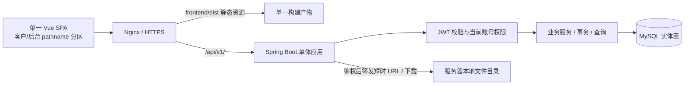
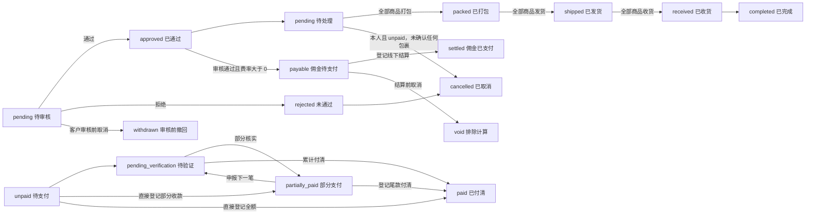
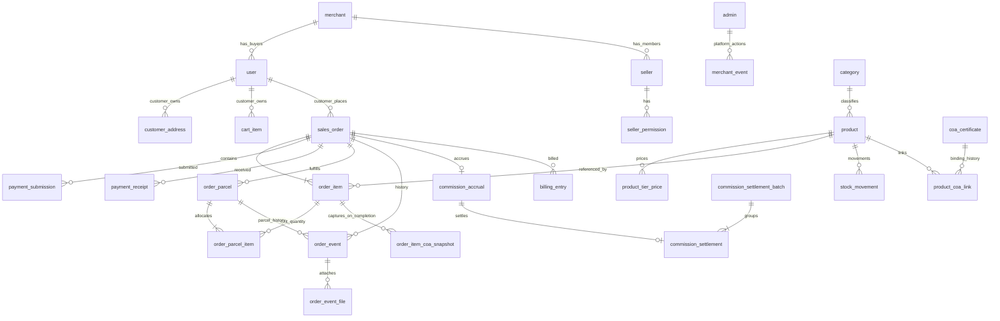

# DailyActivity 技术设计文档

| 项目 | 内容 |
| --- | --- |
| 版本 / 日期 | V1.7 / 2026-10-27 |
| 需求基线 | [prd_v1.md](prd_v1.md)，正文标注 V1.7；当前前端实现为 `frontend/src/App.vue` 单 SPA，客户/后台按 pathname 分区 |
| 适用范围 | 公共商品与商户业务隔离、商家后台；低并发首版 |
| 文档性质 | 可用于开发拆分、接口评审、数据库设计和验收的技术方案；不表示系统已经实现或测试通过 |
| 规则优先级 | 本次用户技术要求 > PRD 已确认业务规则（B）> PRD 实施建议（E）> Demo 现状（D） |

## 1. 技术约束与选型

### 1.1 必须遵循的约束

1. 后端使用 JDK 17、Spring Boot 3.5.6，不使用预览版或 SNAPSHOT；编译、测试与部署统一 JDK 17，版本以仓库 `pom.xml` 为准。
2. 持久化统一使用 MySQL 实体表；不创建数据库视图、物化视图、外键约束，不用触发器或存储过程承载业务。应用层负责关联有效性、业务状态和事务一致性；数据库保留主键、唯一索引和普通索引，不依赖 MySQL 5.6 不执行的 CHECK 约束。
3. 可删除的主数据和关系使用软删除；订单、资金事实、结算、事件、流水、快照和菜单长期保留，不提供物理删除接口，不运行业务数据到期清除任务。
4. 前后端分离。用户原文“后端用 vue”按上下文解释为“前端用 Vue”；Java 提供 REST API，Vue 编译为静态资源部署 Nginx。
5. “不依赖 Node.js”按**生产运行环境不依赖 Node.js**落实：Node.js 只用于开发和 CI 构建，生产只部署 Nginx、JRE、MySQL。无 Node 服务、SSR、Nuxt 服务端或 npm 常驻进程。如果要求连构建环境也禁止 Node.js，则需另选 Vue 浏览器原生模块方案；本设计不把 Vite 构建描述为无 Node 构建。
6. 不引入 Spring Security、相关 starter、OAuth2 Resource Server 或 security-crypto；权限自行实现，JWT 和密码哈希使用独立成熟库。
7. 认证采用 JWT。服务端不保存每次登录的会话记录，不建 Session、Refresh Token 或令牌黑名单表，不使用 Spring Session、Redis 会话或 HttpSession。

### 1.2 版本基线

| 层次 | 选型 | 使用方式 |
| --- | --- | --- |
| Java | JDK 17 LTS | 编译、测试及生产运行统一 17，Maven 编译 release=17，固定发行商和安全补丁 |
| 后端框架 | Spring Boot 3.5.6 | 以仓库 `pom.xml` 锁定版本；不依赖动态 `LATEST` |
| Spring 组件 | Spring MVC、Validation、JDBC | 不包含 Spring Security 或 Actuator；认证使用自定义 Filter 和菜单拦截器 |
| JWT / 密码 | JJWT 0.12.6、argon2-jvm 2.11 | 库负责标准签名/密码哈希，业务自行实现身份和权限，不自行发明加密算法 |
| 数据访问 | Spring JDBC（JdbcTemplate / NamedParameterJdbcTemplate）+ 参数化 SQL | 显式 SQL，便于控制软删除、联合查询、行锁及统计；不采用自动级联删除 |
| 数据库初始化 | Maven、全量 SQL 脚本 | 仅对全新空库执行 `doc/init_mysql56.sql`；应用不负责建表或变更表结构 |
| 数据库 | MySQL 5.6.51、InnoDB | utf8mb4_unicode_ci、COMPACT 行格式，按 767 字节索引上限设计 |
| JDBC 驱动 | mysql:mysql-connector-java:8.0.27 | MySQL 官方 Connector/J；为 MySQL 5.6 显式锁版，com.mysql.cj.jdbc.Driver |
| 前端 | Vue 3、TypeScript、Vite | 当前为一个同时承载客户侧和后台的 SPA；路由由 `App.vue` 根据 pathname 和 `history.pushState` 管理；依赖锁文件固定版本 |
| Web 服务 | Nginx | HTTPS、静态资源、SPA 回退、API 反向代理 |
| 文件 | 服务器本地磁盘 + 后端短时签名下载 | `file_asset` 以应用生成的 `file_uuid` 作为稳定主键，保存文件清单、类型、大小和 SHA-256；业务表统一引用 `file_uuid`；文件内容不进 MySQL |

版本基线以当前仓库 `pom.xml`、`frontend/package.json` 和锁文件为准。后端直接依赖 Spring Boot 3.5.6、MySQL Connector/J 8.0.27、JJWT 0.12.6、argon2-jvm 2.11；测试使用 Spring Boot Test 3.5.6 管理的测试依赖。数据库保持 MySQL 5.6.51。实际发布须记录精确版本和构建摘要，并在目标 JDK 17 与 MySQL 5.6 环境验证连接、事务、字符集、时间和重连。

### 1.3 实施参数与范围

本节落实最新用户指定参数：JDK 17、MySQL 官方驱动、MySQL 5.6、移除 Spring Security、本地文件签名下载、JWT 30 天、0% 不结算、分页 10 条和 YAML 配置优先于旧 PRD/技术方案。其他参数仍是本方案的技术选择。

| 参数 | 本方案取值 |
| --- | --- |
| JWT 有效期 | 30 天，即 2,592,000 秒；exp=iat+2592000，允许时钟偏差 60 秒；不滑动续签、不使用 Refresh Token，过期重新登录 |
| 退出 / 改密 | 提升账号认证版本，使该账号全部既有 JWT 失效；前端明确提示各端需重新登录 |
| 密码 | 12～64 字符；新建和重置同规则；使用带独立盐的 Argon2id 密码摘要，不保存明文；首版不强制首次改密 |
| 文件 | PDF/JPEG/PNG 用于 COA 和独立快递面单；JPEG/PNG 用于履约照片和二维码；单文件 ≤ 5 MiB，打包照片每包 1 张，其他每包每节点每类最多 10 个 |
| 订单商品 | 至少保留一件正品；后台新增正品/赠品须商品上架、类目启用；原订单已有行不加上架门禁 |
| 审核后的赠品 | 与正品一起冻结，不允许增删或改数量、单价；待审核阶段按审核编辑规则处理 |
| 批量结佣 | 同一事务全成功或全失败；单次最多 200 单，超限提示缩小选择 |
| 0% 佣金 | 订单保留推荐人及 0% 费率快照，但不生成计提、应付账单或结算；不进入待结/批量结算列表，直接调用结算接口也拒绝 |
| 分页 | 所有分页固定每页 10 条，包括客户/后台列表、弹窗、历史和候选搜索；pageSize 缺省为 10，其他值报错，不提供大小切换 |
| 同步导出 | 最多 10,000 条输出明细行；超限明确拒绝，不静默截断、不转异步任务 |
| 统计 | 顶部为授权范围全量统计、不随筛选；客户订单记录底部随筛选；取消单不计应收有效金额 |

不增加退款、核验拒绝流程、补退差额、预占库存、预购、拆成多个订单、自动物流、客户确认收货、自动通知、自动链上核验、自动打款、提现、异步导出或独立按钮审批权限。

## 2. 架构与代码组织

### 2.1 部署及请求链路



首版一个后端应用、一个 MySQL 数据库，不依赖 Redis、消息队列、服务注册中心、分布式锁或搜索引擎。业务成功响应必须在数据库事务提交后返回。客户端刷新或重新进入读取最新数据，不要求推送。

客户静态站点位于 `/`，后台位于 `/admin/`，二者由同一个 `frontend/dist` SPA 通过 pathname 区分，API 位于 `/api/v1/`。可同域部署避免跨域配置；客户和后台使用独立认证存储键。静态 HTML/JS 可以公开获取，业务数据和价格由服务端鉴权。文件由后端业务接口鉴权后签发短时 HMAC URL，浏览器通过该 URL 获取内容；URL 到期后失效，详见第 9 章。Nginx 只反向代理文件下载接口，不直接映射上传目录。

### 2.2 后端分层

采用按业务划分包、包内分层的模块化单体：

```text
backend/
  src/main/java/com/dailyactivity/
    DailyActivityApplication.java
    common/          # 金额、分页、时间、错误响应
    auth/            # 自定义 JWT Filter、请求身份、菜单拦截器、账号有效性
    identity/        # 客户、成员、地址、推荐关系
    catalog/         # 类目、商品、等级价格
    inventory/       # 库存和不可变库存流水
    cart/            # 客户购物车
    order/           # 报价、订单、编辑、取消、履约
    payment/         # 渠道、付款申报、人工收款确认
    certificate/     # COA、绑定、完成快照
    commission/      # 计提、单笔与批量结算
    billing/         # 应收应付查询、统计
    export/          # 后台同步 CSV 导出
    file/            # 上传校验、本地落盘、文件名和上传凭证
    config/           # YAML 应用配置读取与校验
  src/main/resources/application.yml
  src/main/resources/application-dev.yml
  src/main/resources/application-live.yml
doc/
  init_mysql56.sql   # 完整空库初始化
frontend/
  src/App.vue        # 客户侧和后台页面、pathname 路由
  src/lib/api.ts     # API、Bearer 和请求期间按钮禁用
  dist/              # Vite 单 SPA 构建产物，不提交仓库
```

各业务包内部按 `api`、`application`、`domain`、`infrastructure` 划分。Controller 主要负责 HTTP 映射和身份获取，部分请求使用 Application record 或 Map；Application Service 负责权限、业务编排及事务；Repository 负责参数化 SQL。业务写入通过明确的应用服务执行，不通过跨模块 Controller 相互调用。

统一采用构造器注入、`@RestControllerAdvice` 和 `@ConfigurationProperties`。当前没有统一独立请求/响应 DTO 层，响应主要由 Map、record 和 `PageResponse` 组成。数据访问显式实现软删除，不使用 ORM 隐式级联；跨模块事务由最外层应用服务统一开启，避免内部自调用导致 `@Transactional` 失效。

### 2.3 业务服务与事务归属

| 服务 | 主要职责 | 原子写入范围 |
| --- | --- | --- |
| AccountService | 建号、资料、启停、密码、权限 | 账号、权限、认证版本 |
| AddressService | 地址与默认地址维护 | 客户锁、地址集合 |
| OrderService | 创建、编辑、取消 | 订单/行、订单号、库存/流水、佣金、事件、购物车 |
| PaymentService | 申报、确认收款 | 付款事实、订单支付状态、事件 |
| OrderService / OrderParcelService | 分包打包、发货、收货、整单完成 | 包裹分配、状态、事件、附件与整体里程碑；完成时写 COA 快照 |
| CertificateService | 元数据、文件替换、转移绑定 | COA、有效/历史绑定 |
| CommissionService | 单笔/批量登记线下结算 | 计提状态、结算批次/明细 |
| BillingService | 应收应付统一列表与统计 | 只读 SQL，不创建数据库视图、不刷新写入财务事实 |
| ExportService | 后台筛选、权限校验、同步 CSV | 导出行数上限和文件生成 |
| 配置属性类 | 读取与校验 YAML 应用配置 | 认证、报价、文件和导出配置读取；业务运费由 merchant 表维护 |

## 3. 身份、JWT 与权限

### 3.1 JWT 结构与验证

采用 HS256 签名，密钥直接配置在 application-dev.yml 或 application-live.yml，不走环境变量，也不由令牌中的任意 URL 决定。密钥必须为至少 32 字节的高熵随机值，live 环境不得使用示例值。固定允许算法为 HS256，校验 `iss`、`aud`、`sub`、`exp`、`iat`、签名及账户状态；拒绝 `alg=none` 和混用算法。

```json
{
  "iss": "Xu",
  "aud": "customer",
  "sub": "user:123",
  "userType": "customer",
  "authVersion": 7,
  "merchantId": 1,
  "iat": 1789900000,
  "exp": 1792492000
}
```

商家使用独立 `aud=admin`、`sub=user:{id}`、`userType=seller`；客户使用 `aud=customer`、`userType=customer`；平台使用 `aud=platform`、`userType=platform`、`merchantId=0`。三类身份分别对应 `/admin/**`、`/customer/**`、`/platform/**`，不能互相访问受保护业务。issuer 当前配置为 `Xu`。JWT 不放密码、地址、交易号和完整菜单权限；卖家菜单从当前用户权限数据读取，不能相信旧令牌中的授权快照。

认证链路自行实现，不引入 Spring Security：

1. 使用 Spring Web 的 `OncePerRequestFilter`（不是 Security 组件）覆盖 `/api/v1/**`；明确放行客户、商家、平台三个登录接口、客户商城品牌配置接口、短时签名文件内容接口、预检 OPTIONS 及健康探活路径（若部署提供）；未知 API 默认认证。
2. 通过独立 JWT 库校验固定算法、签名、iss/aud/sub、iat/exp、30 天时长；查询账号状态、auth_version。
3. 不可变 RequestPrincipal 放 request attribute，自定义参数解析器提供给 Controller；不调用 request.getSession，不产生 JSESSIONID，不在跨请求共享对象保存身份。
4. HandlerInterceptor 解析 `@RequireMenu`，读取当前权限；服务层再校验敏感写操作和资源归属。当前未标注 `@RequireMenu` 的 Handler 默认放行，因此敏感业务必须由 Application Service 显式调用 `requireMenu`；未引入“启动时检查所有 Handler”的机制。
5. Filter 异常通过共享错误响应器返回，MVC 异常由 ControllerAdvice 返回；不能假定 ControllerAdvice 能自动捕获 Filter 异常。异步任务显式传递身份，防止 ThreadLocal 泄漏。
6. 独立 Argon2id 库处理密码，不引入 security-crypto；dependency:tree 验证 org.springframework.security:* 依赖为零。

登录接口在应用内按客户/后台账号标识和客户端 IP 记录失败次数，默认 5 分钟最多 10 次，超限返回 `429 TOO_MANY_REQUESTS` 和 `Retry-After`；成功登录清除账号标识的失败窗口。后端仅当 TCP 对端是回环 Nginx 时才读取其覆盖写入的 `X-Forwarded-For` 首地址，其他对端一律使用 `request.getRemoteAddr()`，不能信任公网请求自带的 forwarded header。限流窗口最多保留 10000 个账号/IP 键，容量满时先清理过期窗口且不再为新键分配内存，并每分钟清理全部过期窗口。当前限流状态保存在单实例内存；多实例部署前需要改为共享限流存储。

### 3.2 无会话存储下的即时失效

买家保存在 `user`，商家管理员和成员保存在 `seller`，平台管理员保存在 `admin`。三张表各自保存密码摘要、状态、auth_version 和最近登录时间，各自生成 ID，不保存 user_type 判别列。认证仓储 AccountRepository 按服务端验证的身份类型从固定白名单选表，所有按 ID 的认证查询、行锁、最近登录和退出版本更新必须同时指定身份类型；禁止跨表搜索同一个 ID 或根据存在性推断类型。JWT 仍保存 userType 和独立 audience；sub 的 user:ID 是令牌标识格式，不表示统一 user 表，必须与已验证的 userType 一起解释。客户、卖家和平台分别只能访问各自 API 范围；商户停用校验只适用于买家和卖家。每次受保护请求从 MySQL 主库读取对应账号，验证启用、未删除、authVersion 和归属，不缓存授权判断。

| 事件 | 服务端动作 | 既有 JWT 的结果 |
| --- | --- | --- |
| 普通登录 | 验密、更新最近登录时间，按当前版本签 JWT | 允许同账号多端登录，无登录记录表 |
| 退出 | 在账号行锁内校验令牌版本，`auth_version + 1`，提交后返回 | 同账号所有既有 JWT 失效；各端下一请求 401 |
| 主动改密 / 后台重置 | 保存新摘要且 `auth_version + 1` | 包括当前页面在内全部重新登录 |
| 停用账号 | `active=false` 且提升认证版本 | 立即拒绝后续受保护请求 |
| 重新启用 | `active=true`，保留提高后的版本 | 旧令牌不能恢复，需要重新登录 |
| 撤销成员菜单 | 更新权限关系 | 下一请求按当前权限返回 403；无须等待 JWT 到期 |

这是“不保存单独会话信息”与 PRD“退出即时失效”的兼容方案。它提供账号级失效，不承诺只踢出一个设备。若要求退出仅影响当前设备且被复制的该 JWT 立即不可用，就必须新增令牌或设备状态，不能同时声称完全没有逐会话存储；本版不采用该能力。

浏览器在独立的 `localStorage` 键保存客户、商家或平台 JWT，浏览器重启后仍可恢复登录，直到 JWT 过期或被服务端撤销；每次请求显式通过 `Authorization: Bearer ...` 发送，不放 URL、日志或业务导出。登录存储键按客户、商家和平台隔离。现有请求封装也能读取对应 sessionStorage 键，但全新系统不依赖历史 token 迁移。退出先调用退出 API，成功后清除 `App.vue` 的敏感状态和本地 token；网络失败可清本地状态并提示“服务端退出未确认”，不能宣称服务端令牌已撤销。重复退出不得用旧令牌再次递增版本并误踢新登录。浏览器持久化存储可被同源脚本读取，因此仍须防范 XSS，不保存密码。

卖家多账号切换复用现有 `POST /admin/auth/login` 和 `GET /admin/me`，无需新增接口、数据库表或修改账号商户归属。`localStorage["dailyactivity.admin.accounts"]` 按成员 ID 保存账号、姓名、商户名称与 JWT；不保存密码或菜单权限，展示缓存不作为鉴权依据。已有单账号登录在 `/admin/me` 成功后纳入列表，不要求准备历史 token。`dailyactivity.admin.token` 仍表示当前活动身份，客户 token 的存储及身份保持独立。

添加账号时登录请求不携带当前 Bearer，登录失败的 401 不清除当前登录。切换目标账号时使用其候选 token 调用 `/admin/me`，验证成功才更新活动 token；候选验证的 401 仅清除对应已保存凭证并要求重新登录，网络及其他服务端失败保留候选凭证供重试。切换不调用 logout、不续签 token；成功后整页刷新至 `/admin`，重新获取实时商户、菜单和业务数据。后台顶部移除姓名字母头像和独立退出按钮；账号切换弹窗通过 signOut 事件复用 App.vue 的退出确认及处理，退出期间禁用切换、添加、移除和关闭，登录页不提供退出入口。退出当前账号仍按账号级认证版本失效规则执行，前端只清除对应已保存凭证；移除非当前账号仅删除本机列表项。

每个文档初始化时固定本页面后台 token，所有后台 API 请求和导出发送前、响应交付前比较本页面身份与当前活动 token；不一致则阻止请求/丢弃迟到结果并刷新，禁止旧页面拿新 token 提交旧表单。401 清理仅在被拒请求的身份仍为活动身份时执行。其他卖家标签页监听活动 token 的 `storage` 变更及存储整体清空后刷新；列表元数据变更只更新账号列表，不重载客户页面。切换弹窗不展示可信设备、标签页刷新及移除范围的静态说明，异步登录/验证期间阻止重复操作和关闭。账号切换弹窗通过 Vue Teleport 挂载到 body，脱离带 backdrop-filter 的顶部栏，遮罩覆盖整个视口并保持卖家配色；内容高度限制为动态视口减去上下留白，超出时在弹窗内滚动。

只接受 Bearer 认证，不接受隐式身份 Cookie，因此 API 不依赖 Cookie CSRF 机制；仍限制可信 Origin、只接受规定 Content-Type，并实施 CSP、文本转义、防 XSS。前端响应 401 时停止重试，保留合法站内返回路由并跳登录；403 显示无权操作。

### 3.3 菜单权限及数据归属

后台菜单码固定为 `order_audit`、`orders`、`commissions`、`bills`、`customers`、`products`、`certificates`、`categories`、`payment_channels`、`members`。每个商家后台账号都保存于 seller 表；拥有某菜单即拥有该菜单的全部操作，不设额外按钮授权或字段脱敏规则。运费从 merchant.shipping_fee 读取，由平台管理员在商户管理页维护，不设独立商城设置菜单。

商户 Admin 是拥有本商户获批菜单的 seller 用户；平台身份独立。每商户保留至少一个有效 members 持有者。客户等级仍为 V1～V6。

客户查询必须将 `customer_id = principal.userId` 写入 SQL 条件，并从买家 user 表验证该账号身份。地址、购物车、订单、付款和文件签发接口逐项验证归属；他人 ID 返回 404，避免暴露对象存在性。推荐人查询限定 `referrer_id_snapshot = principal.userId`，只返回推荐姓名与佣金快照，不返回被推荐人地址、收款凭证或订单操作能力。

客户、佣金、账单菜单的关联订单只读能力通过各自资源路径提供：先证明客户/佣金/账单记录与订单关联，再返回后台只读 DTO。写订单永远要求 `orders`。不使用前端传入 `source=commission` 决定授权。后台没有额外字段权限，同一菜单内返回完整业务字段；客户 DTO 必须排除成本和内部备注。

登录入口执行基础频率限制：Nginx 按真实客户端 IP 限速，单应用内按规范化 email/account 和可信回环 Nginx 写入的客户端 IP 做短时失败计数；建议 5 分钟内 10 次失败后短时限制，返回 429。内存计数是防滥用状态，不是登录会话。错误凭证、不存在账号和禁用账号统一文案。首个拥有全部菜单权限的 seller 用户由一次性受控初始化创建，不提交默认密码。

### 3.4 商户上下文与平台身份（V1.8）

买家 user.merchant_id 和卖家 seller.merchant_id 必填且不通过账号编辑改变；平台账号保存于 admin 表，不含 merchant_id，Java Principal/JWT 使用 merchantId=0 作为平台专属标识（不能作为全局业务查询范围）。平台 aud 固定为 platform，客户与卖家仍为 customer/admin。AuthFilter 同时校验实时账号、authVersion、商户状态、API 路径对应身份；平台仅能调用 /platform/**。

买家接口通过原始 Host（允许开发端口）解析唯一商户域名，不使用 X-Forwarded-Host。认证过滤器使用 Spring RequestPath 的解码路径分段识别 API 身份，与 MVC 的分号参数处理一致；段内编码斜线不拆成额外路径段。所有已认证买家请求均校验域名归属，不依赖原始 URI 前缀作为校验开关，带分号参数也不能绕过。公开接口使用严格白名单放行。客户登录查询必须传 merchantId；受保护客户请求要求 Host 商户等于 JWT 和持久账号归属。Nginx 必须覆盖 Host 为实际访问域名，后端不得经会重写任意 forwarded header 为 Host 的配置运行。未知域名返回 404，停用返回 403，不做默认商户回退。商户停用提升全部所属账号 authVersion。

有效菜单仍按成员授权与商户公共授权计算；创建/修改成员不允许越过商户授权上限。每商户最后一个 members 持有者由商户行锁保护。平台账号不进入成员列表，不存在 user.merchant_management、merchantManagement 响应字段或特殊成员只读规则。平台引导使用 doc/bootstrap_platform.sql，由部署人员设置账号、姓名与 Argon2id 摘要后显式执行，无默认密码，不在启动时自动运行；平台账号没有业务启停/删除接口。

创建商户、域名和主题配置、公共授权、首管理员及其菜单和审计事件在同一事务提交。商户更新以行锁和 expectedUpdatedAt 检查并发冲突，域名唯一索引防并发重复。merchant.domain 使用 ASCII、最长 253，规范化小写并去掉末尾点；应用要求创建/编辑时非空。logo_url 仅接受站点相对路径或 HTTPS URL，平台配置静态图片地址；本期不新增 logo 上传。theme 仅允许 classic/forest/editorial，禁止任意 CSS 或 URL 注入。主题文件按标识分开放在 frontend/src/styles/themes/：classic.css 保存现有买家端基础样式，forest.css 与 editorial.css 分别保存对应主题覆盖规则；通过 frontend/src/styles.css 统一按基础样式、主题覆盖的顺序导入。商户后台等非主题样式放在对应组件或公共样式中。价格、库存、COA 共享，私有 Repository 仍必须显式传入 merchantId。


## 4. 状态、金额和快照

### 4.1 四组独立状态



审核状态与履约、付款、佣金状态分开保存。新单 pending 审核；客户可对任何非取消且 unpaid/partially_paid 的订单申报付款，不要求审核通过，审核决定也不改写支付状态。审核通过后才进入后台订单、应收与佣金。拒绝时同时将订单状态置为 cancelled，并按当前订单行回补库存；客户审核前取消同样取消订单、回补库存并标记 withdrawn。`void` 是内部计提有效性状态，用于保留取消历史，不新增客户佣金支付流程；订单新增部分支付状态独立于佣金状态。无推荐人或下单锁定费率为 0% 的订单不生成计提行，后续提高费率不追补旧单。

| 操作 | 允许条件 | 必填 / 限制 |
| --- | --- | --- |
| 订单审核 | `order_audit` 权限，audit_status=pending | 审核通过/拒绝一次；记录审核人、时间和备注；通过时创建应收及佣金计提，拒绝时回补库存 |
| 审核前商家编辑 | `order_audit` 权限，audit_status=pending + order_status=pending | 未付款可增删商品、改数量/单价；至少保留一行；改价原因必填；付款已申报仍可编辑正品和金额，原申报保留；实际存在收款才锁定金额 |
| 客户编辑 | 本人，pending + unpaid 且未拒绝/撤回、尚无包裹 | 待审核可改已有正品数量、地址、买家备注；审核通过后仅可改地址和备注，商品明细及单价冻结；赠品只读 |
| 客户取消 | 本人，pending + unpaid、尚无包裹且佣金未结算 | 回补当前有效行数量一次；待审核订单转 withdrawn；无后台取消入口 |
| 商家编辑 | orders 权限，审核通过且 order_status=pending、尚无包裹 | 审核通过后商品增删、数量和单价全部禁止修改（含零价赠品）；允许范围内可修改地址和备注；待验证/部分支付/已付清只能改非金额信息及规定的零价赠品 |
| 客户付款申报 | 本人，非 cancelled + unpaid/partially_paid，审核状态不限 | 有效渠道、交易号、本次 declaredAmount、总额快照及必填版本 |
| 商家确认收款 | orders 权限，审核通过、非 cancelled、未付清 | 最终交易号、本次 receivedAmount、总额快照、必填版本及申报 ID；差异原因必填；直接登记需有效渠道 |
| 打包 | orders 权限，审核通过、有未分配商品、非终态 | 每包至少一件商品、正整数数量及本节点至少 1 图；必填订单版本 |
| 发货 | orders 权限，打开本单 packed 包裹 | 运单号必填，承运商和快递面单选填；已提交面单须有效；逐包操作 |
| 收货 | orders 权限，打开本单 shipped 包裹 | 二次确认、必填订单版本，不强制图片；逐包操作 |
| 完成 | orders 权限，received 且逐行核对全部商品已收货 | 二次确认；原子捕获 COA，不检查付款或佣金状态 |
| 结佣 | commissions 权限，audit_status=approved、订单非 cancelled、计提 payable | 确认已线下支付；事务内校验订单和佣金状态；不要求订单完成或收款；0% 不生成记录且不进列表 |

禁止通用“修改 status”接口；每个动作明确允许的原状态及目标状态。不允许跳级、回退、客户收货、付款推动履约、履约推动付款。完成后 unpaid 仍可申报和确认收款，取消后不能付款或履约。

### 4.2 金额与精度

Java 全部使用 `BigDecimal`，数据库金额 `DECIMAL(18,2)`、百分比 `DECIMAL(5,2)`；接口金额采用十进制字符串，例如 `"220.00"`，禁止 `double/float` 作为金额事实。输入超过两位小数直接校验失败，不将 `0.001` 舍入成零价正品。数量校验为 INT 正整数，库存加减和行金额乘法先使用足够宽的类型计算并校验数据库表示范围，溢出返回字段错误，不能截断或绕回负数。

```text
正品单价 = 当前客户等级及数量匹配的阶梯价；未配置阶梯时取等级固定价或商品默认价，必须 >= 0.01 USD
赠品单价 = 0.00 USD
行金额 = 单价 × 正整数数量
商品小计 S = 各有效行金额之和
订单运费 F = 创建时本商户统一运费快照
订单优惠 D = 审核编辑时给予的固定商品优惠额（默认 0.00）
优惠前合计 G = S + F
订单总额 / 最终应付 T = S + F - D
累计实收 R = SUM(本订单已确认 receipt.received_amount)
剩余待收 = T - R
佣金基数 B = S - D（优惠后商品小计，不含运费）
单笔佣金 K = round(B × 下单锁定佣金率 / 100, 2, HALF_UP)
汇总佣金 = 各单已舍入 K 之和
```

示例：S=200、F=20、费率 5%，T=220、K=10；20 仅为示例，不是生产默认运费。两笔 S=0.05、费率 10%，佣金分别 0.01，合计 0.02。缺失成本保存 NULL，不推算利润。

待审核编辑不受付款申报限制；原始申报金额、订单总额和本笔渠道快照保留。实际确认收款后锁定正品及订单金额。审核通过后商品集合、数量、单价及金额在所有付款状态下均冻结。客户转账提示按 `roundHalfUp(本次付款金额 × (1 + rate / 100), 2)` 计算，申报和收款金额表示本次抵扣订单款，不包含附加费。

优惠在待审核订单的编辑保存事务内生效，要求 `order_audit` 权限、尚不存在确认收款；可在待审核期间设置、修改或清除优惠，付款申报不限制。`PATCH /admin/order-audits/{id}` 新增可选 `discountAmount`，省略沿用已有优惠；完整商品集合、优惠和 expectedUpdatedAt 同时提交。优惠为最多两位小数的非负 USD 金额，不能超过编辑后商品小计，正数优惠后应付必须大于 0。订单行锁与版本校验保护优惠、付款申报及编辑并发；先校验新金额，再写库存和商品。优惠不分摊至商品行，不修改运费，佣金按优惠后商品小计（S-D）计算。审核编辑的 `audit_updated` 内部事件记录商品、优惠和应付前后快照、操作者及时间，客户通过订单金额字段读取优惠。审核弹窗只读展示已保存金额，审核决定默认沿用优惠；优惠保存后客户可独立申报，申报后仍可变更优惠，原申报保持历史金额，按最新应付通过或拒绝审核。通过后优惠额、商品明细和金额固定，后续资料编辑保留财务快照。为兼容既有接口，审核决定的可选优惠字段仍接受尚无收款的待审核订单的新优惠，仅 approved 时允许变更，并保留 `audit_discounted` 内部事件；新前端使用编辑接口保存优惠。

### 4.3 快照时点

佣金基数按 `sales_order.subtotal - discount_amount` 计算。审核通过时创建佣金计提并转为 `payable`，同时生成应付账单；商品金额在审核通过时固定，未结佣也不允许修改已审核订单商品。佣金结算在事务内锁定订单和计提，保存当时的不可变结算快照；结算后禁止改变订单计佣金额或取消订单。订单完成只捕获 COA 快照，不再改变佣金基数或状态。全新系统无遗留佣金数据，新计提在审核通过时进入 `payable`；不执行佣金迁移或历史金额重算。佣金列表与结算展示“佣金基数”，佣金 CSV 同名列读取 `commission_accrual.base_amount` 快照，不使用当前订单商品小计重新推算；已有金额响应字段保持兼容。

| 内容 | 固定时点 | 后续行为 |
| --- | --- | --- |
| 下单客户 ID / 姓名 / 邮箱 / code | 创建订单 | 当前客户资料变化不重分配历史订单 |
| 商品 ID / SKU / 名称 / 类型 / 成交价 / 成本 | 加入订单时 | 已有行按快照类型校验；订单行保存变更前后的业务快照；后加行使用当时资料 |
| 运费 / USD | 创建订单 | 改地址、改商品、更新商户配置均不替换旧单运费 |
| 优惠额 / 最终应付 | 待审核且尚无确认收款时编辑保存 | 待审核时可再次调整优惠，申报不阻止编辑，审核通过后优惠额固定；审核通过后商品和金额冻结，资料编辑保留原优惠和应付；旧单优惠默认 0 |
| 收货地址 | 创建或合法订单编辑 | 与地址簿独立；删除地址不影响订单 |
| 推荐人 / 下单客户 / 费率 / 关系版本 | 创建订单 | 关系和费率变更只影响新订单；无推荐不追补 |
| 渠道名称 / 币种 / 网络 / 地址 / 说明 / 二维码 file_uuid | 付款申报或商家直接确认 | 不因当前渠道改动、停用或软删除而改变 |
| 订单 COA 元数据、文件、绑定 | 确认完成 | 完成前读取最新有效资料，完成后仅读完成快照，空集合也是有效快照 |
| 佣金基数 / 逐单金额 | 有推荐人且锁定费率 > 0 的订单完成 | 完成前合法编辑重算、完成后固定；0% 只保留订单关系快照，不生成计提/结算 |

商品下架、停用类目或软删除商品阻止新采购，但不删除库存身份和旧订单。旧订单已有行按状态、金额锁定与库存正常处理。未完成订单（包括 cancelled）的 COA 读取当前有效证书/绑定；商品是否上架不构成订单 COA 的访问门禁。COA 解除、转移或软删除后不回退旧资料。

## 5. MySQL 数据模型

### 5.1 全局约定

| 类型 | 约定 |
| --- | --- |
| 主键 | id BIGINT AUTO_INCREMENT（固定菜单行显式指定 ID）；API 返回字符串以避免 JS 整数精度丢失 |
| 关联 | `*_id BIGINT`，只建索引，不声明 FOREIGN KEY；父子存在性、所有权和有效性由应用事务校验 |
| 时间 | `DATETIME(6)` 存 UTC；JDBC、数据库连接统一 UTC；API ISO 8601 带 `Z` |
| 可变表元信息 | 主数据、可变关系和订单状态表使用 `created_at/updated_at`、`created_by_user_id`、`updated_by_user_id`；无具体用户的初始化数据操作者字段为 NULL |
| 并发控制 | 写事务按固定顺序 `SELECT ... FOR UPDATE` 锁定相关行；可变业务记录返回 `updated_at`，命令可提交 `expectedUpdatedAt` 做乐观冲突检测 |
| 软删除 | 仅可删除的主数据和可重复关系使用 `deleted BIGINT NOT NULL DEFAULT 0`；有效为 0，软删除就是一次更新，删除时同时写 `updated_at` 和 `updated_by_user_id`，不再单独保存删除时间 |
| 文本 | 业务文本列统一 `utf8mb4_unicode_ci`；`file_uuid` 使用 ASCII `ascii_bin`；email/account 由应用 trim 后转小写，类目名、SKU 和渠道名直接按数据库排序规则比较并建立唯一索引，不维护额外规范化副本 |
| 枚举 | VARCHAR + 应用枚举校验；不依赖 CHECK，不使用生成列、函数索引、CTE、窗口函数或 REGEXP_LIKE |
| 文本快照 | MySQL 5.6 无原生 JSON；序列化 JSON 通常使用 LONGTEXT，订单地址和付款渠道快照分别使用 VARCHAR(512)/VARCHAR(256)，由 Java 验证/读写；检索使用结构化列，不用 JSON_* SQL 函数 |
| 删除 SQL | 软删除使用 `UPDATE ... SET deleted=id, updated_by_user_id=:userId, updated_at=:utcNow,...`；等级价和购物车行按业务规则物理删除；其他业务表禁止 `DELETE`、`TRUNCATE`、`REPLACE INTO` 和级联物理删除 |

不可变事件/流水/快照/收款与结算事实和菜单字典不设软删除字段；它们没有业务删除入口。不能把软删除当作撤销资金事实的方法。取消用状态表示，不删除订单。

可重复建立且允许软删除的关系使用 `UNIQUE(业务键, deleted)`：旧行删除后 `deleted=id`，新有效行使用 0；避免 `UNIQUE(业务键,is_deleted)` 只能保留一次历史删除的问题。客户码、订单号、每单已消费报价摘要、每单付款申报、每单收款及每单佣金/结算使用永久唯一，不随软删除释放。

为简化身份与历史识别，本方案选择本商户客户邮箱、seller 表内唯一账号、admin 表内唯一账号、SKU、类目名、渠道名也不因软删除重新分配；编辑名称/邮箱可改为尚未占用的新值，历史订单通过业务快照追踪。这里的“永久唯一”指保留行当前值不因删除释放，不建立未经要求的所有历史曾用邮箱注册表。客户 code 首版无修改入口且永不重用。

买家 user 表仅保存商户、邮箱、姓名、密码、客户码、类型、等级、推荐关系、费率、状态和认证属性；seller 表保存商户、登录账号、姓名、密码、状态和认证属性；admin 表保存平台登录账号、姓名、密码、状态和认证属性。买家邮箱按 (merchant_id,email) 唯一，客户码在 user 表全局唯一；seller.account 和 admin.account 分别在各自表内唯一，可使用相同账号名。三表无共用身份主表、无 user_type 列。客户业务 customer_id/referrer_id 指向 user.id；seller_permission.seller_id 只指向 seller.id。

### 5.2 实体关系



图中关系均为逻辑关系，没有数据库外键。商品可关联零到多份 COA（商品 1:N COA）；每份 COA 同时最多关联一个商品。COA 对绑定历史可有多条，但同时最多一条有效绑定。

### 5.3 用户与菜单表

表中 U 表示唯一索引，I 表示普通索引；未重复列出 5.1 的通用列。`?` 表示可空，其余字段除专门说明外必须非空。

| 表 | 业务字段 | 索引与约束 |
| --- | --- | --- |
| `user` | merchant_id、email(128)、name(100)、password_hash、code(3)、customer_type、price_tier、referrer_id、commission_rate、active、auth_version、last_login_at、审计与软删除 | U(merchant_id,email)、U(code)；邮箱小写，客户码大写，客户推荐只能指向同商户 user |
| `seller` | merchant_id、account(64)、name(100)、password_hash、active、auth_version、last_login_at、审计与软删除 | U(account)，账号小写；商户内成员与菜单授权 |
| `admin` | account(64)、name(100)、password_hash、active、auth_version、last_login_at、审计与软删除 | U(account)，账号小写；无 merchant_id，不进入商户成员管理 |
| `seller_permission` | seller_id、menu_code、创建/修改时间、操作者 ID 与类型、deleted | U(seller_id,menu_code,deleted)，撤权软删除，重新授权新增行 |
| `customer_address` | `customer_id`（`user.id`，必须为 customer）；`recipient_name VARCHAR(100)`；`street VARCHAR(200)`；`apt VARCHAR(100)?`；`city/region VARCHAR(100)`（region 可空）；`postal_code VARCHAR(20)`；`phone VARCHAR(32)`；`is_default BOOLEAN` | I(customer_id,deleted,id)、I(customer_id,deleted,is_default,id)；应用事务保证每客户最多一个有效默认地址 |
| `permission_menu` | menu_code、name、sort_no | U(menu_code)；内置 10 个菜单 |

客户码由应用使用安全随机数从 `0123456789ABCDEFGHIJKLMNOPQRSTUVWXYZ` 生成三位 Base36 字符串，并统一保存为大写；`000` 为合法码，比较不区分大小写。共 36³ = 46,656 个候选码。插入 `user` 时依赖 U(code) 防止重复；发生唯一键冲突时生成新码并重试，达到有限重试上限后返回明确系统错误。客户 code 永不重用，已软删除客户的 code 也保留占用。

默认地址以 `customer_address.is_default` 保存。设置、切换和删除默认地址时锁 customer 对应的 user 行及其有效地址集合；先清空其余有效地址标记，再设置目标地址。删除默认地址时同事务将 created_at/id 最早的其余有效地址标记为默认；最后一条删除后不保留默认地址。应用保证每客户最多一个有效默认地址。

### 5.4 商品、库存与购物车表

| 表 | 业务字段 | 索引与约束 |
| --- | --- | --- |
| `category` | `name VARCHAR(100)`；`sort_no INT`；`active` | U(name)；I(deleted,active,sort_no,id)；sort_no > 0 |
| `product` | `category_id`；`sku VARCHAR(64)`；`name VARCHAR(200)`；`description VARCHAR(2000)?`；`product_type VARCHAR(16)`；`active`；`base_price DECIMAL(18,2)`；`cost_price DECIMAL(18,2)?`；`stock_available INT`；`price_revision BIGINT` | U(sku)；I(category_id,deleted,active,product_type,id)，I(deleted,stock_available,id)；库存非负整数；正品 base_price > 0，赠品=0，成本 NULL 或 ≥0 |
| `product_tier_price` | `product_id`；`tier CHAR(2)`（V1～V6）；`price DECIMAL(18,2)?` | U(product_id,tier)；等级价替换时物理删除旧行；正品 NULL 表示回默认；赠品六档都为 0；跨表类型校验由应用执行 |
| `product_quantity_price` | `product_id`、`tier CHAR(2)`、`min_quantity INT`、`max_quantity INT NULL`、`unit_price DECIMAL(18,2)`、审计字段及 deleted | U(product_id,tier,min_quantity,deleted)；每等级独立连续区间；替换时软删除旧行。正品价 > 0，赠品不配置 |
| `order_item_quantity_price` | `order_item_id`、`min_quantity`、`max_quantity NULL`、`unit_price`、created_at | U(order_item_id,min_quantity)；不可变快照，无历史回填、无删除入口；price_source=manual 时不参与自动计价 |
| `stock_movement` | `product_id`；`order_id?`；`order_event_id?`；`movement_type VARCHAR(32)`；`quantity_delta INT`；`quantity_before/after INT`；`reason VARCHAR(1000)?`；`operation_id VARCHAR(64)`（服务端操作审计 UUID） | U(operation_id,product_id)；I(product_id,created_at,id)，I(order_id,id)；每次业务操作每商品先汇总差额，只追加一次 |
| `cart_item` | `customer_id`；`product_id`；`quantity INT` | U(customer_id,product_id)；I(customer_id,id)；quantity > 0；移除或下单消费时物理删除购物车行 |

商品价格、类型、等级价或数量阶梯变更提升 `price_revision`；库存写入先锁商品行，再把“设置为 N”转换为差额调整和流水，不能覆盖并发订单扣减。`price_revision` 只用于报价快照，不是通用并发版本。

删除类目须已停用且不存在任何关联商品记录（含软删除商品，采用保守历史保留口径）；存在历史关联的类目保留为停用即可。商品先下架才能软删除；购物车查询返回不可售原因，不静默删除使客户漏单；客户移除后物理删除购物车行。类目重命名不改 product.category_id。

### 5.5 订单与付款表

| 表 | 业务字段 | 索引与约束 |
| --- | --- | --- |
| `sales_order` | `order_no VARCHAR(64)`；`customer_id`；`customer_code/name/email_snapshot`；`order_status VARCHAR(16)`；`audit_status VARCHAR(16)`（pending/approved/rejected/withdrawn）；`audited_by_user_id/audited_at/audit_remark VARCHAR(1000)?`；`payment_status VARCHAR(32)`；`currency`；`subtotal/shipping_fee/discount_amount/total_amount DECIMAL(18,2)（discount_amount 默认 0）`；`address_snapshot VARCHAR(512)`；`recipient_name/city` 检索冗余；`buyer_note/internal_note VARCHAR(1000)?`；`referrer_id_snapshot?`；`referrer_name_snapshot?`；`commission_rate_snapshot?`；`status_changed_at`；`completed_at/cancelled_at/coa_captured_at?` | U(order_no)；I(customer_id,created_at,id)，I(created_at,id)，I(customer_id,payment_status,created_at,id)，I(payment_status,created_at,id)，I(order_status,created_at,id)，I(audit_status,created_at,id)；T=S+F-D，discount_amount 在尚无收款的待审核订单编辑保存时生效，付款申报不锁定审核金额，审核通过后优惠额固定，shipping_fee 为下单时唯一运费快照；currency=USD；订单无软删除 |
| `order_item` | `order_id`；`product_id`；`sku/name/type_snapshot`；`quantity INT`；`unit_price/line_amount`；`unit_cost_snapshot?`；`price_source VARCHAR(16)`（增加 quantity_price）；`price_tier_snapshot?`；`sort_no` | U(order_id,product_id,deleted)，I(order_id,deleted,sort_no,id)，I(product_id,order_id)；同单相同商品合并一有效行；删除行软删除并保留业务快照 |
| `order_parcel` | `order_id`；`parcel_uuid CHAR(36)`；`parcel_no INT`；`status VARCHAR(16)`（packed/shipped/received/repacked）；`tracking_no VARCHAR(128)?`；`carrier VARCHAR(64)?`；`packed_at/shipped_at/received_at DATETIME(6)?`；创建/修改审计 | U(parcel_uuid)，U(order_id,parcel_no)，I(order_id,status)，I(tracking_no)；包裹编号递增，归档不复用；不保存金额或历史来源标记 |
| `order_parcel_item` | `parcel_id`；`order_item_id`（订单行快照）；`quantity INT` | U(parcel_id,order_item_id)，I(order_item_id)；正整数；订单行可跨包，总量守恒；不重复变动库存 |
| `order_event` | `order_id`；`parcel_id BIGINT?`（包裹事件，其余为空）；`operation_id`（服务端操作审计 UUID）；`action VARCHAR(32)`；`from_status/to_status?`；`before_data/after_data LONGTEXT?`；`note TEXT?`；`occurred_at`；`actor_user_id` | U(order_id,operation_id,action)；I(order_id,occurred_at,id)；仅追加，后台详情显示备注、操作人和履约附件 |
| `order_event_file` | `order_id`；`event_id`；`file_uuid CHAR(36)`；`stage VARCHAR(16)`；`sort_no` | U(event_id,file_uuid)，I(order_id,event_id)；仅追加，校验上传凭证、归属、用途与磁盘存在性 |
| `payment_channel` | `name VARCHAR(32)`；`currency_code/network VARCHAR(32)`；`receiving_address VARCHAR(120)`；`instructions VARCHAR(240)?`；`additional_rate DECIMAL(5,2)?`（0–100，最多两位小数）；`qr_file_uuid CHAR(36)`；`active`；`sort_no INT`；推荐渠道为有效渠道按 sort_no/id 排序后的第一条 | U(merchant_id,name)；I(merchant_id,deleted,active,sort_no,id)；费率可空，不设推荐字段 |
| `payment_submission` | order_id/customer_id/channel_id；channel_snapshot VARCHAR(256)；original_transaction_no VARCHAR(256)；declared_order_total DECIMAL(18,2)（申报时订单总额）；declared_amount DECIMAL(18,2)（本次抵扣金额）；status VARCHAR(16)（pending/confirmed）；submitted_at | I(order_id,status,id)；逐笔追加，事务锁订单保证同时最多一笔 pending；原申报不覆盖，无软删除 |
| `payment_receipt` | order_id；submission_id?；channel_id/channel_snapshot；verified_transaction_no；received_amount DECIMAL(18,2)（本次核实抵扣订单款，不含附加费）；currency=USD；verified_by_user_id/verified_at；internal_note? | U(submission_id)，I(order_id,verified_at,id)；每单多笔，申报至多一次确认；NULL submission_id 允许多笔直接登记 |

`paidAmount` 是接口字段，由该订单 `SUM(payment_receipt.received_amount)` 得到，不在订单表另存一份可被编辑覆盖的金额。`sales_order.payment_status` 为唯一支付状态列，与申报/收款事实同事务变更；查询不根据金额倒推并修正状态。不建立第二个 `payStatus` 或单独待验证布尔列。

原始交易号与核验交易号分开：核验表单可在确认前填写/更正最终值并保留客户原值；确认后收款事实不可编辑，本版不增加已确认收款的撤销或更正流程。不同订单使用相同交易号允许保存，交易号不建立唯一约束。

### 5.6 COA、文件与佣金表

| 表 | 业务字段 | 索引与约束 |
| --- | --- | --- |
| `coa_certificate` | `name VARCHAR(200)`；`lot VARCHAR(100)?`；`purity VARCHAR(32)?`；`fill VARCHAR(64)?`；`test_date DATE?`；`current_file_uuid CHAR(36)`；`uploaded_at` | I(deleted,created_at,id)；编辑不改创建人，无 COA 业务版本实体 |
| `product_coa_link` | `product_id/coa_id`；`linked_by_user_id/linked_at`；`ended_at?` | U(coa_id,deleted)，I(product_id,deleted,coa_id)；一个商品可有多份有效 COA，一 COA 最多一有效商品绑定，转移软删除旧行并新建 |
| `order_item_coa_snapshot` | `order_id/order_item_id/product_id/coa_id/source_link_id`；`name/lot/purity/fill/test_date_snapshot`；`file_uuid CHAR(36)`；`linked_by_user_id/linked_at_snapshot`；`captured_at` | U(order_item_id,coa_id)，I(order_id,order_item_id)；完成时追加，不覆盖 |
| `file_asset` | `file_uuid CHAR(36)`；`stored_file_name VARCHAR(64)`；`original_file_name VARCHAR(255)`；`purpose`；`media_type`；`size_bytes`；`sha256`；`status`（`available` 才可引用/签发）；`uploaded_by_user_id/uploaded_at` | PK(file_uuid)、U(stored_file_name)；文件内容在本地磁盘，清单是按 UUID 签发 URL 和引用校验的事实源 |
| `commission_accrual` | `order_id`；`referrer_id/referred_customer_id`；双方姓名快照；`rate DECIMAL(5,2)`；`base_amount/commission_amount DECIMAL(18,2)`；`status VARCHAR(16)`；`finalized_at?` | U(order_id)，I(referrer_id,status,id)，I(status,order_id)，I(referred_customer_id,order_id)；状态 estimated/payable/settled/void；仅推荐费率 > 0 创建，不设软删除 |
| `commission_settlement_batch` | `batch_no VARCHAR(64)`；`order_count INT`；`total_base/total_commission`；`settled_by_user_id/settled_at`；`remark VARCHAR(1000)?`；`offline_paid_confirmed BOOLEAN` | U(batch_no)；I(settled_at,id)；单笔也生成一条批次 |
| `commission_settlement` | `batch_id/accrual_id/order_id`；`order_no_snapshot`；`referrer_id/referred_customer_id`；双方姓名快照；`base_amount/rate/commission_amount`；`settled_at/settled_by_user_id`；`remark?` | U(order_id)，U(accrual_id)，I(batch_id,id)，I(referrer_id,settled_at,id)，I(referred_customer_id,settled_at,id)；事实永久唯一、不可改 |

数据库不存文件字节、Base64 或完整 URL；文件清单 `file_asset` 保存应用生成的 UUID、服务端文件名、用途、真实 MIME、大小和 SHA-256。COA、付款渠道、履约附件和完成快照全部保存 `file_uuid`，并在写入引用时校验清单记录和磁盘文件一致。磁盘文件名由 UUID 加已校验扩展名生成，仅白名单字符且不含目录。磁盘根目录只在 YAML 配置。

COA 替换先写新文件，再更新 current_file_uuid，不覆盖原文件；旧文件无当前绑定也保留。空完成快照通过 coa_captured_at 标识，不回退实时查询。上传校验和磁盘/数据库失败处理见第 9 章。

### 5.7 账单与一次性报价实现

| 表 / 实现 | 字段或语义 | 索引 |
| --- | --- | --- |
| `billing_entry` | `bill_no`；`bill_type`；`direction`；`order_id/order_no_snapshot`；客户快照；`currency`；`amount/settled_amount`；`status`（按 bill_type 使用应收或应付状态集合）；`order_created_at`；`settled_at?` | U(bill_no)，U(bill_type,order_id)，I(customer_id,order_created_at,id)，I(bill_type,status,order_created_at,id)；收款、佣金计提和结算事实均通过 order_id 关联；应收和应付账单均为持久化事实 |

`sales_order.quote_token_hash` 保存一次性报价令牌的 SHA-256 摘要，并由 `uk_order_quote_token_hash` 唯一索引保证同一报价最多创建一个订单；NULL 仅用于无报价令牌的历史兼容记录。订单事件与库存流水的 `operation_id` 是每次服务端操作新生成的 UUID，用于关联审计记录，不保存请求体或响应，也不提供重复请求重放。

账单编号为 `BILL-{orderNo}` / `COMM-{orderNo}`，同一订单允许同时存在一条应收账单和一条佣金应付账单。审核通过时写入按优惠后应付计价的应收账单；有锁定佣金时同时写入应付账单。订单编辑、取消、收款核验、订单完成和佣金结算在同一业务事务内更新账单金额、状态和已收/已付金额；账单通过 `order_id` 关联订单、收款、佣金计提和结算事实，不重复保存这些事实的 ID，也不在运行时用 `UNION ALL` 临时拼接账单。

应收账单金额为订单 total（S+F-D），收款核验后写入 payment_receipt 和 `settled_amount`；取消后账单保留但状态为 `void`，不计待收。应付账单金额为当前未结佣金金额，审核通过时从 `estimated` 变为 `payable`，审核通过后商品和金额固定，资料编辑不更新账单金额。结算后写入 commission_settlement 和 `settled_amount`；结算前取消时对应账单变为 `void`，结算后的订单不能取消。两类账单的日期均为 order.created_at，实际核验/结算时间写入 settled_at。

### 5.8 MySQL 5.6 兼容约束与初始化入口

数量阶梯价细节见 [quantity_pricing_design.md](quantity_pricing_design.md)。当前为全新系统，无历史数据迁移或旧客户端兼容要求。完整结构直接维护于 [init_mysql56.sql](init_mysql56.sql)，包含商户、域名、三类账号、阶梯价、订单优惠、审核、多包履约、分阶段付款及全部业务表、主键、索引和菜单字典。部署人员仅在确认的空库执行此脚本，再按 [bootstrap_platform.sql](bootstrap_platform.sql) 引导首个平台账号；具体步骤见 11.4。应用和测试不自动执行建表、迁移或初始化。

不执行旧版本的一次性迁移脚本，不将历史升级步骤作为新系统上线或测试前置条件。不创建视图、外键、触发器、存储过程或会话表；运费保存在 merchant 表，推荐渠道取本商户有效渠道 sort_no/id 排序后的第一条。

- MySQL 5.6.51 / InnoDB / COMPACT；索引按 767 字节限制设计，不要求 innodb_large_prefix 或 Barracuda。
- 唯一键不能用前缀索引冒充完整唯一：email 由应用 trim、转为小写后限制为 128 字符；一般名称不超 100 个 utf8mb4 字符；交易号只在订单详情中按订单读取，不单独建立检索索引。file_uuid 使用 ASCII 字符集的 UUID，不受 utf8mb4 索引限制影响。
- 默认地址由 customer_address.is_default 维护；推荐渠道直接取启用渠道按 sort_no/id 排序后的第一条。设置默认地址时锁所属 user 行及地址集合校验目标有效性，不用生成列。
- JSON 载荷通常以 LONGTEXT 保存；订单地址快照使用 VARCHAR(512)，付款渠道快照使用 VARCHAR(256)。Java 负责 JSON 校验/序列化；正整数、金额、枚举、引用由应用验证，配合行锁、条件更新和唯一索引。

索引只覆盖已确定的列表、关联、排序和唯一性查询。购物车商品反查、订单推荐人反查、文件 SHA-256/用途状态反查、文件 UUID 反查、付款渠道反查、付款交易号/核验时间反查等没有当前业务查询需求的索引不预建；后续出现稳定查询并有执行计划证据时再单独增加，避免为低并发系统维护无收益的索引。

```sql
-- 参数化事务示意，执行后必须 affectedRows=1。
UPDATE product SET stock_available = stock_available - :delta,
  updated_at = :utcNow
WHERE id = :productId AND stock_available >= :delta;

UPDATE sales_order SET order_status = 'cancelled', cancelled_at = :utcNow,
  status_changed_at = :utcNow, updated_at = :utcNow
WHERE id = :orderId AND customer_id = :customerId
  AND order_status = 'pending' AND payment_status = 'unpaid';
```

库存 SQL 不以当前上架/软删除状态作为旧订单门禁；新购另行校验可售性。写入前先对商品行执行 `SELECT ... FOR UPDATE`，再计算差额并更新。回补用独立正增量 SQL，不能传负 delta 绕过扣减校验。索引限制参见 [MySQL 5.6 官方手册](https://downloads.mysql.com/docs/refman-5.6-en.a4.pdf)。

### 5.9 索引与无外键保障

1. 身份、编号、每单资金事实以唯一索引兜底；列表索引以客户/状态/删除标记等值条件在前、时间和稳定 ID 在后。避免单独给低区分度布尔字段堆叠索引。
2. 商品名、描述、客户名等包含搜索可在本版小数据规模用参数化 `LIKE`。普通 B-tree 不能有效加速 `%keyword%`；明确其成本，用分页和实际 EXPLAIN 验证，不宣称已有全文搜索能力。
3. 每次新增/更换关联先验证目标存在、有效性和权限。检查父记录与写子记录放同一事务，需要时锁父行；父记录停用/软删除操作也获取相同锁，防止先检查后失效的竞态。
4. 普通主数据查询默认 `deleted=0`；历史订单使用快照，受控历史 Repository 方法可按历史 ID 读软删除记录，不能通过全局取消过滤向所有客户开放删除数据。
5. 金额、订单、文件和佣金逻辑不依赖级联；所有父子存在性、所有权和状态关系在同一业务事务内验证并锁定。
6. 应用数据库账号仅对 `cart_item`、`product_tier_price` 授予 DELETE，以支持购物车和等级价物理删除；其他表仅授予所需的 SELECT/INSERT/UPDATE，不授予 DROP/TRUNCATE/ALTER/CREATE VIEW。

### 5.10 商户数据模型补充（V1.8）

| 表/字段 | 约定 |
| --- | --- |
| merchant | id、全局唯一 code(32)、name(100)、domain ASCII(253) 非空唯一、logo_url(512)、theme(32)、active、shipping_fee DECIMAL(18,2)、创建/修改时间与操作人；不提供删除 |
| merchant_permission | merchant_id、三个公共 menu_code、created_by_user_id、created_at、deleted；唯一 (merchant_id,menu_code,deleted) |
| merchant_event | 仅追加：merchant_id、actor_user_id、action、detail、created_at；配置与公共维护审计 |
| coa_binding_lock | 初始化 id=1，串行绑定、转移、解绑及 COA 删除；两种页面入口共用 |
| user / seller / admin | 三张独立账号表；user/seller 的 merchant_id 必填，admin 无 merchant_id；按身份类型和 ID 读写认证状态 |
| sales_order | 新增必填 merchant_id，下单从账号写入；订单号及唯一规则不变；时间/审核/支付/履约列表索引前置 merchant_id |
| payment_channel | 新增必填 merchant_id；名称唯一索引改为 (merchant_id,name)，排序/推荐限定本商户 |
| billing_entry、commission_accrual、commission_settlement_batch、commission_settlement | 新增必填 merchant_id；订单产生的事实从订单归属写入，结算批次要求全部订单同商户 |
| stock_movement | 新增必填 merchant_id；商品库存仍共享，流水按业务操作者所属商户归属、查询隔离 |
| file_asset | 新增可空 merchant_id；coa 为 NULL，其他用途必有商户；NULL 仅表达公共文件，不能跳过用途/业务鉴权 |

商品、价格、类目、COA 和绑定表仍全局共用。地址、购物车、成员权限经所属账号隔离；商品行、付款事实、包裹、事件、附件及完成 COA 快照经订单隔离。主表根查询、分页总数、汇总、导出、详情和加锁查询必须校验范围，不能只过滤前端列表。跨商户结算在写批次前校验全部候选并整体拒绝。

类目/COA 更新增加可选 expectedUpdatedAt 条件及 409 冲突响应，当前前端提交版本；为旧调用者兼容，缺省仍接受。商品已有版本检查沿用。绑定操作统一要求有效 certificates 权限，商品页只有 products 时不能写绑定。没有公共管理权限也允许在授权订单入口选品、读取订单 COA；历史快照不改为全局订单读取。

## 6. 事务、并发与重复操作防护

### 6.1 统一事务规则

业务写服务使用数据库事务，默认 `READ COMMITTED`。所有需要串行判断的账号、订单、商品、购物车、地址、成员权限和计提先按固定顺序执行 `SELECT ... FOR UPDATE`，锁内重新读取状态、归属和金额，再完成写入。订单和商品编辑/库存调整响应带 `updatedAt`；这些命令提交 `expectedUpdatedAt` 时，服务端在行锁后比对并在过期时返回 409，避免旧表单覆盖新提交。创建订单先锁商户配置再锁买家；商户运费和停用操作也锁商户行。事务异常统一回滚并返回明确业务错误，不返回部分成功。

多对象操作按固定顺序锁定：相关账号（ID 升序）→ 订单（ID 升序）→ 类目（ID 升序）→ 商品（ID 升序）→ COA/绑定 → 渠道 → 订单子项/佣金/流水/账单。创建订单和购物车写入先锁客户 `user` 行，创建订单和购物车数量调整使用同一客户锁串行；订单创建按商品 ID 升序锁商品，避免多商品命令以相反顺序争锁。某操作不涉及的锁跳过；读到需补锁的新关联时，若会倒置顺序则回滚后重取，不能临时倒序加锁。COA 变更和完成快照依靠同一数据库事务及相关业务行锁保持一致，不使用额外协调表。

该顺序是跨服务约束，代码评审应核对实际 SQL 顺序；死锁/锁超时仍可能发生。仅在能够重新读取并重新验证完整业务状态的调用方显式重试整个请求；不提供通用命令结果重放，客户端不得因结果未知而自动生成新报价或重复提交可能创建新事实的请求。业务冲突、库存不足、报价变化不自动重试。失败不提交部分商品、状态或资金事实。

重要写请求在事务内重新校验当前操作者有效性及菜单权限。卖家用户授权变更锁 `seller` 行和 `seller_permission` 行，业务写命令也锁同一卖家用户行，确保撤权与正在提交动作有明确先后；撤权提交后的新请求不可继续。已在执行中的请求按锁顺序完成或拒绝，不声称能够撤销已经提交的业务。

### 6.2 重复操作与乐观冲突控制

系统不保存通用请求键或首次响应。每条业务命令由事务、行锁、状态机和业务唯一约束保护；成功响应只在事务提交后返回。对已有订单执行编辑、取消、付款申报/核验和履约推进，以及编辑商品或调整库存时，前端提交读取到的 `updatedAt`，服务端在 `SELECT ... FOR UPDATE` 后比较当前行时间。订单时间不同返回 409 `ORDER_CHANGED`，商品时间不同返回 409 `PRODUCT_CHANGED`，相同则继续做当前状态检查并原子写入。付款申报和收款拒绝缺少版本的旧请求；其他既有动作保留原版本兼容规则。

订单创建锁客户行，并将报价令牌 SHA-256 保存到 `sales_order.quote_token_hash`；唯一索引是最终防线，重复消费返回 409 `QUOTE_ALREADY_USED`。购物车写入也锁同一客户行，避免订单校验报价购物车和清理选中行期间被并发改动。订单状态变更、付款申报/收款依赖订单行锁、必填版本和申报确认唯一索引；库存、佣金另依赖商品/计提行锁及业务唯一索引；`order_event.operation_id` 和 `stock_movement.operation_id` 仅为单次操作审计关联 UUID。

`src/lib/api.ts` 在发起请求的按钮上设置 `aria-disabled`、`aria-busy` 和待处理样式，并在捕获阶段拦截该按钮的重复点击；请求及响应解析结束后恢复状态，同一按钮有重叠请求时等待最后一个完成。该体验保护覆盖调用统一 API helper 的客户侧、商家侧命令和导出。它不能替代服务端并发约束。没有通用结果查询接口；若网络断开导致写入结果未知，客户端刷新资源/列表读取最新状态。使用同一一次性 quoteToken 再次下单会得到 `QUOTE_ALREADY_USED`，但文件上传、导出等不具备业务唯一键的请求在超时后可能产生另一份文件/下载，系统不承诺响应重放或严格 exactly-once。

### 6.3 报价与创建订单

报价接口按当前客户定价配置、商品/类目可售性、数量及运费配置计算，返回金额、业务快照字段和短期 `quoteToken`。quoteToken 是专用 HMAC 签名的 v3 报价载荷，含随机 nonce（建议 10 分钟有效），避免同一秒内重复请求生成相同令牌；使用独立密钥，不能作为登录 JWT 使用，服务端无需保存报价会话。载荷不得包含客户类型、定价等级或成本价，避免客户解码令牌获知商家内部资料。

报价载荷包含版本号 2、客户 ID、地址 ID、签发/过期时刻、各商品的 ID/数量/SKU/名称/类型/priceRevision/适用单价，以及商品小计、运费和总额。服务端拒绝缺少版本号或版本不是 2 的旧报价；前端金额只是已展示报价，不能决定服务端成交价。库存是否充足在创建时重新判断，报价不预占库存。运费来自当前买家所属商户配置，订单只保存实际下单时的 shipping_fee。

创建事务顺序：

1. 锁定下单客户 `user` 行，重新验证启用状态；读取当前客户等级、推荐人及费率。校验报价签名、归属、过期时间、商品集合/数量和地址归属；不是只比对前端 total。
3. 读取已锁定商户行中的运费，校验其为非负 USD 金额；校验报价中的运费值与当前配置一致，商户运费变更后旧报价返回 409 `QUOTE_CHANGED`，等待客户重新确认。
4. 校验报价 SHA-256 尚未出现在 `sales_order.quote_token_hash`；同一报价已创建过订单则返回 409 `QUOTE_ALREADY_USED`。按 productId 升序锁定所选商品，检查新购商品有效、上架、正品、类目启用、数量及库存。校验当前价格/等级与报价一致，发现变化返回 409 `QUOTE_CHANGED` 及新报价，等待客户重新确认。此失败不落订单、不清车。
5. 验证并复制完整地址、成交商品资料、运费及推荐关系快照。推荐人存在与关系变更遵循客户行锁；只锁定一层，不递归计算。
6. 使用同一个事务时刻 `createdAt=Instant.now()`，按平台时区 `Asia/Shanghai` 取月日，并将该时刻写入订单 `created_at`。订单号格式为 `YT + MMDD + 4 位随机数字`，例如 `YT10091235`。服务端插入订单时由 `sales_order.uk_order_no` 唯一索引仲裁并发碰撞；碰撞后在当前事务更换随机候选号重试。后缀空间耗尽时以 `ORDER_NUMBER_EXHAUSTED` 返回冲突。该格式不含年份，所以相同月日跨年份共用 10,000 个候选号；取消订单仍永久占用号码。业务日期不取浏览器时区或列表数量。
7. 创建 pending/unpaid、audit_status=pending 订单和有效商品行；按 productId 聚合扣减库存并写一条对应流水。所有商品一起成功或回滚。此步骤不创建应收、佣金计提或账单。
8. 创建 submitted 事件；订单推荐人与费率只保存为下单快照，尚不生成佣金计提。
9. 消费本次报价中的购物车行和数量：客户行锁保证并发购物车写入已串行，仍重新读取并核对商品和目标数量；同一已选行被并发改动时整次创建返回 `CART_CHANGED`，不静默覆盖。未在本次报价中的新商品行不删除。已消费行物理删除。
10. 在 `sales_order` 插入报价 SHA-256 并提交；唯一索引在交叉事务并发时负责仲裁，返回其中一条订单，另一条响应 409 `QUOTE_ALREADY_USED`。订单号、库存、购物车与提交事件一起提交；下单不要求有支付渠道。创建成功后客户进入原有付款步骤，可立即申报或稍后从订单历史申报，不受审核状态限制。财务记录等待订单审核通过后创建。

订单号与订单同事务：事务回滚不会保留订单号；订单提交后即使取消，唯一索引仍保留该号码。

### 6.4 订单审核

审核接口在独立事务中按 ID 锁定 `audit_status=pending` 的订单并检查 `expectedUpdatedAt`。审核结果限定 `approved` / `rejected`，备注最多 1,000 字。条件更新将审核结果、`audited_by_user_id`、`audited_at`、备注和更新时间原子保存；并发或重复决定返回冲突。

审核商品编辑使用独立 `PATCH /admin/order-audits/{id}`，只要求 `order_audit` 权限，并锁定待审订单；请求为完整有效商品集合 `items[{productId,quantity,unitPrice?}]`、`reason?`（最多 256 字）、`discountAmount?`（省略保留已有优惠）、必填 `expectedUpdatedAt`。缺失的原商品行软删除，已移除商品重新添加创建新的快照行；数量按精确整数校验，避免 JSON 小数被截断。先构建并校验完整候选集合，再原子提交库存差额、行、订单金额和 `audit_updated` 内部事件（保存商品集合和金额前后快照，修改原因不向客户返回）。既有行保留名称/SKU/类型快照及未调整的成交价，人工改价记录原因和 manual 价格来源。新行读取当前客户等级价/默认价与成本快照，须商品上架且类目启用；赠品固定 0。候选搜索与保存重新验证均支持正品与赠品，商品搜索按名称/SKU、固定每页 10 条；前端点击“新增商品”时才加载独立选择弹窗，选择后确认添加到订单草稿，取消不修改草稿，保存订单时统一提交。选择弹窗打开时底层编辑弹窗设置 inert 和 aria-hidden，关闭后焦点回到新增按钮。无需额外 `products` 权限，不返回成本或商品维护接口。付款已申报仍允许审核编辑正品、数量、价格和优惠，原申报金额与渠道快照不改写；有实际确认收款时才锁定金额。至少保留一行商品，运费与推荐关系快照不变。审核编辑不创建财务记录、不改审核或支付状态；审核决定与客户编辑/取消/付款均由同一订单锁及版本检查防止过期覆盖。

通过时在同一事务读取审核后的订单快照并创建唯一应收账单；若快照有推荐人且费率大于 0，再创建佣金计提及对应应付账单。拒绝时同一事务将 `order_status` 改为 `cancelled`、按当前有效商品行逐项恢复库存并追加取消事件；不创建应收或佣金。审核不改写独立的 `payment_status` 或付款申报。两种决定均追加 `audit_approved` / `audit_rejected` 事件。普通后台订单、订单统计、佣金、账单及其导出查询均限定 `audit_status=approved`；客户本人订单历史及付款汇总按原订单和付款规则工作，不返回审核信息。客户审核前取消时改为内部 `withdrawn`，保留既有客户取消库存回补规则并退出审核队列。

### 6.5 编辑、取消与库存

编辑先锁订单并核对状态及身份，然后构建候选商品集合再统一校验；禁止边校验边提交各行。

客户端请求只有已有正品行 ID/新数量、地址、买家备注。后台仅能通过待审核编辑入口、在满足订单状态和收款限制时新增、移除和改价；新增商品读取当前客户等级适用的数量阶梯或固定价，已有行按待审核快照规则计价，人工改价须正品 ≥0.01 并记录原因。重复加入同商品合并，保持一个有效行；已有商品主数据改为赠品不能改变旧行原来的正品类型。

审核通过后不论付款状态，逐项比较所有原商品行的身份、数量、单价及人工定价标记；任一变化均拒绝，即使总额相同，零价赠品同样冻结。原有 S/F/T 和渠道快照保留。首次确认任何包裹之后包括地址/备注也不可编辑，不能仅按订单 pending 状态放行。

对每个商品计算 `delta=newQty-oldQty`：delta>0 扣库存，delta<0 回补，delta=0 不写无意义流水。新行 oldQty=0，移除行 newQty=0；软删除旧行并记录前后快照。待审核时重算 S、T，审核通过时生成佣金计提；F 与佣金率/推荐人保持原快照。订单、行、库存、流水、事件和计提同事务提交。

取消仅本人 pending/unpaid：锁订单并比较 `expectedUpdatedAt`，按当前有效行数量逐商品回补，order_status 改 cancelled，存在计提时改 void（0% 无计提则跳过），写事件。不得按最初数量回补，不改变付款状态，不删除订单。并发重复取消由订单行锁和状态检查使后续请求返回冲突，不再回补。商品已软删除也能回补其库存，但不会自动恢复上架。

库存示例：10 → 创建 3 后 7 → 编辑为 5 后 5 → 取消回补 5 后 10 → 重复取消仍 10。打包/发货/收货/完成和付款没有库存流水。

### 6.6 付款申报与收款确认

付款申报事务：校验本人并锁订单 → 必填 expectedUpdatedAt 且与当前版本一致 → 非取消、unpaid/partially_paid、无 pending 申报 → 比较 expectedTotalAmount → 校验 declaredAmount 大于 0、两位小数且不超余额 → 当前有效渠道复制快照 → 追加 submission → 同事务更新订单/应收状态 pending_verification 与事件。客户申报不要求审核通过，也不增加实收。未审核申报后仍可编辑商品和优惠，declared_order_total 与 declared_amount 保留原值。

收款事务：orders 权限、审核通过订单行锁、必填版本及总额快照校验 → 当前未付清且未取消 → 汇总实收并校验 receivedAmount 不超余额 → 有 pending 申报时 submissionId 必须准确关联，本笔禁止换渠道且使用 submission.channel_snapshot，不重新读取修改后的渠道；直接登记需当前有效渠道 → 核实金额与 declaredAmount 不一致时内部原因必填且最多 1,000 字 → 追加 receipt → 关联申报条件更新 confirmed → 累计达到总额则 paid，否则 partially_paid → 同事务更新应收累计 settled_amount、状态和操作事件。

商家登记收款弹窗按金额、渠道、交易号和内部备注／差异原因分别维护字段校验提示，失焦或提交后展示；金额沿用精确分值解析，核实金额与申报金额不同时校验差异原因必填。校验失败为对应控件设置 aria-invalid、关联 aria-describedby，并用红色边框及控件下方红色文字提示；修改正确后清除，提交失败聚焦首个错误字段。明确的服务端字段错误码映射到对应控件，其余业务或网络错误保留弹窗级提示。服务端仍负责最终金额、权限及并发校验。

一笔申报由 U(submission_id) 防重复确认；直接收款由订单锁和必填版本保护。付款写入保证 updated_at 单调递增，避免同一版本重复执行。缺金额或版本的旧请求明确拒绝；不提供通用幂等键或自动重放。网络响应丢失后前端重新读取订单及历史，不能盲目再次登记。

付款历史由申报 LEFT JOIN 收款，加上无申报的直接收款 UNION ALL 查询，每笔一次、按时间/类型/ID 稳定倒序、固定每页 10 条。客户记录校验本人归属，隐藏 internalNote、verifiedByName；商家记录需要 orders/bills/commissions/customers 菜单之一，并限定审核通过订单。确认收款时在同一事务将 internalNote 同时保存到 payment_receipt.internal_note 和 payment_confirmed 事件 note，卖家详情通过事件展示；客户响应仍将 payment_confirmed.note 置空。兼容此前事件 note 为空的记录：仅在卖家详情存在空备注确认事件时，按 ID 追加顺序读取该订单的全部确认事件及收款事实；两侧数量相同、逐笔核验人匹配，且每笔核验时间不晚于本笔事件、不早于上一笔确认事件时，读取对应 internal_note 补充空事件备注。条件不满足不猜测归属；已有事件备注优先，不更新数据库，也不向买家返回补充备注。客户事件不展示内部收款原因。原始交易号和最终核实交易号分别保留，交易号不唯一。查询同时读取申报渠道和收款渠道快照；响应沿用 channelId/channelSnapshot 字段，商家已核验记录取 receipt 的实际收款渠道，商家待核验记录及买家申报记录取 submission 的原始渠道，后台直接收款取 receipt 渠道。历史收款渠道可能与原申报不同，查询保留差异，不覆盖任何历史快照。买家端支付弹窗中 Amount paid / Remaining to pay 位于 Total 下方，通过单独的 dl 分组，复用 payment-modal-totals 样式，字号、颜色及标签左对齐、金额右对齐方式与 Subtotal 一致。订单详情的这组金额在 order-detail-totals 内分两行展示，位于 Order total 下方，复用 Subtotal 的字号、颜色及左右对齐样式，Payment records 保持位于其后。上述金额仍仅在非取消且 pending_verification/partially_paid 时展示。买家端 Payment records 位于订单详情弹窗内容底部，在金额汇总之后、关闭按钮之前；记录使用客户侧样式，内边距 12px 14px、间距 8px，渠道与金额标签和值同行排列，金额字号 18px，交易号行保留轻分隔线、移除背景块，长交易号可换行并保留复制入口，窄屏字段自然换行。买家端申报记录仅展示渠道、Declared amount 和 Transaction ID。status=pending 时展示 declaredAmount 和 originalTransactionNo；status=confirmed（Receipt confirmed）时金额展示 receivedAmount，交易号展示 transactionNo（核实交易号），复制入口使用同一展示值，字段标题保持 Declared amount / Transaction ID。API 继续分别保留原申报及核实金额与交易号，不改写历史数据；买家端直接收款展示渠道、核实金额和核实交易号，交易号标题同样为 Transaction ID。商家端订单详情付款记录分三行展示：第一行渠道、金额、申报时间（submittedAt），第二行交易号，第三行审核人和审核时间（verifiedAt）；仅 submissionId 非空的用户申报记录展示申报时间。待核验的审核时间显示未核验；审核人和审核时间的未核验文本使用现有 color-danger 红色；后台直接收款不展示申报时间。商家记录使用紧凑的标签和值同行布局，第一行渠道、金额、申报时间列宽比例为 1:1:2，第三行审核人、审核时间各占一半；审核人姓名单行展示，超长时省略并通过 title 展示全文，窄屏按字段顺序换行。中文 Transaction ID 标题显示“交易号”，复制图标位于具体交易号后。商家端交易号使用普通字段字体，无背景、分隔线和额外内边距，与渠道标签左侧对齐；已核验记录取实际收款渠道、核实交易号和实收金额，待核验记录取原申报渠道、原申报交易号及申报金额，审核人显示未核验。详情顶部不再单独展示交易号，避免多笔付款时将上一笔核实交易号误当成本笔待核验交易号。商家端隐藏逐笔状态、订单总额快照及内部备注；接口继续保留金额、交易号和核验详情字段。已确认收款不可编辑；超额、退款、撤销和更正在线下处理。

paidAmount 汇总收款事实，remainingAmount=total-paidAmount；取消单 remainingAmount 输出 0（保留原应付和历史记录）。查询不改写存储状态。应收仍每单一张，部分收款立即更新账单实收；账单响应增加 remainingAmount，商家订单与账单列表展示累计实收和余额，CSV 在现有列末尾追加余额等列；settled_at 仅最终付清时记录。申报、收款、审核编辑和直接收款共享订单锁；履约、库存及佣金资格不受收款进度影响。

### 6.7 履约与 COA 完成快照

分包写入在最外层 OrderService 事务中锁定审核通过订单并校验必填 expectedUpdatedAt；OrderParcelService 编排数量、状态与凭证，JdbcParcelRepository 持久化。逐包核对订单行归属、正整数数量、重复行及全批分配总量，UUID 唯一索引防止重复创建；新增包裹和分配、事件/附件、订单整体里程碑原子提交。商家界面对已打包包裹逐包发货，对已发货包裹逐包收货；接口继续使用 parcels/parcelIds 数组契约，前端每次提交一个包裹；先完成全批校验再写入，任一步失败回滚全批。首次确认包裹即锁定编辑/取消，继续打包不重复变动库存。

每个包裹打包验证恰好一条 files[{fileUuid,uploadToken}]，用于一张 order_fulfillment 图片；超出一张返回 TOO_MANY_FILES。发货仅在提供 labelFiles[{fileUuid,uploadToken}] 时验证 order_shipping_label 面单，允许 JPG/PNG/PDF，不再要求独立发货照片或发货 files 字段。labelFiles 可省略、为 null 或为空数组；无面单时仍记录发货事件，不关联事件附件。已提交附件须已落盘、真实格式、用途、当前操作者及订单/包裹 UUID/阶段全部匹配，不同包裹或节点之间不能复用。发货各自保存非空 trackingNo、可选 carrier。确认事务关联 order_event.parcel_id 和已有的 order_event_file；上传成功而提交失败的文件按既有未引用文件规则保留。历史发货照片及已归档包裹继续查询；旧整单 ship 接口的一单一包适配在有附件时仍校验原 order_fulfillment 上传凭证，不作为当前前端流程。

按最新用户要求移除重新分包入口、repack 接口、可执行操作及归档写入代码；保留对已有 repacked 历史记录的只读查询，历史归档数量不参与当前履约，包裹新编号仍从历史最大编号递增。

订单六态保留，服务端根据全部商品已完成的里程碑更新 pending/packed/shipped/received；completed/cancelled 保持终态。fulfillmentSummary 由有效包裹及分配汇总 parcelCount/shippedParcelCount/receivedParcelCount、totalQuantity/packedQuantity/shippedQuantity/receivedQuantity/unpackedQuantity、packingStatus/shippingStatus/receiptStatus（none/partial/all）及 started，不落冗余汇总列。即使当前所有已有包裹均收货，存在未分配订单行数量也不能完成。

买家与商家订单详情的履约进度和订单状态标签读取同一份 fulfillmentSummary，并复用前端阶段判定：最靠后的部分收货、部分发货或部分打包阶段为当前阶段；较早阶段按各自汇总显示已完成或部分完成。没有部分阶段时，按整单 order_status 标记当前阶段；completed 全部完成，cancelled 不继续推进。买家端进度只展示阶段状态，逐包履约时间、备注和附件由包裹列表展示。服务端整单状态仍只记录全部商品达成的里程碑。佣金和账单后台分页列表也读取关联订单的同一份 fulfillmentSummary，复用订单管理的状态文案；orderStatus 保留原始状态供结佣等业务校验。订单为 completed 时，订单管理列表及详情隐藏“管理包裹”入口，包裹记录仍只读展示。 “完成订单”在订单列表操作列展示，订单详情和 SellerParcelManager 不再承载完成入口。独立确认弹窗先读取 GET /admin/orders/{id}，以 allowedActions 包含 complete 决定是否允许提交；复用 POST /admin/orders/{id}/complete，传 confirmed、publicNote 和最新 expectedUpdatedAt。权限仍要求 orders，全部商品收货及 COA 快照规则不变；付款状态不作为完成门禁。提交失败后须重新加载并重新确认，防止响应丢失或版本冲突后盲目重试；成功刷新订单列表及统计。

买家详情的五阶段进度与卖家详情同为单行网格，不提供重复的进度详情折叠区；整单完成备注有值时直接显示在进度下方。窄屏阶段文案允许换行，不改变接口或阶段判定。

客户/商家详情均返回 parcels[]（含包裹商品、运单、阶段时间和事件），商品行新增 orderItemId，事件增加 parcelId，照片沿用 files/signedFileUrls，面单为 labels[{fileUuid,url,mediaType}]。客户仍校验本人订单归属，隐藏内部备注及操作人；商家关联详情沿用入口菜单授权。删除订单响应的顶层 trackingNo/carrier，调用方改读 parcels[]；不按历史来源分支读取旧列。

买家和卖家的 OrderParcelList 共用附件展示：JPG/PNG 面单读取 labels 中的签名 URL，以打包照片的缩略图样式显示并在点击后使用图片弹窗放大；PDF 面单保留文档预览卡片及新标签查看入口。缩略图加载失败沿用现有不可用提示；不改附件接口与历史文件格式。商家打包界面复用订单详情中的地址快照和客户快照展示收件人、街道/门牌、城市、地区、邮编、电话与邮箱，不新增接口或读取实时地址簿；包裹标题旁可复制订单号、包裹编号、当前收货信息和本包商品 SKU/数量组成的纯文本，地址信息与商品清单之间加入分割线，不存在于现有数据模型的字段不输出，复制成功或失败在包裹弹窗内即时提示。包裹管理列表中每个已保存包裹均展示同一份收货信息，并按该包已持久化的 SKU 与分配数量复制打包文本。

完成事务：

1. 锁订单并确认原状态 received 和权限，按每个有效订单行校验 received 包裹分配量等于订单量；不检查支付、不检查商品当前上架状态。
2. 在同一事务内按稳定顺序锁定相关商品、COA、绑定和文件清单行，再读取订单有效商品及当前有效绑定/证书/文件；COA 变更也必须在事务内锁定同一批相关业务行。
3. 将每件商品的全部有效 COA 元数据、绑定信息及 file_uuid 写快照；没有证书允许零条，并写订单 coa_captured_at。
4. 将 order_status 改 completed、设置 completed_at。佣金已在审核通过时进入 payable，完成时不重算佣金；0% 或无推荐人时没有计提。完成事件、订单状态和 COA 快照一起提交。

COA 资料和完成快照只在短数据库事务内锁定相关业务行，不覆盖上传字节、用户确认和导出过程。完成失败整体回滚，不能出现 completed 但没有执行快照捕获。

未完成订单查询用单条关联 SQL 或一个 `REPEATABLE READ` 只读事务取得一致 COA 集合；已完成只读 snapshot 表和不可变文件，不再连接当前证书决定显示内容。取消仍读最新有效 COA，没有完成快照。

### 6.8 单笔与批量佣金结算

1. 请求含选中 accrualId 集合、逐笔预期金额、统一备注和 `offlinePaidConfirmed=true`，不能以“当前筛选全部”在提交瞬间重新扩大选择。
2. 校验 commissions 权限，按 orderId 排序锁订单/计提。每笔必须锁定费率 > 0、订单审核通过且未取消、计提 payable、未有结算、金额一致；不要求订单完成或已收款，不验证当前推荐关系，也不因客户停用隐藏历史资格。
3. 任一不合格返回 409 和授权范围内的冲突 ID，整批不落账；剩余记录不部分成功。
4. 插入批次和每单唯一结算明细，复制原推荐人、下单客户、费率、最终基数和金额；计提改 settled，统一提交。
5. 响应各单结果与合计；客户刷新后 payable 减少、settlement 历史增加；不触发真实打款或通知。

结算事实不提供修改/撤销/删除。0% 没有计提或结算记录，待结列表、批量全选、佣金导出、应付账单均排除，直接构造结算请求也拒绝。当前推荐人数仍包括 0% 的有效推荐关系，客户关系资料可展示，但没有该零费率订单的结算入口；过滤依据是下单锁定费率，当前费率改为 0 不隐藏过去正费率订单。费率 > 0 但小额舍入后金额为 0.00 与 0% 不同：保留有效计提，可登记零金额结算，无真实转账；此实施边界不将用户的 0% 规则扩大为所有零金额均隐藏。结算后更换推荐人、修改邮箱或费率，不重新归属或创建第二笔佣金。

### 6.9 主数据修改和软删除

运费保存在 merchant.shipping_fee，由平台管理员在商户管理页维护，保存后即时生效。配置变更只影响本商户的新报价和新订单；创建订单时锁定商户行，将运费写入 sales_order.shipping_fee，历史订单不改写。报价提交比较运费值，不保存配置版本或配置标识。

COA 转移在同一事务内锁定并重新读取当前绑定及相关商品/证书行；当前归属不符返回冲突，不能无提示抢占。确认转移后软删除旧关系，写 ended_at，新建有效关系同提交。删除 COA 同时结束有效绑定；不删文件或订单快照。

推荐渠道不单独保存配置，始终取启用渠道按 sort_no/id 排序后的第一条；渠道停用、删除或排序变化后，下一次读取自动使用新的第一条。没有启用渠道时新付款不可提交，历史付款仍可查。

## 7. REST API 契约

### 7.1 通用协议

统一前缀 `/api/v1`，客户 `/customer`、后台 `/admin`。JSON 使用 camelCase，数据库 snake_case。当前请求边界主要使用 Controller 内嵌 record、Application record 和少量 `Map`，没有统一的独立 DTO 层。列表 `page` 从 1 开始，SQL 固定 `LIMIT 10`；当前 Controller 未接收 `pageSize` 参数，因此传入其他 pageSize 不会被统一拒绝。分页直接返回 `items/page/pageSize/total/totalPages`。排序字段不接受客户端拼接，SQL 使用参数绑定。

写操作不要求或接受通用 `Idempotency-Key`，也没有已提交命令结果查询接口。创建订单使用一次性 `quoteToken`；已有订单的写操作请求包含 `expectedUpdatedAt`，成功响应中的 `updatedAt` 可用于下一次更新。商品、订单、收款、结算等关键竞争路径另外依靠事务内行锁、当前状态检查及业务唯一索引。

```json
{
  "id": 12345,
  "orderNo": "YT10091235",
  "status": "pending",
  "paymentStatus": "unpaid",
  "subtotal": 200.00,
  "shippingFee": 20.00,
  "total": 220.00,
  "allowedActions": ["cancel", "pay"],
  "createdAt": "2026-10-09T05:00:00Z",
  "updatedAt": "2026-10-09T05:00:00Z"
}
```

客户订单列表和详情均返回 `allowedActions`：`edit` 允许编辑地址和备注，`edit_items` 仅在待审核且满足基础编辑条件时允许修改正品数量；审核通过后不返回 `edit_items`，即使金额不变也禁止商品明细变更。`cancel` 仍按原取消条件及佣金未结算判断，`pay` 允许付款。保留布尔字段 `amountLocked`，审核通过或结佣时为 true。客户编辑页锁定商品输入，仅允许地址和备注编辑；服务端持有订单行锁，逐项比较已有商品集合、数量、单价及人工定价标记，变更返回 ORDER_ITEMS_LOCKED。旧客户端省略只读赠品行时按保留原赠品处理；资料编辑不重写商品、金额、库存及佣金。

allowedActions 由服务端计算，仅用于交互提示，不能替代命令再次校验。列表直接返回 `{items,page,pageSize,total,totalPages}`；客户与商家订单页的统计卡从订单 summary 接口读取完整授权范围的汇总，不能按当前分页或筛选结果在前端重算。

错误响应示例：

```json
{
  "code": "STATE_CONFLICT",
  "message": "订单状态已变化，请刷新后重新确认",
  "path": "/api/v1/customer/orders/123",
  "timestamp": "2026-09-20T05:00:00Z",
  "requestId": "47eb019e-ea8a-4ad3-a54d-78549fe5ff9f"
}
```

| HTTP | 错误码例 | 行为 |
| --- | --- | --- |
| 400 | VALIDATION_ERROR、INVALID_DATE_RANGE、INVALID_EMAIL、INVALID_CUSTOMER_NAME、INVALID_CUSTOMER_TYPE、INVALID_PRICE_TIER、INVALID_PASSWORD、PASSWORD_CONFIRMATION_MISMATCH、INVALID_REFERRER、INVALID_COMMISSION_RATE | 定位字段；不落数据。客户管理创建/更新按字段返回稳定错误码，由前端在对应字段下显示具体原因 |
| 401 | AUTH_REQUIRED、TOKEN_EXPIRED、TOKEN_REVOKED | 清认证状态、重新登录 |
| 403 | MENU_FORBIDDEN | 当前菜单无权限；不重试 |
| 404 | RESOURCE_NOT_FOUND | 不存在或客户不可访问；不泄露归属 |
| 409 | STATE_CONFLICT、ORDER_CHANGED、QUOTE_ALREADY_USED、STOCK_INSUFFICIENT、QUOTE_CHANGED、CART_CHANGED、ALREADY_SETTLED、CUSTOMER_EMAIL_EXISTS、REFERRER_INACTIVE | 刷新并重新确认；客户邮箱和推荐人冲突映射到客户表单对应字段；仅对已授权对象返回冲突详情 |
| 422 | EXPORT_LIMIT_EXCEEDED | 导出超过 10000 行；保留用户输入 |
| 413 / 415 | FILE_TOO_LARGE / UNSUPPORTED_FILE_TYPE | 文件拒绝，原资料不变 |
| 429 | TOO_MANY_REQUESTS | 显示稍后重试及 Retry-After |
| 500 / 503 | INTERNAL_ERROR / TEMPORARILY_UNAVAILABLE | 响应不暴露堆栈；服务端按 requestId 记录完整异常和堆栈；未知写结果刷新资源或列表以读取当前业务状态 |

当前创建接口主要返回 200 和 JSON，更新/删除无响应体时由 Spring 返回 200；只有退出显式返回 204。`ErrorResponse` 和所有 HTTP 响应头均带服务端生成的 `requestId`（`X-Request-Id`），可用它关联客户端错误与服务端日志；不采信客户端提供的 request ID。CSV 导出返回 UTF-8 BOM 二进制流；上传返回 fileUuid/uploadToken；文件字节由后端签名下载接口鉴权并流式返回。

### 7.2 认证与客户 API

以下路径均相对 `/api/v1`；表中 `{id}` 为不可变内部 ID。

| 方法与路径 | 入参 / 返回要点 | 需求 |
| --- | --- | --- |
| `POST /customer/auth/login` | email/password → accessToken、expiresAt、客户基本资料；不回密码 | C-01 |
| `POST /admin/auth/login` | account/password → 后台 token、身份、菜单 | S-01 |
| `POST /{customer\|admin}/auth/logout` | 当前 Bearer；锁账号行并提升认证版本 | C-01 / S-01 |
| `GET /{customer\|admin}/me` | 当前有效身份与基础信息；客户响应不含客户类型和定价等级 | AUTH |
| `PATCH /customer/me/profile` | name；其他字段拒绝；锁定客户行后更新 | C-10 |
| `PUT /customer/me/password` | oldPassword/newPassword/confirmation；改密后全部重新登录 | C-12 |
| `GET /customer/categories` | 仅启用；按 sortNo、id 稳定升序；仅返回前端使用的 `id/name` | C-02 |
| `GET /customer/products` | 无查询参数；返回全部可见正品的 `id/categoryId/category/sku/name/description/price/stock/coas?`；`coas` 返回全部有效关联证书的 `{name,fileUuid,lot,testDate}`，不再重复返回首份证书的 `coa` 别名；不分页，搜索和分类筛选由前端完成。`fileUuid` 仅作客户签名 URL 接口的业务标识，客户点击 COA 后仍须先通过该接口校验访问范围。`price` 是当前客户的适用单价，响应不含价格等级、客户类型、成本价、基础价或其他等级价 | C-02 |
| `GET /customer/certificates` | 无查询参数；返回全部客户可见的商品×证书行及证书自身元数据、商品 SKU 和原始文件名；不分页，搜索由前端本地完成 | C-03 |
| `GET /customer/cart` | 当前行、报价、失效原因；不静默过滤失效项 | C-04 |
| `PUT /customer/cart/items/{productId}` | quantity；锁定本人购物车行后设置目标数量 | C-04 |
| `DELETE /customer/cart/items/{id}` | 锁定本人购物车行后物理删除 | C-04 |
| `GET/POST /customer/addresses` | 列表/新增完整地址 | C-11 |
| `PUT/DELETE /customer/addresses/{id}` | 完整地址/软删除；锁客户及地址行后校验归属 | C-11 |
| `PUT /customer/addresses/{id}/default` | 锁客户及地址集合后原子切换默认 | C-11 |
| `POST /customer/order-quotes` | cartItems 的 ID/数量、addressId → quoteToken、S/F/T、价格/配置业务快照 | C-05 |
| `POST /customer/orders` | quoteToken、buyerNote；客户行锁，报价摘要唯一消费，订单/库存/购物车事务原子提交 | C-05 |
| `GET /customer/orders` | 本人订单，多条件交集，分页；不返回内部审核字段 | C-07 |
| `GET /customer/orders/summary` | 本人全部订单汇总，包含 `payableOrders` 与 `payableTotal`，按非取消且未支付状态汇总；`scope=allAuthorized` | C-07 |
| `GET /customer/orders/{id}` | 本人快照（含 `buyerNote`）、真实状态、客户可见事件（不含内部审核事件）、附件 UUID 列表及 `signedFileUrls` 映射、COA、allowedActions；签名 URL 随详情返回，并逐文件检查客户访问范围 | C-07 |
| `PATCH /customer/orders/{id}` | 正品行数量、addressId、buyerNote、expectedUpdatedAt；锁订单后检查更新时间与状态 | C-08 |
| `POST /customer/orders/{id}/cancel` | reason?、expectedUpdatedAt；锁订单后检查更新时间与状态 | C-09 |
| `GET /customer/payment-channels` | 当前启用渠道（包含可选 `additionalRate` 百分比），按 sortNo/id 第一条为推荐/默认；仅登录客户可读 | C-06 |
| `PUT /customer/orders/{id}/payment-submission` | channelId、transactionNo、declaredAmount、expectedTotalAmount、必填 expectedUpdatedAt；锁订单校验非取消、未付清且无 pending 申报；逐笔追加申报，兼容旧 PUT 路径但缺金额拒绝 | C-06 |
| `POST /customer/orders/{id}/payment-submissions` | 逐笔申报，字段同兼容 PUT；金额和版本必填，保留原申报 | C-06 |
| `GET /customer/orders/{id}/payments?page=`、`GET /admin/orders/{id}/payments?page=` | 逐笔付款历史，10 条分页；客户归属和后台菜单校验；客户不返回内部原因和核验人 | C-07/S-04 |
| `GET /customer/referrals/summary` | 当前人数；非取消且佣金率大于 0 的佣金订单总数和佣金金额；按 payable/settled 汇总待收取/已收取订单数及金额。保留 pendingVerificationOrderCount、estimatedCommissionAmount 兼容字段，历史迁移后为 0；不使用订单 payment_status 代替佣金状态 | C-13 |
| `GET /customer/referrals` | 当前费率大于 0 的直接推荐客户及本人历史有效佣金涉及客户，返回 currentRelation、逐人待结基数/佣金及费率快照统计，新增 settledCommissionAmount；按 commission_settlement 中本推荐人及该用户的快照汇总已结佣金，无记录为 0，不含其他推荐人或未结算金额；仅返回客户码、姓名和启用状态等推荐页所需资料，不返回客户类型或定价等级 | C-13 |
| `GET /customer/referrals/{customerId}/commissions` | 本推荐人范围内非取消且费率大于 0 的逐单基数、费率、佣金；不能返回该客户全部订单 | C-13 |
| `GET /customer/commission-settlements` | 本人结算记录接口，settledAt 倒序，支持 referredCustomerId；买家推荐页展示逐用户已结佣金汇总，不加载结算明细 | C-13 |

路径中的 `{customer|admin}` 表示两个独立路由，实际 URL 不含竖线。变更购物车采用 PUT 设置目标数量，客户行锁使购物车变更和下单消费按客户串行；点击期间前端禁用发起请求的按钮。

买家 My Referrals 列顺序为 User、Commission collected、Pending commission；User 单元格仅渲染 name，不显示 userCode 或历史关系辅助文字，接口字段保留兼容；移除 Commission rate、Operation、Pending commission order amount 及其查看历史弹窗。费率、待结基数和逐单佣金查询接口保持兼容，已结金额由服务端汇总，前端只格式化金额。汇总使用结算记录锁定的 referrer_id、referred_customer_id，当前关系或费率变更不重算历史金额；不增加数据表或字段。

订单列表/详情共用金额字段：`subtotal` 为商品原价小计，`shippingFee` 为下单运费快照，新增 `discountAmount` 为优惠额、`grossTotal` 为 S+F；既有 `total` 表示最终应付 S+F-D。新旧订单默认优惠为 0，报价/购物车仍使用 S+F。客户和商家付款确认的 expectedTotalAmount 使用最终应付；渠道附加费率以最终应付为基数，仅用于转账提示。客户付款弹窗打开前重新读取订单详情，提交遇到版本或金额冲突时重新加载当前金额。客户 DTO 公开优惠金额，内部审核信息不公开。后台详情 allowedActions 中 `audit_discount` 仅在待审核、待处理且无确认收款时返回；订单导出新增“优惠额”列，其他金额统计使用最终应付。

### 7.3 商家 API

| 方法与路径（相对 `/api/v1/admin`） | 关键规则 | 菜单 / 需求 |
| --- | --- | --- |
| `GET /order-audits?result=&q=&page=`、`GET /order-audits/{id}` | 按审核结果（pending/rejected/approved）与订单号、客户姓名/邮箱、运单号、商品名称/SKU 搜索分页；列表返回 createdAt，前端在订单号后按本端时区显示下单时间；详情显示付款申报交易号；要求 `order_audit` | order_audit / S-02A |
| `GET /order-audits/{id}/products?q=&page=` | 待审核订单可添加商品，客户当前等级价、库存，固定 10 条分页；付款申报不限制正品和金额编辑；要求 `order_audit` | order_audit / S-02A |
| `PATCH /order-audits/{id}` | 商品及优惠编辑：完整 items、reason?、必填 expectedUpdatedAt、discountAmount?（十进制字符串，省略沿用已有优惠）；待审核且无确认收款时允许变更优惠，付款申报不限制；锁订单、金额校验、库存差额、软删除行及前后事件原子提交，不提前创建财务记录 | order_audit / S-02A |
| `POST /order-audits/{id}/decision` | result=approved/rejected、remark?、expectedUpdatedAt；默认沿用已保存优惠；已有申报不影响沿用原金额审核；兼容可选 discountAmount，变更要求版本且仅审核通过动作、待审核且无确认收款时允许；锁订单、记录审核人/时间/备注；通过按最终应付创建应收/按优惠后商品小计创建佣金，拒绝原子取消订单并恢复库存 | order_audit / S-02A |
| `GET /orders`、`GET /orders/summary`、`GET /orders/{id}` | 仅查询审核通过订单；列表/全量统计/详情；收货人与下单客户分字段。详情事件保留附件 UUID 列表并增加 `signedFileUrls` 映射；URL 仅在对应订单/客户/佣金/账单详情完成菜单和资源归属校验后签发 | orders / S-02 |
| `GET /orders/payment-channels` | 仅返回启用渠道的 id、名称、币种和网络，供订单权限成员直接核验未申报付款的订单 | orders / S-04 |
| `GET /dashboard` | 当前实现为 `/orders/summary` 的后台别名，返回工作台汇总 | orders / 当前前端兼容 |
| `PATCH /orders/{id}` | 商品行、结构化地址、备注、改价原因、expectedUpdatedAt；锁订单后按版本及金额锁定规则校验 | orders / S-03 |
| `POST /orders/{id}/confirm-payment` | expectedTotalAmount、receivedAmount、submissionId?、transactionNo、channelId?、internalNote?、必填 expectedUpdatedAt；有申报时差异原因必填 | orders / S-04 |
| `POST /orders/{id}/parcels` | parcels[{parcelUuid,items[{orderItemId,quantity}],files[{fileUuid,uploadToken}],publicNote?}]、必填 expectedUpdatedAt；直接确认打包，单次 1～100 包 | orders / S-05 |
| `POST /orders/{id}/parcels/ship` | parcels[{parcelId,trackingNo,carrier?,labelFiles?,publicNote?}]、必填 expectedUpdatedAt；运单号非空、面单可省略或为空，1～100 包，全成功或全失败 | orders / S-05 |
| `POST /orders/{id}/parcels/receive` | parcelIds[]、confirmed=true、publicNote?、必填 expectedUpdatedAt；1～100 包，全成功或全失败 | orders / S-05 |
| `POST /orders/{id}/complete` | 全部商品收货、confirmed=true、expectedUpdatedAt；不要求图片 | orders / S-05 |
| `POST /orders/{id}/pack\|ship\|receive` | 既有请求入口的单包适配：pack 仅尚无包裹时整单打包；ship/receive 仅一个有效包裹且已覆盖全部商品；多包或部分分配返回 PARCEL_SELECTION_REQUIRED，前端改用包裹接口；不读取旧物流列 | orders / 原契约适配 |
| `GET /commissions`、`GET /commissions/summary` | 列表按 commission status（payable/settled；estimated 保留兼容）、订单号/推荐人/客户搜索、下单日期 from/to 分页（固定 10 条）；排除取消订单，返回佣金状态及关联订单的 orderStatus/paymentStatus/fulfillmentSummary。summary 返回非取消订单的记录数、待结数、已结数、佣金总额和已结算额；estimated 兼容统计在历史迁移完成后为 0，不随列表筛选变化 | commissions / S-07 |
| `POST /commission-settlement-batches` | 单笔或批量同契约；items[{accrualId,expectedAmount}]、remark、offlinePaidConfirmed；行锁、状态与唯一结算索引保护 | commissions / S-07 |
| `GET /commission-settlements/{id}` | 结算行详情：批次、订单、推荐人与被推荐客户、基数、费率、金额、结算时间、操作人和备注 | commissions / S-07 |
| `GET /commissions/{accrualId}/settlement` | 从佣金列表的 accrualId 定位对应不可变结算行；用于已结算佣金详情 | commissions / S-07 |
| `GET /bills`、`GET /bills/summary` | 列表按 type/status/q/from/to 分页；q 仅匹配账单号、订单号、客户名和邮箱；结果含邮箱及关联订单的 orderStatus/fulfillmentSummary；取消订单不进入列表或账单总数；下单账单状态按 sales_order.payment_status 筛选，结佣账单按 billing_entry.status 筛选。summary 为不受筛选影响的非取消账单数、有效应收、待收、实收和预计/待结/已结佣金汇总；日期按 order_created_at | bills / S-08 |
| `GET/POST /customers`、`GET/PUT /customers/{id}` | 建号/客户资料；列表支持 q、customerType、unpaid 和 page（每页 10 条），提供最近登录、注册时间、推荐数、订单数、非取消订单总额及待支付订单数/金额；本商户内规范化 email 唯一、推荐人与费率校验 | customers / S-09 |
| `PATCH /customers/{id}/status` | active、reason；锁客户行后更新，停用使旧 JWT 失效 | customers / S-09 |
| `PUT /customers/{id}/password` | 新密码及确认、reason；线下交付，不回传摘要 | customers / S-09 |
| `GET /customers/{id}/orders`、`GET /customers/{id}/orders/{orderId}` | 列表支持 status、paymentStatus、q、from、to、page 分页（每页 10 条）并返回订单商品；详情校验订单确属该客户 | customers / S-09 |
| `GET /customers/{id}/orders/summary` | 接收与列表相同的筛选条件，返回整组匹配数据的订单数、待支付订单数、有效总金额和待支付金额；`paymentStatus=payable` 合并 unpaid、pending_verification 与 partially_paid 并排除取消单 | customers / S-09 |
| `GET /customers/{id}/referrals` | 直接推荐客户分页；返回用户码、姓名、邮箱、客户类型、佣金率、最近登录时间和注册时间，不返回其他客户数据 | customers / S-09 |
| `GET /products` | q、categoryId、productType、active、sortBy（stock/price）、sortDirection（asc/desc）、page；每页 10 条，按关键字、类目、正品/赠品和上/下架状态筛选；排序列由服务端白名单选择 | products / S-10 |
| `POST /products`、`GET/PUT/DELETE /products/{id}` | 商品、等级价、COA 绑定；商品响应仅以 `coas[]` 返回完整关联，不重复返回首份 `coa`/Lot 日期别名；PUT 提交 expectedUpdatedAt，商品资料与库存差额在同一事务提交；删除须先下架 | products / S-10 |
| `PATCH /products/{id}/status` | 锁商品行后更新上/下架状态 | products / S-10 |
| `POST /products/{id}/stock-adjustments` | targetStock、reason、expectedUpdatedAt；锁商品行、检查更新时间并流水化，服务端生成 operation_id 关联审计记录 | products / S-10 |
| `GET /products/{id}/stock-movements` | 商品库存流水，分页；返回 operationId 关联同次业务操作的审计记录 | products / S-10 |
| `GET/POST /certificates`、`GET/PUT/DELETE /certificates/{id}` | 后台 COA 列表按 q、page 分页（每页 10 条）；创建和更新均要求 name、testDate、fileUuid，更新可沿用当前 fileUuid；软删除 | certificates / S-11 |
| `GET /certificate-product-options?q=`、`GET /certificates/{id}/product-options?q=` | 按 SKU 或商品名搜索可关联商品；COA 菜单权限 | certificates / S-11 |
| `GET /certificates/{id}/product` | 返回当前关联商品详情，供 COA 管理弹窗查看；COA 菜单权限 | certificates / S-11 |
| `GET /products/{id}/certificates`、`GET /product-coa-options?q=` | 查询商品已关联 COA 和可选 COA；商品菜单权限 | products / S-10 |
| `PUT /products/{id}/certificates` | coaIds；事务内替换商品当前 COA 集合，COA 绑定从其他商品转移时结束旧关系并新建当前关系；一个商品允许多份 COA | products / S-10 |
| `PUT /certificates/{id}/product` | productId?；锁相关商品、证书和绑定行后可解除/转移 | certificates / S-11 |
| `GET/POST /categories`、`PUT/DELETE /categories/{id}` | 类目名称、排序、启停、受限软删除；管理列表返回未软删除的关联商品数 `productCount`、`updatedBy` 和 `updatedAt` | categories / S-12 |
| `GET/POST /payment-channels`、`PUT/DELETE /payment-channels/{id}` | 名称/币种/网络/地址/说明/可选附加费率/二维码/启停/排序；推荐渠道取有效列表第一条 | payment_channels / S-13 |
| `GET/POST /members`、`PUT /members/{id}` | account/name/password?、菜单集合；成员列表返回 `updatedAt`；账号最多 64 个字符、姓名最多 100 个字符、密码 12～64 个字符；编辑密码空值表示不改 | members / S-14 |
| `PATCH /members/{id}/status` | active、reason；锁本商户 seller 用户行后校验目标及最后 members 保护；用户管理权限按 `members` 菜单控制 | members / S-14 |

商品菜单与 COA 菜单可分别完成自身入口的绑定动作，不要求同时具有两个菜单权限。当前实际候选接口为 `/certificates/{id}/product-options` 和 `/products/{productId}/certificates`；文档规划的 `/products/{id}/certificate-options`、`/certificates/product-options` 和 `/orders/{id}/product-options` 当前没有实现，也没有等价替代。

关联订单只读接口 `/customers/{customerId}/orders/{orderId}`、`/commissions/{accrualId}/order`、`/bills/{billId}/order` 已实现，均复用后台订单详情响应并分别校验 `customers`、`commissions`、`bills` 菜单权限。佣金和账单列表仍只返回审核通过订单的关联快照；需要完整订单时由页面调用上述详情接口。

### 7.4 上传、静态文件和导出 API

| 方法与路径 | 契约 |
| --- | --- |
| `POST /api/v1/admin/files` | multipart 文件、purpose、orderId/stage/parcelUuid?；包裹照片 purpose=order_fulfillment，绑定订单/包裹/阶段；面单 purpose=order_shipping_label 且 stage=shipped、parcelUuid 必填；校验菜单及实际文件，生成 fileUuid，落本地盘并写 `file_asset`，返回 fileUuid、uploadToken；重复上传会生成新文件 |
| `GET /api/v1/admin/files/{fileUuid}/signed-url`、`GET /api/v1/customer/files/{fileUuid}/signed-url` | 后台校验 seller 身份及用途菜单（COA 要求 products 或 certificates，履约附件要求 orders，二维码要求 payment_channels）；客户校验 COA 商品/订单访问范围、本人订单的履约照片及快递面单关联，或当前启用收款渠道对二维码文件的引用。订单详情直接返回事件附件签名 URL，使用详情接口已完成的菜单和订单归属校验；GET /api/v1/admin/orders 不查询履约附件，不返回 previewImages，订单列表不设图片列；包裹详情与附件接口仍按原权限提供图片和面单；上传接口也按 purpose 校验菜单 |
| `GET /api/v1/files/{fileUuid}/content` | 使用短时签名参数访问；后端校验签名、用途、路径、过期时间和 `file_asset` 状态后流式返回，不接受目录遍历 |
| `POST /api/v1/admin/exports/{orders\|commissions\|bills}/count` | 请求体与导出共用当前 `filter`；校验对应菜单权限，返回匹配记录数、实际 CSV 数据行数及最大行数，不生成文件 |
| `POST /api/v1/admin/exports/{orders\|commissions\|bills}` | 请求体为当前 `filter`；对应菜单校验后即时查询并同步返回 CSV，服务端限制最多 10000 条输出明细行；不保存导出任务或选择状态 |

原文件流 API 由上述单项签名 URL 接口或已授权的订单详情接口在完成身份、菜单及数据归属校验后生成短时下载 URL。订单详情保留原附件 UUID 列表并增加 UUID→URL 的 `signedFileUrls` 映射，避免前端再逐文件调用签名接口。当前 HMAC 输入包含 `fileUuid`、服务端文件名、用途、GET 路径和过期时间；默认 `app.file.signed-url-seconds=3600`（1 小时）。URL 是短时 bearer 凭证，过期后必须重新获取；浏览器不需要把长期 JWT 放到 `` 或 `<iframe>` 的 URL 中。

上传凭证采用独立用途的 HMAC 签名，包含 fileUuid、purpose、orderId/stage、包裹操作的 parcelUuid、上传人和过期时刻（当前 24 小时）；大小及哈希保存于文件清单；不作为 JWT 登录凭证。`file_asset` 是文件清单事实源，持久化 file_uuid、原始文件名、服务端文件名、用途、MIME、大小、SHA-256、上传者和状态；业务表只保存 file_uuid，业务详情按 UUID 查询清单并生成 signedUrl。业务提交验证凭证、用途、当前操作者、`file_asset` 状态及文件存在性，再只持久化 file_uuid。已有绑定未替换可直接保留原 file_uuid，但不能借此绑定别人的任意文件。上传重试可产生新文件，客户端结果未知时应先检查业务引用。

前端先调用导出计数接口，返回匹配记录数、实际 CSV 数据行数和行数上限，再由成员确认后调用导出接口。两个请求都携带点击导出时保存的筛选条件；计数与生成之间的数据变更可能造成实际行数变化。计数接口不保存会话、选择快照或导出任务；超出上限或没有匹配行时前端禁止确认，导出接口仍独立校验并拒绝超限请求。

导出在当前默认 `READ_COMMITTED` 只读事务内读取当前匹配集合与全部关联事实，并校验菜单权限和最多 10000 条输出明细行。同步 CSV 完整生成校验后才发下载头，不把生成成功描述为浏览器已保存。事务不覆盖下载网络耗时。

### 7.5 平台与商城配置 API（V1.8）

| API | 规则 |
|---|---|
| POST /api/v1/platform/auth/login | 独立平台账号密码登录，失败限流，返回平台 JWT |
| GET /api/v1/platform/me | 验证平台身份，返回 member，不返回商户或商家菜单 |
| POST /api/v1/platform/auth/logout | 提升账号 authVersion，使既有平台令牌失效 |
| GET /api/v1/platform/merchants?page=1 | 平台查看商户，每页 10 条 |
| POST /api/v1/platform/merchants | code/name/shippingFee/permissions/adminAccount/adminName/password/confirmation/domain/logoUrl/theme，事务创建 |
| PUT /api/v1/platform/merchants/{id} | name/active/shippingFee/permissions/expectedUpdatedAt/domain/logoUrl/theme，事务更新 |
| GET /api/v1/customer/storefront | 免登录，仅返回 name/logoUrl/theme；Cache-Control: no-store，不泄露经营配置 |

删除旧 /admin/merchants 与 merchant-settings API，不保留兼容入口。商户响应附带 domain/logoUrl/theme。平台页面 `/platform/` 使用独立 localStorage 键 dailyactivity.platform.token；商家和买家认证键保持各自独立。买家入口在挂载 App 前读取品牌，失败展示错误和重试；样式以受控 data-storefront-theme 选择 CSS，不改变共享业务组件和服务端规则。


## 8. 查询、统计、时间与 CSV

### 8.1 筛选与聚合

后台订单列表先限定 `audit_status=approved`，再叠加时间区间、真实 paymentStatus、orderStatus/配送分组、关键词条件；关键词仅匹配订单号、下单用户名、邮箱、tracking number、商品名称和商品 SKU 快照。运单匹配任意非 repacked 包裹，检索商品和包裹使用 `EXISTS` 子查询，避免一单多商品 JOIN 导致订单重复计数。分页以 `created_at DESC,id DESC` 稳定排序。客户自己的订单历史保留订单号、用户码、用户名、邮箱、收货人、运单号及商品名称/SKU 搜索。

| 名称 | 服务端口径 |
| --- | --- |
| 总订单数 | 当前授权范围所有订单，含取消 |
| 有效订单总额 | 非 cancelled 的 total_amount 合计 |
| 待支付（含待验证、部分支付） | 非 cancelled 且 payment_status IN ('unpaid','pending_verification','partially_paid')；每单一次、金额取剩余待收 |
| 已支付 | paid 为付清订单；实收金额汇总所有 receipt.received_amount，包含部分支付 |
| 待收金额 | 非取消订单总额减有效实收；未付、待验证与部分支付合并；已完成未付仍包括 |
| 待发货 | pending + packed，包含部分发货且不含 cancelled |
| 部分发货筛选（status=partial） | pending/packed 且存在 shipped/received 有效包裹 |
| 已发货筛选 | shipped + received + completed |
| 运输中 / 已收货统计 | 分别至少一个包裹为 shipped / 整单 received + completed；每单只计一次 |
| 预计佣金 | 上线前兼容状态 estimated；迁移后不再产生新记录，汇总为 0 |
| 待结基数 / 佣金 | rate>0、审核通过、未取消且 status=payable；按下单锁定推荐人汇总，0% 不计待结订单数/基数/金额 |
| 已结佣金 | 不可变 commission_settlement 金额之和 |
| 推荐人数 | 当前直接推荐关系计数；不等于历史佣金涉及客户数 |

客户端和后台复用 `OrderSummaryQuery`、`CommissionSummaryQuery` 和统一状态映射，不能在 Vue 中用未分页全量拉取后各算一套。后台关联客户订单页明确 `scope=currentFilter`，其余顶部 summary 明确 `scope=allAuthorized`。客户订单列表使用 `GET /admin/customers/{customerId}/orders/summary` 接收与列表相同的日期、付款、发货和搜索条件，返回 `orderCount`、`pendingPaymentOrders`、`totalAmount`、`pendingPaymentAmount`，供分页栏与当前筛选共用；统计由 SQL 聚合整组匹配订单，不按当前页计算。`paymentStatus=payable` 表示非取消的 unpaid、pending_verification 与 partially_paid 付款集合；总订单数包含取消单，总金额只计非取消单。日期/状态筛选变化不影响注明“全部数据”的统计卡。

应收、应付分开汇总，不将两方向金额之和标为收入或利润；没有真实成本时不提供虚构利润。账单总数为两个分支行数之和，与总订单数分别命名。核验只改变应收分支，结佣只改变应付分支。

统计验算：未付 100、待验证 60、已付 40、取消 30，结果为待支付 2 单/160、已收 40、有效总额 200、总订单 4 单。未付 100 即使 completed 仍计待收；付款申报将 unpaid 改待验证时汇总不变。

订单统计接口返回的汇总范围为全部当前授权订单。客户 summary 保留既有 all/pending/completed/cancelled 字段，并提供 received、transit、pendingShip、payableOrders 和 payableTotal；商家 summary 在保留 dashboard 字段外提供 allOrders、pendingPaymentOrders、notShippedOrders、completedOrders、grossOrderValue、pendingReceivableAmount 和 paidAmount。待支付数量/金额合并 unpaid、pending_verification 与 partially_paid、排除 cancelled；paidAmount 取收款事实表的实收金额；统计卡不随列表筛选变化。

后台订单管理的付款筛选按钮只展示状态名称。页面加载查询当前筛选的订单列表，并通过现有缓存读取顶部 summary，不再为四种付款状态的按钮计数分别请求订单列表。

### 8.2 时间口径

所有瞬时业务时间使用 UTC 保存和传输。客户/商家前端各自获取 `Intl.DateTimeFormat().resolvedOptions().timeZone`，无有效时区则显式显示 UTC；证书 testDate 是日历日期，保持 DATE，不做时区偏移。

筛选 API 接受 `dateFrom`、`dateTo`（本地日期）和 `timeZone`（IANA），由 Java `ZoneId` 计算 UTC `[startInclusive,endExclusive)`；或前端提交已计算 UTC 边界并由服务端校验，但同一 API 不混用两套参数。本版默认前一种，降低浏览器计算夏令时边界错误的风险。

例如查询上海 2026-09-20：UTC 区间为 `[2026-09-19T16:00:00Z,2026-09-20T16:00:00Z)`。纽约夏令时转换日按其下一日零点计算，不写死加 24 小时。周从周一开始，月使用自然月；起始晚于结束报 400。查询响应回传 normalizedRange 和 timeZone，供页面与导出复用。

订单号的月日始终由平台 Asia/Shanghai 的创建时刻决定，与展示和查询时区分开。订单、佣金列表、两类账单的日期筛选统一使用 order.created_at；结算历史按 settled_at。9 月下单、10 月核验/结佣的两类账单仍归属该查询时区对应的下单日期，不归到资金登记月份。

### 8.3 CSV 规范

同步生成 UTF-8 BOM CSV，使用逗号分隔、CRLF 换行；所有单元格加双引号，内部双引号双写，换行与逗号保留。对用户文本以 `= + - @` 或制表/控制字符开头的情况做公式注入防护，在规范化检查后添加文本标记；不能仅加 CSV 双引号。

订单号、SKU、邮编、运单号作为字符串输出；面向常见表格软件的导入说明明确这些列按文本导入。CSV 没有原生类型，不能承诺所有软件双击打开都保留前导 0；不得用 `="00123"` 这种公式包装解决。数值和金额列输出标准两位小数，不能混入货币符号。

| 导出 | 字段 |
| --- | --- |
| 订单 | 订单号、下单时间（带时区说明）、下单客户、邮箱、商品总价、运费、优惠额、订单总额（最终应付）、支付状态、订单状态、运单号、买家备注、累计已收、剩余待收；每个订单一行 |
| 佣金 | 订单号、结佣客户、下单客户、佣金基数（优惠后商品小计快照）、锁定佣金率、佣金额、订单状态、佣金状态、下单时间（注明时区） |
| 账单 | 账单号、类型、方向、订单日期（注明时区）、订单号、客户、邮箱、账单金额、已收/已付金额、账单状态、订单状态、剩余待收/待付；按账单类型分别展示收款状态或结佣状态 |

订单导出每个订单一行，商品总价使用订单小计快照；不输出后台内部备注（本版导出入口均为授权后台）。文件名分别为 `order-details-YYYY-MM-DD.csv`、`commission-details-YYYY-MM-DD.csv`、`billing-details-YYYY-MM-DD.csv`。导出不脱敏，但仍校验菜单和当前筛选范围。

## 9. 本地磁盘文件与后端签名下载

### 9.1 上传、引用及失败处理

1. 上传先认证及检查对应菜单：履约 orders、证书 certificates、二维码 payment_channels。包裹附件还验证当前订单/包裹 UUID/阶段。
2. 限制单文件 5 MiB；COA 和快递面单允许 PDF/JPEG/PNG，履约照片和二维码只允许 JPEG/PNG。按魔数、解码结果检查真实类型，图片不超过 40 百万像素；拒绝 SVG/HTML/脚本文件和路径穿越。客户端原文件名不作为服务器路径。
3. 在 Nginx 不可直接访问的临时目录接收/校验，使用服务端随机 UUID 作为 file_uuid，并用 UUID 加扩展名生成文件名；在与最终目录相同文件系统中写入并 fsync，原子移动到配置目录；最终文件名不可覆盖已有文件，UUID 冲突则重新生成。确认最终文件存在后写入 `file_asset`，再返回 fileUuid/uploadToken。
4. COA/渠道/节点保存时再次验证 uploadToken、用途、订单阶段、当前操作者、`file_asset` 状态和文件存在性，数据库只保存 file_uuid；创建 COA 或推进节点失败不发布业务引用。
5. 文件写入与 MySQL 无共同事务：先落盘后写清单/业务引用；磁盘失败不写数据库，数据库失败文件保留为未引用文件，不自动物理删除；`file_asset.status` 标记其可用状态。不可声称磁盘可随数据库回滚。
6. 同一 COA 替换采用新 file_uuid，完成订单快照继续指向旧 UUID；文件长期保留，业务软删除不删除磁盘文件，上传中断的未发布临时缓冲可由传输层清理。

`file_asset` 是文件清单表，不保存文件字节。它记录 file_uuid、服务端文件名、原始文件名、用途、MIME、大小、SHA-256、上传者、创建时间和状态；只有 `status=available` 且未软删除的记录可被业务引用或签发下载 URL。订单/COA 的业务表保存使用时的 file_uuid、阶段或 COA 关联。运行日志不记录文件字节。

### 9.2 签名下载边界

YAML 配置绝对目录 `/srv/dailyactivity/uploads/`、短时 URL 有效期和独立文件签名密钥。数据库保存服务端 basename，不保存完整 URL；URL 由业务详情接口按当前请求域名和固定 `/api/v1/files/{fileUuid}/content` 路径生成。开发环境可用 HTTP，线上与站点一致使用 HTTPS，避免混合内容。

Nginx 不映射上传目录、不提供 `/files/` 静态 location，只反向代理 `/api/v1/files/**` 到 Spring Boot。应用只按 `file_asset.stored_file_name` 拼接受控根目录，禁止把客户端路径直接传给文件系统；响应添加 `X-Content-Type-Options: nosniff`、受限 `Content-Security-Policy` 和明确的 `Content-Disposition`。上传目录与前端发布目录分开，发布/回滚不会覆盖上传资料。

文件 URL 是短时 bearer 凭证：持有者在有效期内可读取对应文件，但 URL 不包含长期 JWT。签名 payload 至少包含 `fileUuid`、`storedFileName`、用途/访问范围、请求方法、请求路径、签发时间、过期时间和随机数，并使用独立 HMAC 密钥。签发前由业务接口校验当前身份、订单/COA 归属和菜单；下载接口再次校验签名、过期时间、路径、文件清单状态和文件存在性。退出登录、撤权或软删除不会回收已经签发且尚未到期的 URL，到期后必须重新鉴权获取。

前端 img/iframe/a 使用业务详情返回的短时 signedUrl，可新标签查看或下载，不再把长期 JWT 放入文件 URL。PDF 预览使用受限 iframe。文件响应 MIME 以 `file_asset.media_type` 为准并限制在允许集合，缺失文件返回 404，业务关联记录保留。

## 10. Vue 前端设计

### 10.1 路由与模块

| SPA | 路由 | 页面模块 |
| --- | --- | --- |
| 客户 | `/`（兼容 `/products`） | 商品目录、类目/搜索、本人价格；未登录时同一 App 显示登录界面 |
| 客户 | `/certificates` | COA 列表和短时文件链接 |
| 客户 | `/cart` | 购物车、地址选择、报价确认及建单；checkout 是页面内状态，不是独立 URL |
| 客户 | `/orders` | 历史、详情侧栏、付款/取消操作；订单详情和付款不是独立 `/:id` 路由 |
| 客户 | `/account`、`/security`、`/referrals` | 资料、地址、密码、推荐与历史佣金；通过同一 App 状态切换账户子页面 |
| 后台 | `/admin` | 概览面板；未登录时同一 App 显示后台登录界面 |
| 后台 | `/admin/order-audit` | 待审核订单查询和审核决定 |
| 后台 | `/admin/orders` | 审核通过的订单、履约、订单导出 |
| 后台 | `/admin/finance`、`/admin/billing` | 佣金、结算详情、关联订单、账单和导出；通过 `adminMode` 复用 finance 页面 |
| 后台 | `/admin/products`、`/admin/certificates`、`/admin/categories` | 商品、COA 和类目管理 |
| 后台 | `/admin/users`、`/admin/payments`、`/admin/permissions` | 客户、收款渠道、成员权限；`customers`、`settings`、`members` 是代码中的页面别名/状态名 |

当前前端保持一个 SPA 和一个 `App.vue`，不拆分 `customer/dist`、`admin/dist`。这对当前共享商品、小规模页面集合更简单，避免两套构建产物和路由回退配置；但手工 pathname 路由和单文件组件的维护性较弱。后续页面明显增长时，可在不改变 API 的前提下先引入 Vue Router、拆分页面组件，再评估是否拆成两个 SPA。

### 10.2 状态和请求管理

- `App.vue` 的 ref/reactive 保存当前身份展示、购物车服务端响应、语言与短期页面状态；不把订单、资金、权限当作本地事实源。持久化存语言等偏好、按客户/后台隔离的 JWT 及卖家多账号登录列表；JWT 在 `localStorage` 保存至 30 天到期或服务端撤销，不保存密码或 Demo 账户。
- `src/lib/api.ts` 统一附加对应 Bearer；请求期间禁用触发请求的按钮并设置 `aria-busy`，请求结束后恢复，401 会清理对应 token。前端不发送通用幂等键。
- 当前通过 Nginx SPA 回退加载同一个 `index.html`，`App.vue` 根据 pathname 和 `history.pushState` 恢复客户/后台页面，再获取 `/me`。订单详情、付款、checkout 使用页面内 ref 状态而不是 `/:id` 子路由；客户端路由只是体验层，后端每次重新授权。
- 编辑页保存时提交当前表单值，由服务端在事务内锁行并重新读取状态；成功以服务端完整响应替换，再刷新相关列表/汇总；状态冲突保留输入供用户对照，不自动覆盖新状态。
- 客户定价和总额由服务端返回，前端可显示编辑预估但标记待确认；精确金额使用十进制展示工具，禁止 JS 二进制浮点结果作为成交参数。
- 筛选进入路由 query，详情返回恢复条件、页码与滚动。导出先按点击时的筛选条件获取匹配数，成员确认后再同步生成；筛选变更清空批量结佣选择。
- 当前推荐人数与历史佣金分开显示。旧关系解除后仍有有效历史佣金的客户继续显示在推荐列表中，逐用户已结金额按结算归属快照汇总，不展示费率或操作列；后台保留逐单佣金及结算明细查询。
- 客户语言沿用 `localStorage["dailyactivity.language"]`，默认英文；商家语言使用独立的 `localStorage["dailyactivity.admin.language"]`，默认中文。登录页和后台顶部栏通过共用的“语言图标 + 下拉选择”切换语言，展示当前“中文 / EN”选项并同步当前页面的 `html.lang`；使用带本地化 aria-label 的原生 select，支持键盘和窄屏操作。COA 文件及收款二维码使用 `SellerFilePicker` 提供可翻译的文件选择按钮和空态，原生文件输入隐藏，文件名及上传内容保持原样。商家订单/账单筛选及 COA 检测日期复用 `CustomerDatePicker`，通过 `locale` 显式控制月份、星期、日期辅助标签及日历操作文案，避免原生日期弹层继续使用浏览器语言；日期值保持 `YYYY-MM-DD`，手工输入在应用筛选或保存前校验真实日期及起止顺序。后台通过 `seller-locale.ts` / `seller-messages.ts` 和 Vue provide/inject 共用响应式翻译，复用客户侧公共词条；静态标签、状态、表单错误、弹窗及确认提示在展示边界翻译，既有插值错误仅按完整消息模板匹配，保留参数。切换不重新请求数据或重置编辑草稿，不修改业务字段、用户输入、金额或状态。尚未引入 Vue I18n；商品名称、备注和证书原件不自动翻译。

### 10.3 关键交互

商家搜索框统一复用 SellerSearchField：输入框插槽后跟带双语 aria-label/title 的 SVG 刷新按钮，type=button 避免误提交表单，loading/disabled 时不发出刷新事件。管理列表刷新保持关键词、分类、日期和状态，重置对应页码为 1，并在必要时失效相关统计缓存；显式刷新取消待执行的防抖请求。关联商品、COA、推荐人和客户订单弹窗复用各自查询入口，保留已填写表单；包裹商品搜索重新应用本地条件，不重置打包草稿。

创建成功立即跳转稳定订单付款路由；不能通过返回结算再次创建同一采购。新下单和历史 Pay now 共用付款模块，completed/unpaid 也展示付款入口。无渠道时显示联系商家且保留订单，不显示虚构二维码。

下单前报价变化展示原价/新价与运费变化，客户确认新报价后产生新命令键。提交中禁用重复点击；超时展示结果未知并查询原命令，不直接宣布失败。上传列表逐文件显示状态，失败附件不计入有效节点；提交前仍需后端验证。

后台内容区桌面上边距和左右边距均为 16px，窄屏为 12px；顶部栏左右内边距与内容区对齐。订单管理列表不展示更新时间列，接口的 updatedAt 字段继续用于乐观冲突检查。订单管理点击订单号立即打开详情弹窗，调用已有 `/admin/orders/{id}` 接口；弹窗覆盖加载、失败重试和关闭状态，请求期间禁用订单号入口，关闭后不接收迟到结果，列表筛选和页码保留。商家端订单详情将服务端 status 标签置于顶部订单号旁，将 paymentStatus 标签通过付款记录组件的 status 插槽置于标题旁，移除独立状态行；取消订单隐藏支付标签，标题和标签支持窄屏换行。订单详情标题旁提供“复制订单”按钮，按整单快照复制订单号、收货人及联系方式、客户邮箱，以及所有商品 SKU 和数量；成功或失败在弹窗内提示，3 秒后自动清除。商品管理列表的赠品标签按服务端 `productType` 显示在名称旁，订单详情则按订单商品类型快照显示，不能仅根据零价推断。零价赠品客户只读，后台根据状态显示编辑能力。客户管理页可从客户行打开该客户的订单记录和直接推荐客户分页；订单号进入客户归属校验后的订单详情。佣金列表的已结算行进入结算明细，佣金/账单关联订单进入同一后台订单详情。打包显示至少一图要求；发货仅运单号必填，承运商和面单选填；收货、完成仅确认。退出说明会使该账号各端登录失效。买家订单详情的运单复制使用图标按钮，复用现有详情复制图标样式并提供 aria-label/title，通过 copyValue 事件复用 Transaction ID 的 copyCustomerValue 与 CustomerNotice 临时提示，成功显示“运单号已复制”，失败沿用统一提示，3 秒后自动关闭。复制失败保留文本供手动复制；买家与商家在每个有运单号的包裹上提供“查询物流”入口，按该包运单号构造 17TRACK 链接，添加 `noopener noreferrer`，不发送地址、姓名或 JWT；站内不保存第三方实时物流轨迹。

首版按 PRD 验证加载、空态、错误、冲突、无权限与键盘焦点；客户 375/768/1440、后台 1024/1440 宽度可操作。不得沿用预购/分开发货、银行卡或未实现自动支付的原型承诺。

商家 `SellerParcelManager` 采用逐包装箱，在同一页完成商品勾选、数量、图片和备注，支持“这一包装剩余全部 / 只装一部分”。每次保存一个包裹，“保存（仅此包）”返回列表，“保存，继续下一包”以响应中的剩余数量、订单版本和可执行操作创建下一空草稿；实际编号及状态以服务端为准。数量/空包错误聚焦对应商品，缺图定位图片区域。包裹管理不提供重新分包、批量操作、包裹选择复选框和常驻刷新按钮，包裹行直接提供“发货”及“确认收货”；加载失败或版本冲突时保留重读入口。发货表单承运商在运单号上方，仅运单号显示红色必填星号，快递面单上传区标记选填。`ParcelPhotoPicker` 复用图片选择、预览及移除样式，打包仅允许一张 JPG/PNG 图片，并提供选择图片和调用设备后置摄像头拍摄两种入口；面单可追加、拖入，额外允许 PDF 并提供文档预览，每包最多 10 个面单文件。单文件均不超过 5 MiB，本地 URL 在移除/卸载时释放。提交时显示进度并禁用操作；上传或版本冲突保留输入并要求重读订单。商品列表及表单可滚动，底部保存操作保持可见；进入下一包重置滚动位置。草稿在同一弹窗返回列表后可续填，关闭或重读清空，不新增数据库字段或浏览器持久化数据。

## 11. 构建、部署与运维

### 11.1 构建产物与环境

开发/CI 环境安装 Maven/JDK 17、Node.js 和包管理器；生产环境安装 Nginx、JDK 17、MySQL 5.6.51。构建顺序为依赖锁定 → 后端检查/打包 → 前端类型检查和构建 → 产物校验 → 发布。

后端 Maven 关键配置如下（当前仓库 `pom.xml`，继承 Spring Boot 3.5.6 parent）；显式固定编译目标和驱动版本，运行依赖中只保留这一种 JDBC 驱动，避免同时引入其他厂商驱动或另一版本的 MySQL 驱动：

```xml
<properties>
    <java.version>17</java.version>
    <maven.compiler.release>17</maven.compiler.release>
</properties>

<dependencies>
    <dependency>
        <groupId>mysql</groupId>
        <artifactId>mysql-connector-java</artifactId>
        <version>8.0.27</version>
        <scope>runtime</scope>
    </dependency>
</dependencies>
```

CI 检查 Maven 实际使用 JDK 17，产物必须可在生产 JDK 17 启动；不使用 Java 21/25 API、虚拟线程或预览特性。依赖树检查不得存在另一 JDBC 驱动版本；数据库初始化脚本不因本次 JDK/驱动调整而修改。

```text
后端：mvn clean verify → target/dailyactivity-backend-0.2.0.jar
前端：cd frontend && npm ci && npm run build → frontend/dist/
发布：静态文件复制到 Nginx 发布目录，JAR 由单机 systemd 运行；本版不设计容器、集群或多实例部署
```

当前仓库没有 Maven Wrapper，CI 和发布直接使用 Maven；运行服务器不执行 npm install/npm run dev、不部署 node_modules。前端只有一个构建产物，客户根路径和后台 `/admin/` 都回退到同一个 `frontend/dist/index.html`。

建议发布目录为 `/srv/dailyactivity/releases/{releaseId}/www`，其中 `www` 对应 `frontend/dist`；切换 current 符号链接完成静态发布，旧资源保留用于回滚及仍打开页面。

### 11.2 Nginx 生产配置

仓库根目录提供两份独立主配置模板：[`nginx.conf`](../nginx.conf) 启用 TLS，并将 HTTP 请求重定向到 HTTPS；[`nginx-no-ssl.conf`](../nginx-no-ssl.conf) 不启用 TLS，直接通过 80 端口提供 SPA 和 API。两份文件都包含 `events`、`http`、上游、虚拟主机及代理规则，不依赖额外的 Nginx 片段文件，面向单台 Nginx 同机通过 `127.0.0.1:8080` 访问 Spring Boot。安装前按操作系统设置 Nginx worker 账号和系统 MIME 文件路径，并确认域名、站点目录及证书路径与部署环境相符。

`nginx-no-ssl.conf` 中的登录凭证、Bearer Token 和签名文件 URL 都会以明文通过网络传输，只应部署在受信任的内网或测试环境，不应直接暴露到公网生产环境。两种配置均不提供 ACME HTTP-01 例外。

配置约束与上线要求：

1. TLS 版证书须覆盖配置中的 `server_name`。若服务器没有 IPv6 监听能力，删除所选配置中的 `[::]` 监听行；首次开启一年 HSTS 前先确认 HTTPS 已稳定可用。不要未评估子域名就添加 `includeSubDomains` 或提交 HSTS preload。非 SSL 版不配置证书、HTTPS 跳转或 HSTS。
2. `X-Forwarded-For` 必须由 Nginx 用 `$remote_addr` 覆盖客户端输入，不能使用 `$proxy_add_x_forwarded_for` 让客户端提供的伪造值进入后端。若前面有 CDN/负载均衡，先配置可信代理网段和 Real IP 模块，只信任供应商公布的代理地址，再将解析出的真实地址覆盖转给应用；禁止信任任意公网 forwarded header。
3. 有效 `/api/**` 路径只反向代理到后端，不走 SPA 回退，也不将错误改写成 HTML；后端的 401、403、404 等状态码与 JSON 错误体原样返回。配置不映射上传目录、不创建 `/files/` 静态 location；短时签名文件只经后端接口读取。
4. Nginx 访问日志只记录 `$uri`，排除 `$request`、`$request_uri`、`$args` 和 Referer，避免写入签名下载 URL。限制访问日志和错误日志的文件权限及保留周期，不启用会记录完整请求的 debug 日志；签名 URL 仍是有效期内的 bearer 凭证。
5. CSP 只用于 SPA 静态内容，不加到 API location，以保留后端文件响应按文件类型设置的受限 CSP。若前端增加外部图片、字体、分析服务或其他来源，先逐项审核，再按需调整 CSP；不要直接使用 `default-src *` 或 `script-src 'unsafe-inline'`。
6. 只有带内容 hash 的 `/assets/` 文件设置一年 `immutable` 缓存。每次发布都要保留旧版本已发布的 hash 资源供仍打开的旧页面加载（例如将历史 hash 文件复制到新站点目录或使用共享只增不删的 assets 目录）；`index.html` 和 SPA history 路由使用 `no-cache`。当前 Vite 资源路径是 `/assets/`，不是 `/admin/assets/`。
7. 安装前备份系统现有主配置，避免覆盖其他站点；停用重复的默认站点配置，并确认静态发布目录对 Nginx worker 可读。加载后先运行 `nginx -t`，再 reload；检查所选 HTTP 模式、深层路由刷新、缺失 asset 404、API 错误不返回 HTML、6 MiB 上传边界和日志不含签名 query。后端只监听回环/内网，不将 8080 暴露公网。

### 11.3 YAML 配置与数据库脚本

全部业务配置从 `application.yml`、`application-dev.yml`、`application-live.yml` 读取，不使用环境变量占位或 .env，不引入 application-prod.yml。公共参数放 application.yml，开发/线上参数放对应 profile 文件；通过启动参数 `--spring.profiles.active=live` 选择线上环境，这只是 profile 选择，连接、密钥、目录等值仍在 YAML。

以下为当前代码使用的关键配置示例。线上文件由部署管理、限制读取权限，不把真实口令或签名密钥提交公共仓库；配置仍使用 YAML。

```yaml
# application.yml
spring:
  application:
    name: dailyactivity-api
  profiles:
    active: dev
  sql:
    init:
      mode: never
  servlet:
    multipart:
      max-file-size: 5MB
      max-request-size: 6MB
  datasource:
    driver-class-name: com.mysql.cj.jdbc.Driver
    hikari:
      maximum-pool-size: 10
      minimum-idle: 2
      connection-timeout: 5000
      validation-timeout: 3000
      transaction-isolation: TRANSACTION_READ_COMMITTED
      connection-init-sql: "SET time_zone = '+00:00', sql_mode = 'STRICT_TRANS_TABLES,NO_ZERO_DATE,NO_ZERO_IN_DATE,ERROR_FOR_DIVISION_BY_ZERO,NO_ENGINE_SUBSTITUTION'"
  jackson:
    time-zone: UTC
server:
  address: 127.0.0.1
  port: 8080
  tomcat:
    accept-count: 128
    threads:
      max: 32
      min-spare: 8
      max-queue-capacity: 64
app:
  auth:
    issuer: Xu
    audience-customer: customer
    audience-admin: admin
    token-days: 30
    clock-skew-seconds: 60
    login-window-seconds: 300
    login-max-attempts: 10
  quote:
    ttl-seconds: 72000
  file:
    signed-url-seconds: 3600
  export:
    max-rows: 10000
```

HTTP 并发参数当前由 `server.tomcat` 控制：最大工作线程 32、保活空闲线程 8、执行器排队上限 64；`accept-count: 128` 是连接接收队列上限，不是业务任务队列。超过执行器队列后由 Tomcat 按连接/线程资源返回或拒绝，Nginx 仍应设置连接与请求超时；代码没有独立的业务请求队列或 Redis 排队层。

```yaml
# application-dev.yml
spring:
  datasource:
    url: jdbc:mysql://127.0.0.1:3306/huanhuan?sslMode=DISABLED&allowLoadLocalInfile=false&characterEncoding=UTF-8&connectionCollation=utf8mb4_unicode_ci&connectionTimeZone=UTC
    username: "<repository-local-username>"
    password: "<repository-local-password>"
app:
  auth:
    secret: "<local-dev-jwt-secret>"
  quote:
    secret: "<local-dev-quote-secret>"
  file:
    root: ./runtime/dailyactivity-dev/uploads
    signing-secret: "<local-dev-file-signing-secret>"
```

```yaml
# application-live.yml
server:
  address: 127.0.0.1

spring:
  datasource:
    url: jdbc:mysql://127.0.0.1:3306/huanhuan?sslMode=DISABLED&allowLoadLocalInfile=false&characterEncoding=UTF-8&connectionCollation=utf8mb4_unicode_ci&connectionTimeZone=UTC
    username: dailyactivity_app
    password: "REPLACE_LIVE_DATABASE_PASSWORD"
app:
  file:
    root: /srv/dailyactivity/uploads
    signing-secret: "REPLACE_WITH_LIVE_RANDOM_FILE_SIGNING_SECRET"
  auth:
    secret: "REPLACE_WITH_LIVE_RANDOM_JWT_SECRET_32_BYTES_MINIMUM"
  quote:
    secret: "REPLACE_WITH_LIVE_RANDOM_QUOTE_SECRET"
```

URL 统一使用 jdbc:mysql 协议，驱动类为 com.mysql.cj.jdbc.Driver，连接 MySQL 5.6；参数使用 MySQL Connector/J 的名称和值：sslMode=DISABLED、allowLoadLocalInfile=false。显式指定 utf8mb4_unicode_ci，避免采用旧数据库不支持的排序规则；connectionTimeZone=UTC 与连接初始化的 UTC 会话时区配套。示例仅因数据库在同机回环地址而关闭数据库 TLS，禁止将此明文配置照搬到跨机连接；跨机须验证实际 5.6 服务端与 JDK 17 的 TLS 兼容性并配置证书校验，或使用受控加密隧道，不为兼容旧 TLS 放宽 JDK 安全策略，也不直接公开数据库端口。时间读写由 Java Instant 与 UTC LocalDateTime 明确转换，不依赖机器默认时区。

应用不包含 Actuator 管理端口；后端通过 `server.address: 127.0.0.1` 只监听回环，健康检查由部署进程或 Nginx 上游探活负责。不使用任何自动建表或自动变更表结构功能，不把初始化脚本配置为每次启动执行。初始化脚本只在明确授权的空库执行。当前全新系统不执行历史迁移，应用不自动变更表结构。

`HttpTrafficLoggingFilter` 在认证过滤器外为每个请求生成 UUID requestId，写入 MDC 和 `X-Request-Id` 响应头，并记录方法、路径、查询参数、脱敏后的 JSON 请求/响应体、状态码和耗时；因此鉴权失败和 MVC 错误响应也可按 requestId 关联。未预期 MVC 异常由 `GlobalExceptionHandler` 在 ERROR 级别记录异常类型、方法、路径和完整堆栈；逃逸过滤器链的异常也在过滤器边界记录。客户端响应只返回通用错误及 requestId，不含内部异常细节。Logback 控制台和滚动 `logs/error.log` 显式输出完整堆栈，error 日志按天滚动并保留 30 天。请求体最多捕获 64 KiB，二进制或非 JSON 响应仅记录字节数，不写入内容。字段名含 password、secret、token、Authorization、cookie、签名、密钥、email、电话、地址、姓名、备注、交易号或账号的值统一记为 `***`；异常日志不记录请求体、密码、JWT 或文件签名凭证，日志目录应限制读取权限。后台文件落盘不再占用 MySQL packet；数据库 packet 按文本快照和有界导出配置。

### 11.4 初始化、备份与恢复

经明确授权后，仅对全新空库执行 [init_mysql56.sql](init_mysql56.sql)，然后按 [bootstrap_platform.sql](bootstrap_platform.sql) 显式提供平台账号、姓名及 Argon2id 摘要。平台登录后创建商户及其首个卖家管理员。不提供默认密码，不由应用自动初始化。

运营准备公共商品、库存、COA 和各商户的客户、渠道后开放下单。各商户运费存于 merchant.shipping_fee，开通时必填非负 USD 金额，之后由平台管理员在商户管理页维护。保存立即影响本商户的新报价，旧报价提交时须校验运费是否变化，已创建订单始终保留运费快照；修改旧 app.store.shipping-fee 或重启应用不会更新商户运费。

备份分成 MySQL 全量/binlog 与本地上传目录两部分，数据库备份不包含文件。文件采用只新增不覆盖：先取得数据库一致备份点，再复制截至复制时全部最终上传文件（可多于该时点引用集合），并生成文件清单/校验值；结合增量恢复时同步补齐恢复时点引用的文件。不能拿更晚的数据库配更早的文件目录而宣称恢复完整。

恢复演练在独立环境同时恢复数据库和上传目录，逐一检查所有 file_uuid 对应的 `file_asset` 清单记录及磁盘文件存在，并核验文件清单；验证历史 COA、订单附件、二维码、库存、收款及佣金。具体 RPO/RTO 由环境实测确定。监控数据库磁盘、文件盘、备份失败、HTTP 错误与锁等待；不通过删除历史文件解决容量问题。

前端/JAR 发布目录和 uploads 分离；回滚仅切换应用及静态产物，保留已提交业务和上传资料。数据库恢复使用完整备份；灾难恢复需对账，不能重复执行已登记的线下收款或结算。

### 11.5 分阶段付款部署与验证

全新空库由 init_mysql56.sql 直接建立逐笔付款申报、收款和应收结构，无历史付款回填或迁移步骤。前后端使用同一版本接口，申报和收款显式提交本次金额与订单版本；字段缺失返回对应业务错误，不能默认全额付款。pendingPaymentSubmission 表示当前待核验申报，分页 payments 接口返回逐笔历史。

客户 HTTP 集成测试必须同时提供有效 Bearer 令牌和夹具商户域名 Host，以便先通过域名归属校验，再验证金额、版本及付款历史。测试库由部署人员提前准备完整新结构，测试事务只创建最小业务数据，不自动建表或迁移。MySQL 5.6 是 SQL 兼容目标，其他版本的验证不代表已验证 5.6。

### 11.6 多包履约部署与验证

全新系统直接使用 order_parcel、order_parcel_item 及带 parcel_id 的事件结构，不存在旧订单物流字段或历史包裹转换步骤。前后端同步发布，验证单包、多包、部分履约、数量守恒、附件归属和搜索/导出。业务失败必须回滚本次事务；发布回滚及备份恢复遵循 11.4，保留已提交业务数据与上传文件。

CSV 每个订单一行，全部有效包裹运单按包号顺序在运单单元格内换行，末列追加包裹数。使用 Java 汇总完整运单列表，避免 GROUP_CONCAT 长度限制截断。

### 11.7 多商户发布（V1.8）

当前为全新系统，无历史数据迁移或旧接口兼容要求。全新空库使用 init_mysql56.sql 与独立平台引导 SQL；不执行旧商户迁移或首商户引导脚本。前后端及 SQL 按同一版本部署。

订单号及共享商品、价格、库存规则保持既有业务定义。域名、HTTPS 与反向代理配置见文末 V1.8 部署补充。

## 12. 测试与验收设计

本文交付为技术文档，以下是实施后需要执行的验证，不是当前已有通过结果。PRD AC-01～AC-79 是原业务验收基线；AC-80～AC-83 新增订单审核门禁、库存回补及 V5/V6 价格场景。

### 12.1 验证层次

| 层次 | 验证范围 |
| --- | --- |
| 领域单元测试 | 金额精度、逐单佣金舍入、三组状态机、金额锁定、允许动作 |
| MySQL 集成测试 | 使用真实 MySQL 5.6.51（兼容环境或 Testcontainers）；软删除唯一性、随机 Base36 code 冲突重试、email/account 规范化唯一性、行锁、回滚、订单号唯一索引冲突与重试、COA 快照、收款/结算/账单唯一性；不以 H2 替代这些语义 |
| API 测试 | 客户/后台隔离、菜单授权、当前账号状态、并发状态冲突、同报价重复提交、字段白名单、上传/file_uuid 引用校验及签名下载边界 |
| 前端端到端 | 创建→付款→履约、先完成后付款/结佣、地址、各端筛选/时区、跨页导出、成员撤权、后端签名文件预览 |
| 发布验证 | 静态深层路由刷新、API 不回退 HTML、生产无 Node 进程、重启持久化、备份恢复及历史文件哈希 |

并发测试只覆盖双击、两标签或两个运营同时操作的正确性，不引入高并发压测交付目标。时间使用可替换 Java Clock，便于午夜、月末与时区测试。

### 12.2 必测不变量与需求映射

| 场景 | 预期与证据 | PRD 验收 |
| --- | --- | --- |
| 建号/身份 | 随机三位大写 Base36 code、比较不区分大小写、唯一冲突重试、软删除不重用；email/account 由应用 trim 并转为小写后唯一；无公开注册 | AC-01/21/23/29/30/39/40/68/74 |
| JWT 与撤权 | 无 HttpSession/会话表；退出/改密/停用后旧 JWT 在下一请求失败；撤权后旧页 403，客户 token 不可调后台 | AC-02/39/51/60/74 |
| 目录/定价 | 正品零价拒绝、空等级价回默认、赠品不开放客户采购、类目排序/停用生效 | AC-03～06/32/33/41 |
| 报价与编号 | 同一 quoteToken 最多创建一个订单并返回 `QUOTE_ALREADY_USED`；订单号符合 `YT + MMDD + 4 位数字` 且依靠唯一索引防止重复；配置文件运费变化需重确认，未配置不能下单 | AC-07～10/65/68/73/76 |
| 库存 | 10→7→5→10→10；多商品不足整体回滚；发货不再扣库存；下架不阻止旧单合法操作 | AC-09/17/19/20/24/69/77 |
| 金额与收款 | 所有入口 S+F-D；优惠在尚无收款的待审核订单可设置；付款申报不锁定审核正品和优惠额；审核通过后商品明细和金额冻结；同总额换行也失败；逐笔追加 receipt，同一申报只确认一次，交易号跨订单可重复 | AC-11～14/18/25/37/38/41/62/70/71/75/84～86 |
| 付款/履约独立 | 未付款可完成，完成后可付款核验；无核验拒绝、退款、客户收货或回退接口 | AC-26～28/61/63 |
| 节点图片 | 每包恰好一张打包图、发货面单选填；已提交附件须有效且不同阶段不可复用；附件失败不推进；收货/完成不强制图片 | AC-27/72 |
| COA 资料 | 一证最多一有效商品；元数据来自证书；未完成/取消读最新；完成快照原子且空集合不回退；原文件不覆盖 | AC-16/34～36/51/58/66/78 |
| 佣金 | 逐单 0.01+0.01=0.02；审核通过即待结，不要求完成或收款；关系变更不追溯；结算后金额锁定且订单不可取消；0% 不创建计提/应付/结算且不入列表；批量冲突不部分落账 | AC-42～47/64，0% 以本次新要求覆盖 |
| 账单/统计/时间 | 待支付含待验证且排除取消；应收应付不混加；两账单日期均为下单日期，跨月核验不改变归属 | AC-15/31/48/52/54/79 |
| 权限关联详情 | 仅佣金菜单可结佣/导出/读关联订单，但不可改订单；推荐人不得看他人地址/收款凭证 | AC-02/39/51/67 |
| 地址/账户 | 首地址默认、删除默认自动维护；账户切换不串购物车/地址，资料与快照分开 | AC-10/21～23/30 |
| 导出 | 先计数并确认后同步下载；取消不导出；零行或超过上限不能确认；筛选快照传递给计数和生成；订单每单一行；公式注入防护 | AC-47/49/50/57 |
| 体验与运维 | 双语/响应式/键盘、刷新一致、重启不丢、日志无令牌密码、恢复后历史文件可查 | AC-53/55～60 |

额外技术验收：

1. 查询业务 schema，所有持久对象为 BASE TABLE，VIEW 数量为 0，FOREIGN KEY 数量为 0；索引与本设计一致。
2. 用应用数据库账号验证 DELETE/TRUNCATE/DDL 被拒绝；对支持软删除的主数据/关系验证删除后表行与本地磁盘历史文件仍在、有效查询不展示、历史关系仍可读。
3. 对允许软删除并重复建立的关系，重复“新增→软删除→新增”至少三次验证唯一设计；资金事实、code、orderNo、付款申报不因删除字段绕过永久唯一。
4. 同键不同内容返回冲突；提交后断开连接重试返回原结果；重启后仍可查询，不重复分配编号/扣库存/收款/结算。
5. COA 替换、转移、删除与订单完成并发，完成结果只能是一次一致资料集合，不能新旧混合；没有当前资料仍可完成。
6. 部署机不安装 Node 仍可完整运行商城；开发/CI 的 Node 依赖须清楚记录，不宣称构建也不依赖 Node。

## 13. 实施顺序与源码追踪

### 13.1 实施顺序

| 阶段 | 交付物 | 进入下一阶段的条件 |
| --- | --- | --- |
| A 基础工程 | Maven/Vue 工程、版本锁、全量 SQL、自定义 JWT Filter、权限、错误契约、事务约束与文件清单 | 登录隔离、撤权、软删除与唯一索引验证 |
| B 主数据 | 客户/地址/推荐、成员、类目/商品/价格/库存、运费/渠道、文件/COA | 新购可售性、默认地址、配置和文件权限验证 |
| C 交易 | 购物车、报价、编号、订单、库存、编辑取消、付款、履约/COA 快照 | 事务/行锁、一次性报价、乐观时间戳、金额锁定及库存不变量通过 |
| D 对账 | 佣金计提/结算、统一账单查询、筛选/统计、同步导出 | 财务对账和批量冲突验证通过 |
| E 发布 | 前端整体验收、生产主数据、Nginx、备份恢复、上线检查 | PRD 核心验收、环境验证及业务资料核对完成 |

这是实现依赖顺序，不是工期承诺。实际运费、真实收款信息、商品/证书资料、首个全权限 seller 用户凭证、域名和备份介质属于实施输入；无需为文档填写而伪造值。

### 13.2 原型来源与落实差异

| 原型来源 | 已核对逻辑 | 本方案对应 |
| --- | --- | --- |
| [customer/store.js](customer/store.js) | 共享 DemoStore、固定等级价、浏览器认证、地区运费与客户码生成 | 稳定客户 ID、服务端定价/JWT、配置文件统一运费、三位随机 Base36 code |
| [客户登录](customer/login_register.html)、[商家登录](seller/login.html) | 已开通账号登录、统一错误、独立入口 | 3、7.2；无开放注册，客户/后台 audience 分离 |
| [商品目录](customer/index.html) | renderCategories/renderCatalog、加车、库存与价格 | 类目启停排序由服务端控制；移除预购承诺；本人等级价格 |
| [COA 目录](customer/coas.html) | coaRows/renderCoas，商品×证书展开、商品级字段优先 | 证书自身元数据；业务引用鉴权、文件后端签名下载；完成时捕获快照 |
| [购物车与结算](customer/shoping_cart.html) | 四步结算、placeOrderBtn、payNowBtn、清购物车 | 6.3；按客户行锁分配编号、一次性报价、即时扣库存、完整快照、只消费本次购物车项 |
| [客户订单](customer/history.html) | saveCustomerOrderEdit、submitCustomerPayment、取消/筛选/详情 | 4、6、7；已有商品编辑校验、完成后付款、统一金额与库存事务 |
| [我的账户](customer/my_account.html) | renderReferrals、资料/改密、默认地址删除限制 | 默认地址切换/自动维护；逐单历史费率；解除关系后历史入口保留 |
| [商家后台](seller/index.html) | openSellerOrderEdit、openPayOperation、applyOrderOperation | 待验证/已付禁止改金额，收款事实独立；正式实现打包本节点必传图、发货运单必填且面单选填 |
| [商家后台](seller/index.html) | commissionRowForOrder、批量结算、unifiedBillingRows、导出 | 订单级佣金快照、账单事实表与永久唯一结算；同步当前筛选导出 |
| [商家后台](seller/index.html) | bindProductCoasToProduct、openCoaModal、类目/客户/权限/渠道 | 唯一有效 COA 绑定、元数据与文件不可混合、实时权限和应用层关联保障 |
| [prd_v1.md](prd_v1.md) S-15、8～10 章 | Demo 尚未完整体现的统一运费、库存、软删除、快照和时间要求 | 以 PRD 已确认规则落地，不因原型缺入口而遗漏 |

订单审核升级脚本与生产数据库操作尚未执行；不能把原型的 localStorage/sessionStorage 业务模拟、示例密码、估算成本或旧测试通过记录当作生产实现。


## 14. 全量 MySQL 5.6 初始化脚本

### 14.1 交付与执行范围

脚本：[doc/init_mysql56.sql](init_mysql56.sql)。包含本文件第 5 章全部 31 张表、完整字段、31 个主键、必要索引及固定行；不含环境账号口令、模拟业务数据、可登录默认 seller 用户。文件清单使用 `file_asset` 表；JWT 不建会话存储表。

脚本仅用于全新空业务库，使用普通 CREATE TABLE 而非 IF NOT EXISTS，防止对不匹配旧表结构静默跳过。已有库的订单审核升级使用上文的一次性手动脚本，不能把本初始化脚本用于增量升级。不会执行 DROP、DELETE、TRUNCATE、REPLACE，也不会重置已有配置。若执行中断，不使用 mysql --force 继续，也不在已有业务库上重新执行；清理空库后重新执行完整脚本。MySQL DDL 隐式提交，因此不是整个文件的原子事务。

```sql
-- 在 MySQL 5.6 中由受控 DDL 账号创建空库，开发库改名 dailyactivity_dev。
CREATE DATABASE dailyactivity CHARACTER SET utf8mb4 COLLATE utf8mb4_unicode_ci;
```

```sh
# 密码交互输入；初始化脚本不自行选择/创建数据库、不写环境变量。
mysql --default-character-set=utf8mb4 -h 127.0.0.1 -u ddl_operator -p dailyactivity < doc/init_mysql56.sql
```

连接的是预先确认的空库。数据库用户和授权由部署单独配置：应用账号对目标业务表授予所需 SELECT/INSERT/UPDATE，并仅对 `cart_item`、`product_tier_price` 授予 DELETE；DDL 账号仅用于初始化建表。不把 root/默认密码写入应用配置，也不在初始化脚本创建数据库用户。

### 14.2 初始化后检查

1. 核对全部表为 InnoDB BASE TABLE，业务文本列为 utf8mb4_unicode_ci，file_asset.file_uuid 为 ASCII ascii_bin，无视图、外键、触发器、存储过程、生成列、原生 JSON 或二进制文件列。
2. permission_menu 有 9 条固定菜单；file_asset 为空表但结构、UUID 主键、索引和状态字段必须存在。
3. 商户开通时设置非负 shipping_fee；购物车/报价按账号归属读取，订单保存下单快照。旧 app.store.shipping-fee 已移除。
4. 核对软删除字段仅存在于支持软删除的表、永久唯一/有效关系唯一索引，以及所有复合索引字节长度 ≤767；付款交易号不单独建索引，按订单唯一关联读取。
5. 在真实 MySQL 5.6 上验证建表、中文/四字节字符、DATETIME(6)、事务回滚、大小写归一化后的 Base36 code、分页 LIMIT 10 和重复结算/账单约束；新版本 MySQL 的成功不能替代 5.6 验证。
6. 补充新验收：JWT exp-iat=2592000；Security 依赖为零；0% 不生成计提/应付/结算且接口拒绝绕过；所有分页均为 10；文件内容只在磁盘，`file_asset` 使用 file_uuid 主键且业务表全部保存 file_uuid；账单事实与订单、收款、佣金、结算事务一致；live 配置全部来自对应 YAML。

### 14.3 验证记录与限制

2026-10-08 多包履约改动：该次改动后的初始化 SQL 包含 26 张表（V1.7 为 31 张表），新增包裹及分配表，删除订单旧运单/承运商列。PRD、接口调用、Repository SQL、测试及初始化结构已同步；git diff --check 无格式错误。

迁移在独立 MySQL 8.3.0 测试库执行，复制旧库表结构但未复制业务记录。使用合成数据验证各历史状态的一单一包、商品及赠品数量、软删除行忽略、运单和事件附件保留、订单金额/支付/完成时间快照不变、旧列/索引删除、重复执行无重复数据。另验证源数量错误、未履约异常运单、跨订单附件时保留旧字段，修正合成数据后重试成功。未执行现有业务库迁移，也未执行全量初始化脚本。

前端 npm run build（类型检查和生产构建）通过。后端完整测试使用独立升级测试库及 Mockito javaagent 执行：171 项，166 通过、3 失败、2 错误，0 跳过；新增包裹规则、JDBC 流程、上传签名、真实照片/PDF 面单关联与买家归属测试通过。剩余 5 项在开发前的 HEAD 提交、独立旧结构测试库上也全部复现：日志非 JSON 输出、推荐佣金汇总、客户佣金费率、付款渠道测试名称长度、购物车运费。完整测试不能标为全绿。本次未执行浏览器端到端测试。

当前可连接本地数据库为 MySQL 8.3.0，SQL 按 MySQL 5.6 约束编写；真实 MySQL 5.6 初始化、迁移、事务与联调仍须在目标环境完成，8.3 成功不能替代 5.6 验证。此前文档中记录的 Nginx 静态配置检查未在本次重跑。

2026-10-08 商家多包打包交互首轮优化（两步交互，已由下述逐包流程替换）：前端 `npm run build` 通过。在本机 Chrome 的隔离预览中，以合成订单和模拟接口检查初始空包、同商品跨包分配、剩余商品快捷装箱及实时数量更新、空包/非整数/超额拦截、逐包必需图片、图片追加/去重/移除、步骤返回和草稿续填、批量提交参数、部分打包、重分包完整分配及上传失败。375px、1024px、1280px 布局检查通过，另覆盖 20 种商品与 6 个包裹的滚动和底部按钮；浏览器未出现运行时异常。本次只修改商家前端交互，未重跑后端测试，未操作真实订单或执行数据库迁移；隔离预览不能替代真实接口联调。

2026-10-08 商家逐包装箱优化（按用户参考图）：前端 `npm run build` 与 `git diff --check` 通过。隔离 Chrome 使用合成订单和模拟接口检查商品勾选/取消、同商品拆分数量、剩余全部/部分切换、空包/非整数/超额/缺图校验及定位、图片追加/去重/移除、返回列表续填、每次保存 1 包、保存后直接继续下一空包、刷新剩余量及 expectedUpdatedAt、新 UUID、赠品计数、重复点击拦截、重分包草稿导航/删除/完整性与全批提交、上传失败和版本冲突保留输入。375px、1024px、1440px 及 375×667 较矮手机布局检查通过，覆盖 20 种商品滚动与底部按钮；进入下一包重置列表和表单滚动，未出现浏览器运行时异常。本轮仅修改商家交互及相关文档，未改后端接口或数据库，未重跑后端测试，未操作真实订单；模拟接口检查不能替代真实接口联调。

2026-10-08 后续需求调整：移除商家重新分包、批量操作及包裹勾选；承运商置于运单号上方。发货 parcels/ship 请求删除 files，仅保留 labelFiles；旧前端需与后端同步更新，原仅上传发货照片的调用不能通过新包裹接口校验。再按用户最新要求改为仅运单号必填，承运商和面单选填，运单号前显示红色星号，并移除包裹管理列表常驻刷新按钮。此次不改数据库结构，历史照片、面单、归档和附件关联继续保留。

此前必传面单阶段的验证记录：前端 `npm run build` 和 `git diff --check` 通过；独立 MySQL 8.3 测试库中包裹规则、JDBC 流程、真实图片/PDF 面单与上传签名的 16 项相关测试通过，覆盖打包图不能充当面单、面单关联/买家归属以及列表缩略图包含面单图片并排除 PDF。全量后端测试 171 项、166 通过，仍有此前 HEAD 基线已复现的 3 失败和 2 错误（日志非 JSON 输出、佣金汇总、客户佣金费率、付款渠道名称长度、购物车运费）。隔离 Chrome 合成订单/模拟接口检查逐包打包回归、无重分包/批量/包裹选择、承运商在前、单面单上传区、图片/PDF 预览与追加/去重/移除、当时的必传校验、仅当前包发货/收货、上传失败保留输入；375px 和 1280px 发货界面及 375/1024/1440px 打包布局通过，未出现运行时异常。此次未操作真实订单或执行数据库迁移，模拟页面不能替代真实接口浏览器联调，MySQL 5.6 验证仍待目标环境完成；以上记录不代表最新面单选填规则已验证。

2026-10-08 商家订单列表精简：移除图片列和 `/api/v1/admin/orders` 的 `previewImages` 字段，删除列表专用附件查询、签名、类型及样式；已收货/已完成订单状态下隐藏包裹总数、已发与已收包数，其余已开始履约订单保留。详情和客户侧附件展示仍使用原详情接口。


2026-10-27 V1.7 多商户实现验证：新增商户、公共菜单授权、账号/订单归属、支付/履约/资金/导出/私有文件隔离，保留公共商品库存及原订单号规则。54 项聚焦单元测试通过（MerchantAuthorizationTest、MerchantTokenTest、MenuAuthorizationInterceptorTest、ParcelUploadTokenTest、OrderDiscountTest、OrderParcelServiceTest、StagedPaymentServiceTest）。前端类型检查和生产构建通过。新增 PrdMerchantIsolationTest 覆盖双商户隔离、共享库存、撤权、商户停用/恢复、管理账号保护、账号唯一性及商户运费，尚待 V1.7 测试库执行。

本次全量后端测试首次运行 187 项，128 项因现有测试库缺少 merchant 表报错；另有 1 项既有 HttpTrafficLoggingFilterTest 非 JSON 日志断言失败（此前验证记录亦有此问题）。未执行现有库迁移或初始化。当前仍待授权创建独立空测试库；此记录不代表数据库集成验证通过。浏览器所需 Node REPL 工具不可用，未完成浏览器交互及窄屏实测。初始化/增量迁移 SQL 尚未在 MySQL 引擎执行验证，真实 MySQL 5.6 验证亦待目标环境完成。


2026-10-27 多商户评审修复：补齐 JdbcOrderRepository 的 find、findForUpdate、findAuditOrder、findAuditOrderForUpdate 中 merchantId 的 SQL 参数绑定；同步修正 11.3/11.4 的新库开通、已有库增量升级和商户运费维护说明。新增 JdbcOrderRepositoryTest，以真实 Repository 和 NamedParameterJdbcTemplate 执行参数解析及 PreparedStatement 绑定，仅模拟 JDBC I/O；12 个场景在修复前均复现缺少 merchantId，修复后全部通过，覆盖两个商户 ID、买家/后台查询和审核加锁查询。该测试及相关订单、商户权限和 JWT 单元测试共 61 项通过，git diff --check 通过。本轮未执行数据库初始化或迁移，未重跑受测试库结构阻塞的数据库集成测试；参数绑定测试不能替代真实 MySQL 验证。

历史实施记录（V1.8 已移除该能力与相关只读规则）：2026-10-27 权限管理账号保护：merchant_management 账号在成员列表中标记为只读，禁止本人、其他商户管理者及普通成员编辑或启停；成员接口返回 403，前端禁用操作并提供双语提示。新增 MemberServiceTest 13 项单元测试及指定管理员列表标记、自编辑/自停用数据库集成用例通过，前端只读按钮和交互回归通过，类型检查与生产构建通过。全量后端测试 218 项，209 通过，3 失败、6 错误，涉及日志断言、最后商户管理者测试、成员未知权限错误码、客户佣金率、分阶段付款和推荐佣金测试；未将全量结果视为通过。前端语言测试 15 项、14 通过，剩余顶部用户区域旧断言仍未匹配商户名称展示。本次未执行数据库初始化或迁移。

2026-10-27 成员列表分页修复：dev 库只读核对确认指定商户管理账号位于所属商户成员列表第 11 位，旧前端固定请求 page=1 且缺少分页入口。现已补齐与商品管理一致的分页控件，并将成员搜索独立于其他页面关键词，移除当页二次筛选。前端类型检查、生产构建及 2 项成员相关模板/交互回归通过，覆盖第二页账号可见、只读按钮、搜索回到第一页、清空搜索、重复请求拦截及加载失败保留原页；复用已有窄屏分页样式，未执行浏览器视觉实测。本次未修改后端或数据库数据，未重跑后端测试；前轮全量测试未通过事项仍有效。

2026-10-27 整单完成入口调整：从包裹管理移至订单列表操作列，独立确认弹窗读取最新订单及版本；不在订单详情增加入口。前端类型检查、生产构建和 3 项模板/交互回归通过，覆盖已收货列表入口、未付款不阻止完成、包裹管理无完成按钮、二次确认、重复提交与提交中关闭拦截、提交失败先重读、关闭后忽略迟到响应及成功刷新列表/统计。本次复用现有完成接口，未修改后端或执行真实订单操作，未进行浏览器视觉实测。

2026-10-27 商家搜索刷新入口：8 个管理列表及 6 个弹窗/包裹内搜索框接入统一刷新图标，保留筛选条件并重查第一页，包裹内本地筛选保留草稿。新增 3 项模板/交互测试通过，覆盖各列表图标、加载禁用、非表单提交按钮、关键词及筛选保留、分页重置；前端类型检查和生产构建通过。全量语言回归 22 项、21 通过，顶部用户区域旧断言仍有 1 项失败；未进行浏览器视觉实测，未修改后端或数据库。

2026-10-28 卖家多账号快速切换：新增本机账号列表、首次添加登录、候选 token 验证切换、失效重新登录与本机移除；保留独立退出及账号级撤销语义，增加后台请求身份固定、旧请求/401 清理保护和跨标签刷新。前端类型检查与生产构建通过；14 项账号切换测试及现有语言、数量定价回归共 41 项通过，使用模拟 HTTP 响应验证真实请求封装和 Vue 组件处理函数/模板。当前环境无可用浏览器测试工具，尚未进行真实浏览器多标签联调或窄屏视觉实测。本次未修改后端或数据库，未执行 mvn test、数据库初始化或迁移。

### V1.8 域名、主题与部署补充

merchant 保存 domain（非空、唯一 ASCII 域名）、logo_url、theme；买家、卖家、平台分别保存于 user、seller、admin，admin 无商户字段；买家邮箱唯一索引为 (merchant_id,email)。全新系统直接维护 init_mysql56.sql，不提供或执行历史迁移。测试夹具必须使用新结构。

客户域名、通用管理域名部署同一前端 dist，`/`、`/admin/`、`/platform/` 均回退 index.html，/api/v1/ 反向代理同一后端。每个商户域名单独配置 DNS 和 TLS 证书（通配证书仅覆盖其允许范围）。Nginx 用 `proxy_set_header Host $host;` 保留访问域名；不信任客户端 X-Forwarded-Host，未配置域名由默认虚拟主机拒绝，管理域名不配置为商户买家域名。商城配置接口不能被代理/CDN 跨 Host 缓存。任意同源 logo 路径应由站点静态资源提供，HTTPS logo 地址需能公开访问。

本地开发在平台配置 localhost 为商户域名，即可使用 localhost:5173 的买家入口；多商户联调可用 hosts 文件将不同测试域名指向本机，并在开发代理中保持 Host。首个平台账号由独立受控 SQL 引导，商户与首个 seller 均通过平台页面建立。尚需在配置好新结构的测试库和实际 TLS/网关环境验证端到端流程，构建成功不代表这些部署步骤已完成。

### V1.8 本次验证记录

后端 StorefrontSecurityTest、MerchantAuthorizationTest、MemberServiceTest 共 16 项通过；当前沙箱禁止 Mockito 动态 attach，运行时通过 Maven argLine 显式加载本地 Mockito javaagent。前端 seller-accounts.test.mjs 共 16 项通过（包括平台令牌隔离、买家品牌渲染），vue-tsc 与 Vite 生产构建通过。全量后端测试已尝试，但连接本地 MySQL 时收到 Operation not permitted 后停止，数据库集成验证未完成。未执行初始化或引导 SQL，未修改现有数据库。实际域名/TLS 部署及浏览器端完整交易流程尚需联调；Vite 仍提示单包超过 500 kB。

### V1.8 评审修复验证

本轮修复客户 API 路径带分号参数时的身份和域名校验绕过，补齐付款 HTTP 测试的商户 Host，并同步 PRD、认证设计、部署说明、README 和开发指引。新增真实 MVC 路由回归覆盖 api/v1/customer 各段带分号参数的请求：正确商户允许访问，其他商户及平台身份拒绝。修复前回归测试复现绕过，修复后 StorefrontSecurityTest、MerchantAuthorizationTest、MemberServiceTest 合计 22 项通过，测试运行显式加载 Mockito javaagent。

已尝试 PrdStagedPaymentTest#httpSubmissionRequiresExplicitAmountAndVersion，但创建测试数据时本地 MySQL 连接返回 Operation not permitted，未进入付款业务断言，不能视为集成测试通过。未执行数据库初始化或迁移，也未修改现有数据库。

### 独立账号表与操作者身份

三张账号表允许相同数值 ID，身份始终是 (customer/seller/platform, id)。混合操作者的 order_event 与 merchant_event 保存 actor_type、actor_user_id；通用主表审计列成对保存 created_by_type/created_by_user_id 与 updated_by_type/updated_by_user_id。Actor 类型是服务端身份值，不能由请求体传入。只允许单一身份维护的记录使用对应固定类型，混合身份写入显式保存类型；user 自改资料与商家管理资料、平台创建卖家与卖家维护成员、买家及卖家编辑订单均保持不同类型。列名中的 user_id 在通用审计中表示账号 ID，必须与配套类型联合解释，不能直接 JOIN user。

订单事件按 actor_type 分别 JOIN user、seller 或 admin 获取名称。审核人、收款核验人、COA 绑定人及其快照、文件上传人、结佣操作人均是 seller，相关专属字段仅指向 seller.id；文件私有归属由 seller.merchant_id 确定。订单相关库存流水从已校验订单读取 merchant_id，人工库存调整从卖家读取商户，不能再通过通用账号 ID 查询 user 推断商户。订单事件的历史收款备注匹配同时检查操作者为 seller，避免不同身份的同号账号混淆。

平台引导 SQL 只写 admin；商户开通创建 seller 和 seller_permission。商户停用在同一事务提升该商户 user 与 seller 的 auth_version，admin 不受商户启停影响。账号查询、登录、改密、退出、菜单鉴权和测试夹具均使用对应表；账号拆分直接更新空库初始化 SQL，无历史迁移或旧统一账号表兼容入口。API 路径、JWT userType/audience 与现有前端登录响应结构继续沿用；订单事件可额外返回 actorType。

### 独立账号表验证记录

完成 user/seller/admin、seller_permission 及审计类型字段的空库结构与 Repository 同步，测试夹具同步使用三表。清理旧编译类后，15 个不依赖数据库的相关测试类共 107 项通过（包括同号身份查询、退出版本隔离、SQL 表名白名单、域名隔离、订单、履约和付款服务）；显式加载 Mockito javaagent。前端类型检查与生产构建通过。静态核对 34 张表与主代码、测试夹具的 56 处 INSERT 字段列表，无缺失字段；此检查不代表实际执行过 SQL。

扩大单元回归时，未改动的 HttpTrafficLoggingFilterTest.marksNonJsonResponseWithoutLoggingItsContent 仍有一项失败：期待带字节数的非 JSON 标记，现有实现只输出通用标记，本轮未改动该日志行为。全量 mvn test 已尝试，但数据库测试在创建夹具时收到本地 MySQL 连接 Operation not permitted，因重复相同环境错误而停止。数据库集成验证未完成，未执行初始化或引导 SQL，未修改现有数据库；前端仍有既有 500 kB 分包提示。
